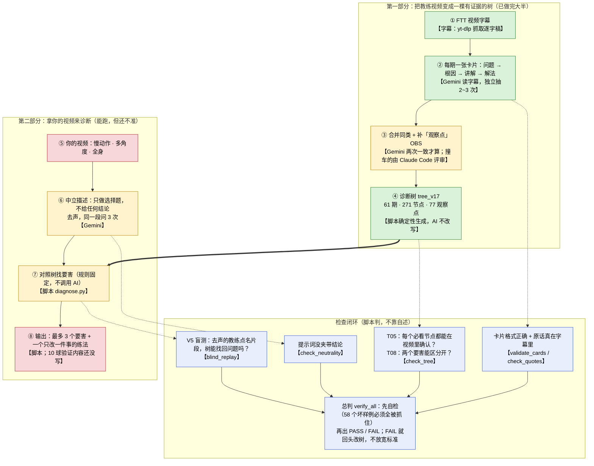

# 整个诊断流程（给不写代码的人看的一页纸）

> 写于 2026-10-19，依据仓库里真实的脚本和报告核对，不是凭记忆。数字来自 `ftt_tree/tree_v14.json`（v13 对照） 和 `loop/reports/verify_*` 的真实输出（见第 3 节）。用户 2026-10-19 对拍板清单 8 条全部「按你建议」已落地；同日甜区代决：剩余 6 单期 T05 全升 OBS，V5 本轮跳过。
> 一句话：**先把教练视频里"说过的话"变成一棵有证据的树；再让 AI 只"描述"你视频里看到了什么；最后由脚本拿描述去树里对照，找出最可能的要害。** 每一步都有脚本检查对错，不靠"我觉得对"。

---

## 1. 流程图（谁做哪一步）

颜色：绿＝已跑通；黄＝能跑但还有缺口；红＝还没真正跑通。

---

## 2. 每一步：输入 → 输出 → 怎么检查对错

| 步 | 输入 | 输出 | 谁做 | 怎么检查对错 |
|---|---|---|---|---|
| ① 字幕 | FTT 频道视频 | 逐字稿（放在仓库外，不入库） | yt-dlp 抓取 | 覆盖率 ≥ 90%（不够就不能建卡）；记录文件指纹，字幕被换了就必须重核 |
| ② 每期卡片 | 一期字幕 | 一张卡：这期解决什么问题、根因链、多角度讲解、解法；每条都挂教练原话（≤40 词）+ 时间点 | Gemini（gemini-3.8-flash）读字幕，独立跑 2 次，不一致跑第 3 次 | `validate_cards`：格式和规则 R01–R12（例如：每个根因必须有字幕原话；解法里出现"推肘/降拍/旋后/伸肘"当口令就失败）。`check_quotes`：每句原话必须真在字幕里、时间对得上。两次抽取要足够一致 |
| ③ 合并 + 观察点 | 所有卡 | ·「同机制」合并：不同期说的是同一件事 → 合成一个节点 ·「观察点 OBS」：能在视频里看见的动作，统一成一道中立选择题（如"触球时肘明显弯曲吗"） | Gemini 做分组/绑定，**两次都一致才算**；撞车的节点对交给 Claude Code 评审，Gemini 再两次确认；脚本校验 | `check_obs_binding`、`check_mech_merge`。新观察点：跨 ≥2 期仍优先；单期需用户批 + 能解开验收价值（2026-10-19 已批，一次最多 5 个）。层 A/B、机位明确、无禁词 |
| ④ 诊断树 | 卡片 + 绑定 + 合并结果 | `tree_vN.json`（节点＝问题/根因；每个节点有"必看项/支持项/排除项"） | 脚本确定性生成，AI 不参与改写 | `check_tree` 规则 T01–T13（见下文 T05 / T08）。**每个正式版本单独存成 tree_vN，旧版本（含 tree.json v1）不覆盖** |
| ⑤ 你的视频 | 你拍的视频 | — | 你 | 需要：机位、帧率、全身（见第 6 节） |
| ⑥ 中立描述 | 视频（去声）+ 树里 54 道观察题 | 一份事实表：每道题的答案、3 次里几次一致、几拍表现出来 | Gemini，同一段问 3 次，选项顺序随机打乱 | `check_neutrality`：提示词里不许出现 FTT、术语、你的结论；不过不许发送。事实不到 2/3 一致、只出现在少数几拍的，直接丢弃 |
| ⑦ 对照 | 事实表 + 树 | 候选要害排名 | 脚本 `diagnose.py`（纯规则，不调 AI） | 同样输入必须同样输出（自检会验证）。只用 A 层和合格的 B 层事实；"体感"类（C 层）看不见，不参与 |
| ⑧ 输出 | 排名 | 最多 3 个要害；每个附证据、缺什么证据、什么会推翻它；只给"改一件事"；开头固定呼吸提醒 | 脚本 | 练法文字必须通过禁令扫描（T06）；置信度低时不给练法，只给"补拍/测试"。**现状缺口：238 个节点里只有约 51 个写了"只改一件事"，0 个写了"10 球验证"；且脚本规定"高置信"必须有姿态/人工实测支撑，目前没有姿态，所以最高只会是"中"** |

### 检查里几个名字，一句话各是什么意思

| 名字 | 一句话 |
|---|---|
| **PASS / FAIL** | 由 `verify_all.py` 脚本判，不是人说了算。只要有一条检查 FAIL，整体就是 FAIL。 |
| **selftest（自检）** | 先"检查检查员"：故意造 58 种坏样例（编造原话、时间错位、偷偷放宽规则……），每一种都必须被对应规则抓住；抓不住，整轮判 FAIL。 |
| **T05** | 一个"必须纠正"的节点，如果没有任何"必看的、能在视频里确认的观察点"，就永远没法从视频里确认它 → 判 FAIL。例外：路径 A（问题节点有已签名根因）；**觉察层**（`diagnostic_layer=awareness`）不报 T05。 |
| **T08** | 两个节点的"必看项"一模一样、又没写区别 → 系统分不出该选哪个 → 判 FAIL。例外：同卡 problem↔cause 且评审为同一机制 → 豁免；self_feel_only 对 → INFO。 |
| **V5 盲测** | 拿 FTT 视频里教练**亲口点名示范者有某问题**的片段，把声音去掉，只给 AI 中立描述，看树能不能自己找回那个问题（recall@3＝正确答案进前三名的比例）。再加"没问题的片段"当阴性对照，看会不会乱报。 |
| **文本盲测**（补充） | 不看视频，只用保留集字幕的原话去树里检索，看树里有没有对应的问题。是 V5 的替代参考，不能当 V5 通过。 |
| **holdout（保留集）** | 20 期视频故意**不放进树**，只留来出题，模拟"树从没见过的新视频"。 |
| **层 A / B / C** | A：普通手机视频就能稳定判断；B：要指定机位 + 逐帧才看得准；C：只能靠体感，视频里看不到。 |

---

## 3. 现在做到哪一步了（真实数字）

数据来源：`ftt_tree/tree_v14.json`；报告 `loop/reports/verify_2026-10-19_tree_v14.json`（对照 v13）。T05 已清零；V5 本轮跳过（不放宽阈值）。

| 环节 | 状态 | 真实数字 |
|---|---|---|
| ① 字幕 | **已通** | 频道清单 97 条：57 条已建卡并核对、33 条有字幕但还没抽、7 条只在清单里；20 条划为保留集 |
| ② 卡片 | **已通** | 72 张卡里 57 张"字幕层已核对"，15 张是草稿（不入树）。引用的原话核对 0 处失败。**视频层（Stage 2）仍 0 张**。草稿卡已移出 validate 扫描 |
| ③ 合并 + 观察点 | **已通（单期例外）** | **70** 个观察点（v13：64；v14 再升 OBS-65..70）；绑定/合并 0 FAIL；M08 允许用户批准扩展/新建组合并组 |
| ④ 诊断树 | **已生成；树侧验收 PASS** | **tree_v14**：54 期、54 问题 + **183** 根因、219 边；**99** 节点有必看项；**104** awareness；观察点 **70** |
| 检查 T05 | **FAIL：0**（v13：6 → **−6**） | 见 `loop/t05_breakdown_v14.md`：6 单期全升 OBS-65..70 |
| 检查 T08 | **FAIL：0**（6 INFO self_feel_only） | 见 `loop/t08_remaining_v14.md`；无新签名撞车；规则未放宽 |
| 检查 validate_cards | **0 FAIL**（v10：12） | 3 张草稿卡不参与扫描 |
| 自检 selftest | **PASS** | 58 个坏样例全部抓住 |
| ⑥⑦ 看视频 + 对照 | **能跑，不准** | 见下 |
| V5 静音盲测 | **本轮跳过**（上轮 FAIL） | 用户定：本轮不下新片段、不重跑。上轮 `v7_muted_blind` recall@3=0；瓶颈仍是取值≠故障 required + 斜拍门控 |
| 文本盲测（参考） | 弱 | 对 tree_v5 的 18 个用例：答案进前三约 15%（只在树里已覆盖的 3 例里约 89%）——主要问题是树还没覆盖保留集的话题 |
| ⑧ 对你真实视频出结论 | **还没真正做过** | 还没有用你按规范拍的视频走完整流程 |

**还有两个"没接上"的地方（如实）**
1. **"姿态/关键点"没接进流程**：仓库有姿态估计代码（`core/pose_estimator.py`），但诊断脚本里所有事实目前都来自 Gemini（`source: model`），没有一条来自姿态。`pose_quantifiable_obs.md` 只是清单。
2. **没有"一条命令从你的视频到结论"**：从视频到事实表这一步，目前是执行者临时脚本跑的，没有存进 `pipeline/`（本轮补了可复用脚本，见 night_log）。

---

## 4. 你拿一个新视频来，实际会发生什么（逐步）

1. 你给我视频（并告诉我：哪只手持拍、拍摄机位、是否慢动作/帧率）。我先人工检查（这一步没有脚本）：全身在不在画面、是否正手单拍、能不能数出连续几拍。不合格就让你补拍，不硬诊断。
2. 去掉声音，剪成 20–40 秒的片段（只用你的视频，不涉及下载别人的整集视频）。
3. 把 41 道中立选择题（每个观察点一道）交给 Gemini，**同一段问 3 次**。提示词里没有 FTT、没有术语、没有你之前的任何结论。
4. 丢掉不可靠的答案：3 次里不到 2 次一致的；只在少数几拍出现的（偶发动作不算习惯）；体感类；机位不符的"需指定机位"类。
5. 脚本拿剩下的事实去树里对照：先排除与事实矛盾的节点，再按"置信度 → 越上游的根因越优先（治因不治症）→ 命中分"排名（脚本线索，不是给人的最终叙事）。
6. **对人输出前先选唯一 trunk**（见 §8），再把其余命中挂成分支；最多交代 3 个要害，但必须有一个核心；每个附证据、缺什么、什么会推翻；再给**一个**只改一件事的练法（外部目标，不用"推肘/降拍/旋后/伸肘"当口令）。证据不够时，只告诉你"需要补拍/补问什么"。
7. 你场上试 10 球确认或排除（PLAN_v2 §6 第 9 步的"结案"；目前树里还没有写好的 10 球测试内容，需要补）。

诚实提醒：目前第 3–5 步在 FTT 教练视频上盲测的召回率是 0（见第 3 节），所以**现在对你视频的结论只能当"待验证的线索"**，不能当诊断。

### 你需要提供什么

| 项目 | 要求 | 为什么 |
|---|---|---|
| 机位 | 至少一个**正侧面**（与击球线垂直）+ 一个**正后方**；尽量固定三脚架，不手持、不变焦、不切镜头 | 树里 41 个观察点有 26 个是 B 层，必须指定机位才看得准；侧面看前后，后面看左右 |
| 帧率 | 手机慢动作（≥120 fps 最好，至少 60 fps）；同时留一段正常速度 | 30 fps 下 0.1 秒只有 3 帧，触球前后谁先谁后分不清 |
| 全身 | 头到脚、球拍全程在画面里；光线足；衣服与背景有反差 | 髋、膝、脚、持拍臂都要看到；遮挡会让答案变 `unclear` |
| 内容 | 至少连续 5 拍同一种正手（低速发球机即可），告诉我持拍手 | 少于 80% 的拍数出现的现象不算习惯 |
| 不要给的 | 你的猜测/结论 | 提示词必须中立；你的猜测只会在输出之后拿来对照 |

---

## 5. 与 PLAN_v2.md 不一致的地方（如实标注）

| PLAN_v2 写的 | 实际仓库 |
|---|---|
| `ftt_tree/tree.json` 是唯一的树 | 现在是版本化的 `tree_v2 … tree_v14`；`tree.json`（v1）保留不动作基线 |
| 自检"22 个变异" | 随规则加严已增至 **58 个**（README 与 PLAN §4.2 仍写 22/57，没同步） |
| 每期要跑 Stage 2（Gemini 看画面补充）才算 stage2_verified | **从未跑过**；全部卡停在 stage1_verified。原因：直接用 YouTube 链接看视频无法去声、会泄露答案（`loop/video_layer_feasibility.md`），且结论只能当弱旁证 |
| T05：必须纠正的节点必须有可见必看项（无例外） | **已加例外（路径 A，2026-10-19，用户批准）**：问题节点只要有一个相连的根因有必看项，就不报 T05。PLAN_v2 §10 变更记录没有记这条 |
| G1 在约 15 期时过；盲测用例来自保留集 | 已 54 期，G1 仍未过；保留集 20 期里只有 1 期有卡，其余因为不能入树也没建卡，所以盲测大多只能用**非保留集**期做"管线验证"，不能宣称泛化 |
| 事实来自 Gemini + 姿态（pose） | 只有 Gemini；姿态没接入 |
| "不再多模型投票" | 合并撞车对时用了 Claude Code 评审 + 2 次 Gemini 确认（只提案、脚本守门；提案不直接入树） |
| 盲测下载"~30–50 段" | 2026-10-19 用户批准按段下载；实际已下 10 段（~30 秒/段，去声） |
| holdout 校验脚本（V8） | 仍未写；保留集目前靠 `check_tree` T02（树不得引用）守住 |

---

## 6. 现在卡在哪、接下来

- 卡点 1（T05）：**已清零**（v14：0；v13：6）。见 `t05_breakdown_v14.md`。
- 卡点 2（T08 **0** FAIL + 6 INFO）：平台期（self_feel_only）。见 `t08_remaining_v14.md`。
- 卡点 3（V5 recall 0）：本轮按用户决定跳过；上轮见 `v7_muted_blind_2026-10-19.md`。
- 最终目标（PLAN_v2 §5.3）：`verify_all` 总判 PASS + G2。树侧（无 V5 gate）已 PASS；挂 G1 仍会被 recall@3=0 拉 FAIL。

> 更新记录：本文件第 3 节数字对应 tree_v14；以 `loop/night_log_*.md` 与最新 `loop/reports/verify_*.json` 为准。

---

## 7. 拍板清单（2026-10-19 用户全部「按你建议」→ 已落地）

1. **扩展/新建合并组** — ✅ 已合入 `mech_merge_v11`（MG14/MG15 扩展 + MG16 DX8A|QXAT）；M08 对用户批准组豁免。
2. **同卡 problem↔cause 豁免 T08** — ✅ `check_tree` + `build.t08_exemptions`（FxDm P|C01/C02/C03）。
3. **整条手臂卷动 vs 前臂** — ✅ **不升 OBS**；记入 `pending_timing_notes.md` §10。
4. **单期新 OBS** — ✅ 升 5 个最高价值（OBS-42..46）；其余 28 个仍在 breakdown，不批量升。跨期≥2 规则本身未改。
5. **觉察层** — ✅ 88 节点 `diagnostic_layer=awareness`；T05 不报；节点原文未删。
6. **草稿卡移出扫描** — ✅ `verify_all` 跳过 `*_draft`；validate 12→0。
7. **6 对不可见 T08** — ✅ 标 `self_feel_only`，T08 报 INFO 不报 FAIL；节点未删。
8. **OBS-40 改名** — ✅ `arm_lags_behind_chest` → `racket_arm_behind_torso_line`；已跑 check_neutrality。

### 觉察层（补充说明）

体感 / 战术 / 心理 / 模型判不可见的根因，保留在树上供你自己对照感受，但**不再要求**必须有「视频必看 OBS」才能过 T05。字段：`diagnostic_layer: awareness`。不影响原文与证据链。

---

## 8. 诊断输出必须有核心 trunk（2026-10-19）

> 用户反馈：正后方视频诊断不能把 OBS 命中点「硬拼凑」成并列要害；必须先有一个核心知识点，其他点围绕它发散。完整样例见 `user_case/rear_20261019_trunk.md`。

**硬规则（给人看的输出，不是改 tree 刷 PASS）：**

1. **先选唯一 trunk**：从「必须纠正」故障卡里选一个（常见：FLT-02 手臂主导 / 动力链断开；或 FLT-05 髋胸未转回导致 FLT-02）。一句话写清 + 带 FTT 原话出处（页码或 video id+quote）。
2. **再挂分支**：脚钉死、随挥早收、击球点深浅等只能标成「上游条件 / 下游表象 / 情境 / 机位不足」，禁止两个并列「第一要害」。
3. **中立规则只管抽事实**：前两遍不问知识库概念；到叙事/处方这一步必须先选 trunk，不能把 OBS 命中排序直接当结论。
4. **输出模板**：一句主干 → 断点（A 腿 / B 髋胸 / C 臂胸脱节）→ 分支表（支持/削弱/机位不足）→ 只改一件事（外部目标，禁推肘/降拍/旋后/伸肘口令）。

对照 §4 第 5–6 步：脚本排名仍可跑，但**对人交付时**必须用本节约束重写叙事；盲测未过关前，trunk 只标「待验证线索」。

### 8.1 树干 → 粗枝 → 叶子（2026-10-20 用户拍板，细化第 1–2 条）

- **树干** = 动力链：力从哪来、怎么传到拍子、什么时候启动。
- **粗枝** = 少数几根主问题，现在固定两根：
  - 粗枝 1：髋没把力传上来 → 手臂 / 小臂代偿；
  - 粗枝 2：挥拍启动过早。
- **叶子** = 挂在某根粗枝下的可观测细节（OBS），每片叶子标「正后方能见 / 需侧面 / 体感」。脚钉死、随挥缠肩、小臂上抬、击球早晚都是叶子或上游 / 下游，**不能平铺成同一层级**。
- 每根粗枝至少要有一条 ≥2/3 一致的中立事实才算「有事实」，否则标「待测」。用户自述可以提出粗枝，但要单独标来源。
- 完整地图：`ftt_tree/kinetic_chain_trunk.md`；样例：`user_case/rear_20261019_trunk.md`。

