# 动力链树干 + 粗枝地图（kinetic_chain_trunk）

> 版本：2026-10-21 user-adjudication｜按用户拍板的结构：**树干 = 动力链；粗枝 = 少数几根主问题；叶子 = 挂在粗枝下的可观测细节**。
> 本版按用户 2026-10-21 裁决优化：整体仍以 FTT 原书（John Kumpf，`books/ftt_fault_tolerant_forehand/original.pdf`）为准；粗枝 1 核心改回「髋没先启动」；coil 降为增强（BOOK:p119）；Unit Turn 写入用户意识层理解；粗枝 2 拆清「等球」vs「链内过早开胸」。所有 id、叶子角色、OBS 都没变，与 `trunk_branches.json` 同步。
> 用途：诊断时先认树干，再认是哪根粗枝，最后才挂叶子（OBS）。这是给系统诊断用的，不是场上口令。
> 引用规则：
> - 只引已核对卡片的原话（`episodes/<id>.card.json`）和书页码。
> - KU7FHy1qQOI 的原话以 2026-10-24 重过稿的字幕段起点为准（`SRC-FTT-KU7FHy1qQOI_repass_2026-10-24.md`）。它仍不是已核对卡片，只作知识引用，不进 tree evidence。6ak4ZScH_gc 已于 2026-10-20 按字幕核对原话，2026-10-24 再用 norm.tsv 段起点加画面核对，收成粗枝 1 的体感旁支；它仍不是已核对卡片，只作知识引用，不进 tree evidence。精确原话见 `docs/diagnosis/sources/SRC-FTT-6ak4ZScH_gc_feel_tension_2026-10-24.md`。
> - ui-RFRdQKRk、5jHCDc44SQM 是 **holdout 期**：可以作为知识引用，**不得写进 tree 节点的 evidence**（check_tree T02）。
> 禁令：推肘 / 降拍 / 旋后 / 伸肘 / 送髋（含「把髋送进球里」「髋往前顶」）不作任何处方口令。原话里出现的 supinate / pronate 等词只作知识记录，不作口令。
> 本文件不改 tree.json v1，也不改 tree_v18 或任何 verify 阈值。
> 裁决文件：`book_orphans_adjudication_2026-10-21.md`。
> **2026-10-24**：粗枝 1 增加知识旁支「体感层：感知张力不感知运动（6ak4）」。它只回答「髋先启动时该感到什么」。粗枝 1 的书核心不变（髋没先启动 / 扭回面向网，BOOK:p.83 / p.117）。coil 仍是 BOOK:p.119 的非必需增强，不升成粗枝 1 的唯一核心。这条旁支只写在本文件和 `docs/diagnosis/sources/SRC-FTT-6ak4ZScH_gc_feel_tension_2026-10-24.md`，**不**给 `trunk_branches.json` 新 id，因此 compose / verify 仍走 2026-10-21 的 id、叶子角色和 OBS。不改 tree.json，不改 verify 黄金。
> **2026-10-24 Batch A 第一刀**：在同一条「只加旁支、不改书核心」的规则下，补四期重过的交叉引用。`ui-RFRdQKRk` 仍是 holdout。`wFIrPMutzRo` 的腹斜 X 和少量侧屈、`UB6SbA_KX9E` 的短终点脉冲、`KU7FHy1qQOI` 的甜区 / 几何与旋转旋钮，都只作知识旁支或结果层前面的条件。详注见各 `SRC-FTT-*_repass_2026-10-24.md`。不给 `trunk_branches.json` 新 id。
> **2026-10-24 Batch A 续**：肩内收、肩滚的接触时机、反旋刹车、上手投和绕挥，六期都只作叶子或旁支。`Am8j1Zw5KrE`、`5KdScDKxVSI` 仍是 holdout。不把肩升成新粗枝，不改成肩先于髋。场上主句仍是「肩往前、髋被往后拽」；各期抽出的一句只写在来源稿的练习口令旁支。
> **2026-10-24 Batch A 收尾**：tilt、corkscrew、胸参与、非持拍侧、低到高神话（Shorts，deep-with-gap）、单脚探球，六期都只作叶子、旁支或上游。`5jHCDc44SQM` 与 `ui-RFRdQKRk` 仍是 holdout，不进 tree evidence。不升新粗枝，不改成肩或胸先于髋。`uQcObi2oTSs` 只有一句主张，缺口写在来源稿。场上主句不变。
> **2026-10-24 Batch B 第一刀**：间距、近端稳定、释放窗口、迈进的锚、最简单的接触、柄上的触觉，六期都只作叶子、旁支或上游。`q6LrQYDvxmY`、`2J8q7sn4JLc` 仍是 holdout，不进 tree evidence。`x_WIg59Wr9Y` 的「从触球开始」是释放窗口的体感，不改写粗枝 2 的书核心（BOOK:p.75）。不升新粗枝，不改成肩或胸先于髋。场上主句不变。
> **2026-10-24 Batch B 第二刀**：翻转、拍床张力、手槽、握拍转轴、刷、大力不出台，六期都只作叶子、旁支或上游。`gehRK0Y6AdQ` 仍是 holdout，不进 tree evidence。刷若和绕挥冲突，书与 2Nn / Pwk 赢。`dZadhzVEsds` 的耐心钉在字幕段起点，不改写粗枝 2 的等球（BOOK:p.75），也不改 OBS-57。不升新粗枝，不改成肩或胸先于髋。场上主句不变。
> **2026-10-24 Batch B 第三刀**：上旋的松开、手感往下打、握拍针眼、连续来球的练习结构、眼睛在链前、半秒里不插口令，六期都只作叶子、旁支或上游。都不升粗枝，不改成肩或胸先于髋。刷 / 低到高 / 往下打若和绕挥冲突，书与 2Nn / Pwk / geh 赢。`toArb3WkJcs` 不写成发球机最低速，也不改写粗枝 2 的等球（BOOK:p.75）。场上主句不变。不进 tree evidence。
> **2026-10-24 Batch B 第四刀**：Topspin Pro 的打穿、两种正手的两端、变化来球里的稳定段、髋把动量交出去、慢球在球的高度打穿、跑动中先稳住臂，六期都只作叶子、旁支或上游。都不升粗枝，不改成肩或胸先于髋。刷 / 低到高若和绕挥冲突，书与 2Nn / Pwk / geh 赢。高短球等它落下来、慢球在还高于网时打到，都不改写粗枝 2 的等球（BOOK:p.75）。场上主句不变。不进 tree evidence。
> **2026-10-24 Batch B 第五刀**：全速打高、翻转短版、配重水平半圆、手只导向、前臂滚和躯干重叠、容错仍打在身前，六期都只作叶子、旁支或上游。`EkzzGZkqCgc`、`hqganBxzQNM` 是 holdout，不进 tree evidence。翻转短版不另写机制，指向 wzL。链内的后摆时序、选目标的耐心、找高度的一小下，都不改写粗枝 2 的等球（BOOK:p.75）。容错以书 p.13 / p.21 为准。不升粗枝，不改成肩或胸先于髋。场上主句不变。
> **2026-10-24 Batch B 第六刀**：同一结果多种挥法、选目标的耐心与凶、用腿把球接到接触点、墙上能用力的接触点，四期挂在粗枝 1 的结果层或上游。发球背挠（`cIIEYn42o4g`）和发球旋前（`emZxTmSVSa8`，holdout）是范围旁支，不挂正手粗枝。旋前、旋后只作描述，不升口令。选目标的耐心不改写粗枝 2 的等球（BOOK:p.75）。不升粗枝，不改成肩或胸先于髋。场上主句不变。不进 tree evidence。
> **2026-10-24 Batch B 第七刀**：髋被往后拽仍指向 6ak4，coil 不升成唯一核心（`agtIR3PuNsw`，holdout）。腕还满着时打出去、第一下朝外、低球侧屈，都只作叶子或已有旁支。球和球之间的注意、两拍之间的小跳，不改写粗枝 2 的等球（BOOK:p.75）。`jDBg4Fpf0tQ` 是 deep-with-gap，不挂粗枝。`QrRYuVjVibU` 也是 deep-with-gap，指向 tzg / lbd。`BbGzWTp5pCM` 是 holdout。不升粗枝，不改成肩或胸先于髋。场上主句不变。不进 tree evidence。不碰 `mOFtt9PllI0`。
> **2026-10-24 Batch B 收尾**：`mOFtt9PllI0`（holdout）有节制的进攻是几何，through and down 不写成降拍，间距不完美仍打在身前，计划改到球到身前。挥得更快不写成手臂发力。站得很深只是弹起之后还有时间调接触，不改写粗枝 2 的等球（BOOK:p.75），也不新开叶子。发球和接发只标范围，不挂正手粗枝。不升粗枝，不改成肩或胸先于髋。场上主句不变。不进 tree evidence。Batch B pending 0。未开 Batch C。
> **2026-10-24 Batch C 第一刀**：单打几何、高压朝外扔、发球由内向外、切削高压、防守高度，都是范围旁支，不挂正手粗枝 1/2。`WoVEWh7fFfc` 的手松、拍头回进来，挂粗枝 1 叶子；push / fire 不写成推肘。发球的往下不写成正手降拍。旋前、内旋只作描述。`Bhzd6cM-oFU`、`-ZmnDrRFfjc` 是 holdout。不升粗枝，不改成肩或胸先于髋。场上主句不变。不进 tree evidence。不碰 `E_zmENJIj4g`。
> **2026-10-24 Batch C 第二刀**：单手反手、双手反手、发紧时打中间、让对方失误、截击拍在球后，都是范围旁支，不挂正手粗枝 1/2。`FOmz8Wjv3DQ` 的落地前认出方向挂粗枝 2 旁注，不改写等球（BOOK:p.75）。单反的由低到高不写成正手降拍。双反的 coil 不升成正手 p.119 核心，侧身不改写正手 p.21。先手后髋不改写正手髋先（BOOK:p.83 / p.117）。挥得更快不写成手臂发力。press / push 不写成推肘或送髋。截击没有后摆不写成正手不要引拍。六期都不是 holdout，仍不进 tree evidence。不升粗枝，不改成肩或胸先于髋。场上主句不变。不碰 `E_zmENJIj4g`。

---

## 0. 树干（一句话）

**动力链：蹬地进腿 → 髋先启动（蹬后腿、把髋扭回面向网）→ 躯干带胸整体转回 → 手臂和拍子被动甩出；并在对的时间启动。髋肩反向扭转张力（coil）为非必需增强项（BOOK:p119）。**

树干回答三个问题，下面的粗枝分别挂在其中一个上：

| 树干要回答的 | 断了会怎样 | 对应粗枝 |
|---|---|---|
| 力从哪来、怎么传 | 髋没先启动，力传到髋就断，手臂只好自己发力 | 粗枝 1 |
| 什么时候启动 | 相对来球等不够，链还没准备好就开始挥 | 粗枝 2 |
| 传到拍子上的是不是身体的力 | 结果层，由前两问决定 | 叶子（随挥、球质、口播结果） |

FTT 出处（书；英文均【已核对】，见 FLT-02 / 04 / 05 卡）：
- 「the answer is not to pull with your arm」（书 p.83）
- 场上内化：「twisting the hips back towards the net」（书 p.83 / 117 一带）
- 「Power does not come from swinging harder with the arm」（书 p.116）
- 「When, instead, our hips and chest are still sideways at contact, the arm is much more impinged.」（书 p.30）
- 「A full hip rotation is actually impossible if both of your feet are firmly planted on the ground.」（书 p.84）
- 「When a player consciously initiates their swing by exploding off of their hitting leg, they are far less likely to leave their hips under-rotated」（书 p.111）
- 「All players initiate the swing with their hips, whipping them around before the shoulders」（书 p.119 一带 POWER）
- 腹部 coil / 肩髋分离角：增强项；「The angle separation isn’t necessary for effortless power, though; it just helps add yet another link…」（书 p.119【已核对】）
- 「we aren't harnessing rotation…」— PwkGLkRm73o:Q02（视频补充）

### Unit Turn 与髋（意识层 / 用户 2026-10-21）

- 书 p.59：Unit Turn 时「The hips turn to the side, away from the target, so that they can explosively twist back towards it」——髋也转离目标，这是书的描述，**不否定**。
- 视频（ui-RFRdQKRk holdout）：「The unit doesn't include your hips」。
- **用户理解（意识层，不是改书）**：初学时可以有意识地先不把髋转开，以便做出 twist（反向扭转）。用「髋先别跟着肩一起开」来找 coil/twist。这是初学意识层的找感觉法，不是否定书 p.59 的髋转离。
- 写入本树干 / 粗枝说明时标：**意识层 / 用户 2026-10-21**。

---

## 1. 粗枝地图

```mermaid
flowchart TD
  T["树干：动力链<br/>地面 → 腿 → 髋先启动（扭回面向网）→ 躯干/胸整体转回 → 手臂 → 拍子<br/>+ 启动时机<br/>coil = 增强 BOOK:p119"]

  T --> B1["粗枝 1：髋没先启动 → 力断在髋 / 髋胸未转回 → 手臂代偿<br/>（怎么传）"]
  T --> B2["粗枝 2：相对来球等待不足（BOOK:p75）<br/>（什么时候启动）"]

  B1 --> L11["叶：肩先转、髋不领先 OBS-25"]
  B1 --> L12["叶：前挥手臂先动 OBS-18"]
  B1 --> L13["叶：turn ≠ coil（增强旁支 BOOK:p119）"]
  B1 --> L13b["旁支：体感层：感知张力不感知运动（6ak4）<br/>找到髋先启动的正确体感<br/>不改书核心；coil 仍非唯一核心"]
  B1 --> L13c["旁支 2026-10-24：ui holdout turn≠coil<br/>腹斜 X + 少量侧屈（wFIr）<br/>髋脉冲落在短终点（UB6）<br/>甜区/几何在链前（KU7）<br/>都不改书核心；ui 不进 tree evidence"]
  B1 --> L13d["旁支 2026-10-24 续：肩内收是接触叶子<br/>内旋刚开始才接触（JIMg）<br/>转动随后被刹车（xLs）<br/>绕挥 / 拍头路径 ≠ 手臂路径<br/>肩不升粗枝；Am8j、5Kd holdout"]
  B1 --> L13e["旁支 2026-10-24 收尾：低球少量侧屈（tzg）<br/>腹部张力体感（5jHC holdout，书赢）<br/>驱动时臂贴躯干（hNV）<br/>非持拍侧向回留住（McCb）<br/>低到高一句缺口（uQc）<br/>单脚探球在髋启动上游（Exk）<br/>都不升粗枝；5jHC 不进 tree evidence"]
  B1 --> L13f["旁支 2026-10-24 Batch B：间距在持拍侧外（q6 holdout）<br/>近端稳住臂才接上（uJpu）<br/>迈进的前脚锚（aPc）<br/>最简单接触 / 上身一起转回（0m3B）<br/>柄贴进手（2J8 holdout）<br/>都不升粗枝"]
  B1 --> L13g["旁支 2026-10-24 Batch B 第二刀：拍在躯干慢下来时松开（wzL）<br/>拍床在链前（5-Ia）<br/>手槽（RVfm）<br/>转轴在手上侧（pWzy）<br/>刷指向 2Nn/Pwk（geh holdout）<br/>都不升粗枝"]
  B1 --> L13h["旁支 2026-10-24 Batch B 第三刀：上旋松开在肩刚开始回转（wd4）<br/>手感往下打仍是打穿（9Nir，2Nn/Pwk/geh 赢）<br/>柄贴住且腕能铰（fjpr）<br/>半秒里只有一个感觉（Qszz）<br/>眼睛在链前（Appd）<br/>一组连续来球不插推理（toArb）<br/>都不升粗枝"]
  B1 --> L13i["旁支 2026-10-24 Batch B 第四刀：上旋是打穿加拍自己转（FxDm，2Nn/Pwk/geh 赢）<br/>多拉和早稳住是两端（LoSr）<br/>变化来球里接触段不变（Vg8）<br/>髋把动量交出去（T5me）<br/>慢球手在球高打穿（Psid）<br/>跑动时臂先稳住（lbd）<br/>都不升粗枝"]
  B1 --> L13j["旁支 2026-10-24 Batch B 第五刀：全速高过网中段（8r09）<br/>翻转短版指向 wzL（Ekzz holdout）<br/>配重水平半圆（hqgan holdout）<br/>手只导向（p41）<br/>前臂滚和躯干带重叠（GsHk）<br/>容错是打在身前（OYf，书 p.13/p.21）<br/>都不升粗枝"]
  B1 --> L13k["旁支 2026-10-24 Batch B 第六刀：同一结果多种挥法（JzcA）<br/>耐心是大目标（_Qu1）<br/>用腿把球接到接触点（42Bfb）<br/>墙上能用力的点（wVa）<br/>都不升粗枝"]
  B1 --> L13l["旁支 2026-10-24 Batch B 第七刀：髋被拽仍是 6ak4（agt holdout，p.119 赢）<br/>腕还满着时打出（lCK）<br/>第一下朝外指向 wzL（wFOy）<br/>低球指向 tzg/lbd（QrR gap）<br/>下一颗球（7_JP）<br/>两拍之间小跳（BbGz holdout）<br/>都不升粗枝"]
  B1 --> L13m["旁支 2026-10-24 Batch B 收尾：有节制的进攻是几何（mOFtt holdout）<br/>through and down 不写成降拍<br/>间距不完美仍打在身前<br/>计划改到球到身前，不改写 p.75<br/>发紧仍打身前那颗<br/>都不升粗枝"]
  B1 --> L13n["旁支 2026-10-24 Batch C 第一刀：手松着拍头回进来（WoVE）<br/>push/fire 不写成推肘<br/>发球往下不挂正手<br/>不升粗枝"]
  G7["缺口：Iroh 动画对白（jDBg）<br/>不挂粗枝"]
  S6["范围旁支：发球背挠（cIIE）<br/>发球旋前（emZx holdout）<br/>不挂正手粗枝；旋前旋后不升口令"]
  S8["范围旁支 2026-10-24 Batch C 第一刀：单打几何（omsLx）<br/>高压朝外扔（PfD）<br/>发球由内向外（1W1）<br/>切削高压（Bhzd holdout）<br/>防守高度（-Zmn holdout）<br/>不挂正手粗枝"]
  S9["范围旁支 2026-10-24 Batch C 第二刀：单反上背（Z9）<br/>双反左右手（lw）<br/>发紧打中间（FB）<br/>让对方去失误（Pj）<br/>截击拍在球后（XX）<br/>不挂正手粗枝"]
  B1 --> L14["叶：小臂往上抬 / 往上兜<br/>视频 ui holdout / 用户自述"]
  B1 --> L15["叶：象征性蹬髋；禁用送髋"]
  B1 --> L16["旁支：链内过早开胸 / 肩抢先<br/>（从原 B2 混入项拆出）"]
  B1 --> U1["上游：脚钉死 / 腿没加载"]
  B1 --> D1["下游：随挥马上缠回左肩 OBS-15b"]

  B2 --> L21["叶：前挥启动时球在弹跳后的哪一段<br/>NEW-OBS；最高点/80% = 用户自述"]
  B2 --> L22["叶：开始转体时拍头还在球上方 OBS-57"]
  B2 --> L23["叶：口播结果 / 下网 OBS-16"]
  B2 --> L24["旁支 2026-10-24：释放窗口贴着触球（x_WIg）<br/>「从触球开始」是体感<br/>不改写 BOOK:p.75 的等球"]
  B2 --> L25["旁支 2026-10-24 Batch B 第二刀：拍到球高再加速转动（dZad）<br/>等到球进槽，或把槽送到球上（RVfm）<br/>都不改写 BOOK:p.75"]
  B2 --> L26["旁支 2026-10-24 Batch B 第四刀：高短球的鞭打要等它下来（LoSr）<br/>慢球要在还高于网时打穿（Psid）<br/>都不改写 BOOK:p.75"]
  B2 --> L28["旁支 2026-10-24 Batch C 第二刀：落地前已认出方向（FOmz）<br/>不改写 BOOK:p.75<br/>不新开时机粗枝"]

  B2 -. "推断：急着挥 → 髋没先启动 → 手臂抢先" .-> L12
```

规则：
- 粗枝只有这两根。脚钉死、随挥缠肩、小臂上抬、击球早晚都是**叶子或上游 / 下游**，不能和粗枝平级。`S6` 是发球范围旁支，不挂正手粗枝，也不是第三根粗枝。`S8` 是 Batch C 第一刀的范围旁支，同样不挂正手粗枝，也不是第三根粗枝。`S9` 是 Batch C 第二刀的范围旁支，同样不挂正手粗枝，也不是第三根粗枝。`L28` 是粗枝 2 的旁注，只说落地前已经认出方向，不改写 BOOK:p.75，也不是新的时机粗枝。`G7` 是动画短片的缺口，不挂粗枝。`mOFtt9PllI0` 的发球一句写在文字里，不新开节点。站得很深也不新开 B2 叶子。
- coil / 髋肩反向张力：叶子或旁支增强，**不是**粗枝 1 的唯一核心。2026-10-24 的「感知张力不感知运动」是另一条旁支：它讲体感，不把 coil 升成核心。
- 链内过早开胸 / 肩抢先：归粗枝 1，**不要**和粗枝 2「等球」混成一条。
- 粗枝之间的虚线是推断，不是证据。

---

## 2. 粗枝 1：髋没先启动 → 力断在髋 / 髋胸未转回 → 手臂代偿

**一句话（书为准）**：前挥没有从髋引导启动——没有蹬后腿、把髋扭回面向网（Lead With The Hips p.83–88；POWER p.115–121）。力在髋这里断；髋胸若仍侧对，手臂被卡，只好用手臂小肌肉代偿。

**核心不是 coil 不足**：
- 书 p.119：「The angle separation isn’t necessary for effortless power」——肩髋分离角 / coil 是**非必需增强**，可作叶子或旁支，引 BOOK:p119；视频 coil 说法作补充，不得压过「髋先启动」。
- 「手臂往上兜」：标 **视频源**（ui-RFRdQKRk holdout / 用户自述），不当书证据。书对应是 p.30「手臂被卡、用小肌肉」。

**这根粗枝说的不是「把髋往球里送」**：
- 书要的是「扭回面向网 / 髋引导启动」，不是「送髋 / 把髋送进球」；
- **禁用**「送髋」「把髋送进球里」「髋往前顶」；
- 6ak4 等视频反对「有意推持拍侧髋」→ 降为**枝叶补充 / 防误用提示**，不得压过书 p.83/117（用户 2026-10-21：B 类髋冲突 **书赢**）。2026-10-24 的体感旁支不推翻这条裁决。

### 旁支：体感层：感知张力不感知运动（6ak4）

**一句话**：髋先启动时，要感到的是张力，不是录像里的运动。详注 `docs/diagnosis/sources/SRC-FTT-6ak4ZScH_gc_feel_tension_2026-10-24.md`。字幕原话按 norm.tsv 段起点；画面核对只含红皮筋双锚、文章叠图、错误目标下皮筋松弛、减速不换向。

**它在粗枝 1 的哪一层**：粗枝 1 的核心仍是书——髋没先启动 / 扭回面向网（BOOK:p.83 / p.117）。这条旁支只回答「这件事做对的时候，身体感到什么」，以及「哪一种意图会让人故意不把线拉上」。它不是新粗枝，不替换上面的一句话。

**和 BOOK:p.83 的关系（兼容）。**

- 书的场上内化是「twisting the hips back towards the net」。
- 6ak4@4:03 的意图句是 "drive your shoulders forward, hips back"。它鼓励把髋锚和肩锚之间的斜向筋膜线拉满；回弹时髋被同一股张力拽向网这一侧。方向和 p.83 相同。
- 6ak4@7:31 "the pelvis does accelerate forward before the shoulders. So, that is true." 这是物理事实，对应书「髋先于肩」。先向前加速的功能是把线再拉满（@5:42、@9:13），不是把「持拍侧髋往前」当成目标。
- 6ak4@5:17 反对 "send your right hip through the shot"，因为这个目标会让人故意不拉伸，髋肩 "back together, front together"（段起点 5:21）。这是防误用。书赢，和 2026-10-21 裁决一致。

**和 BOOK:p.119 的关系（不升格）。**

- p.119【已核对】：「The angle separation isn’t necessary for effortless power」。肩髋分离角 / coil 仍是**非必需增强**，可以没有，只要髋先启动。
- 本期把 corkscrew / 分离 / 张力从「防误用脚注」补成体感说明，**不**把 coil 写成粗枝 1 的唯一核心，也**不**要求把分离角做大。
- 感知定律 6ak4@9:51："we don't really perceive motion. We perceive tension and thereby acceleration." 要找的瞬间是 @5:56：骨盆被往后拽，肩被往前拽。录像上的前转可以同时为真。@7:59 多数球只是前移中被拽住后减速，不换向（画面核对与这句字幕一致）。
- 所以 p.119 决定 coil 的地位（增强，可无）；本期决定这个地位在体感上怎么落地（感到张力与加速度，不感到「髋在往前转」）。地位不变。

**用户映射（2026-10-24 同日补充；假设，不进 tree evidence）。** 不升成新粗枝，不改书赢。

- 用户自述：以前转髋只转髋；加上非持拍侧左肩往前伸，感到强烈的 X 型拉伸之后，才体会到髋力。这对得上本旁支的斜向筋膜线（髋锚 ↔ 肩锚），不是另一条链。
- 用户理解：髋末段要有往回拉的意识，力才释放。这里的往回拉 = 张力体感（@5:56 被往后拽，@9:51 感知张力），**不是髋倒退**。@7:57–8:01 多数球是前移中被拽住后减速，不换向。

**场上意图护栏（仍是这一句，不是新清单）。**

- 场上只留：「肩往前、髋被往后拽」。即 6ak4@4:03 "drive your shoulders forward, hips back"，并与 BOOK:p.83「twisting the hips back towards the net」同向。
- 左肩由躯干带着走，不单独抡左臂。单独把非持拍手肘提前绕开，是书 p.111【已核对】的过早开胸：「In some cases, the non-hitting elbow is pulled around the body too early in the swing, causing the chest to open up too early」。那已经挂在本粗枝的「链内过早开胸」旁支上，不为此再开一根粗枝。

**不进树的边界**：无新 OBS id。张力是 C 层。骨盆是否减速仍用既有 OBS-71（正后方实测 unclear）。6ak4 仍不进 tree evidence。同日补充也不新开 id。

### 旁支：2026-10-24 Batch A 第一刀（只加叶子，不改上面的一句话）

四期都按字幕段起点加重抽帧。书核心仍是髋没先启动 / 扭回面向网。coil 仍是 p.119 的非必需增强。都不进 tree evidence。

- **ui-RFRdQKRk（holdout）**：侧身不等于 coil。0:37「The unit doesn't include your hips」。2:38「I can compensate by swinging up more」（旧注 @2:35）。2:46 起髋和肩 back together, forward together，是负面例子。4:58 挥拍时髋向后，和 6ak4 同向。0:55「drive this point forward」只是准备时把髋留成锚，不写成送髋。0:07 把 coil 说成力量秘诀，书 p.119 赢。详注 `SRC-FTT-ui-RFRdQKRk_repass_2026-10-24.md`。
- **wFIrPMutzRo**：腹斜 X，左肩拉在右髋上；背后那一侧是右肩向前时右髋向后（3:48），和 6ak4 同一股张力。髋角变直（2:04 hip pops forward）是录像，不是送髋。少量侧屈让直立硬转不再发僵（0:08、5:43 对 5:58）；侧屈不是后倒，也不写成口令。3:53 肘去左膝只是演示，不作推肘。详注 `SRC-FTT-wFIrPMutzRo_repass_2026-10-24.md`。
- **UB6SbA_KX9E**：肩线可以在腿还弯着时已经转开，右腿随后伸直。这和书「髋先于肩启动」是两套时钟。**书赢，不改成肩先于髋。** 留下的是：髋的脉冲要落在短终点（8:24 press slot），不要落在转完整圈的末尾。9:42「throwing your hip into the ball」只记录，禁止写成送髋。8:32 手臂随后把拍带走，禁止写成推肘。详注 `SRC-FTT-UB6SbA_KX9E_repass_2026-10-24.md`。
- **KU7FHy1qQOI**：甜区和高度 / 距离排在链的前面，不新开粗枝。上身即使往前跑也要先拧上（13:30），这是 coil 增强。16:16 挥拍更短就稍等，是粗枝 2 的视频补充，书核心仍是 p.75。14:44 左臂把躯干拉到髋上，只作准备感觉，不写成拉左臂。详注 `SRC-FTT-KU7FHy1qQOI_repass_2026-10-24.md`。

### 旁支：2026-10-24 Batch A 续（肩内收 / 反旋 / 绕挥，仍不改上面的一句话）

六期都按字幕段起点加 360p 抽帧。肩内收、肩滚、反旋刹车、绕挥都挂在粗枝 1 下面，**不升成新粗枝，不改成肩先于髋**。场上主句仍是「肩往前、髋被往后拽」。各期另有一句练习口令旁支，写在来源稿里，不替换主句。都不进 tree evidence。

- **Am8j1Zw5KrE（holdout）**：接触区的最后一环是肩内收，上臂同时转向内（0:58）。0:21 是拉过身体，不写成推肘。5:58 慢打可以只用这一环做干净接触；6:12 后髋 uncork 才加上速度。速度环仍是髋先。详注 `SRC-FTT-Am8j1Zw5KrE_repass_2026-10-24.md`。
- **5KdScDKxVSI（holdout）**：接触是胸肱角关上（0:05、3:05）。2:29 和 3:49「可以不转」与书冲突，**书赢**。3:56 自己把后腿和躯干放回接触上游。3:12、4:47 的 push 只记录，不写成推肘。详注 `SRC-FTT-5KdScDKxVSI_repass_2026-10-24.md`。
- **JIMgI3jiVns**：接触在这个人内旋刚开始（0:14），大部分滚动在接触后（3:03）。没有客观接触点（3:58）。静帧只认出人和肘的远近，不证明滚动起点。不改成肩先于髋。详注 `SRC-FTT-JIMgI3jiVns_repass_2026-10-24.md`。
- **xLs469ZVMPU**：髋的转动要开始再被停住（0:57）。右腿向后、左腿向上、前脚在接触时蹬住，是三种刹车。1:11「fire that right hip into the shot」只记录，禁止送髋。和 UB6 的短终点同向。BOOK:p.84 的两脚钉死不和第三种刹车合成一句。详注 `SRC-FTT-xLs469ZVMPU_repass_2026-10-24.md`。
- **PwkGLkRm73o**：0:24 旋转没穿过肩。0:49 手臂可以不走低到高，拍头仍然可以。1:05 的 supinate / pronate 只作知识。7:12 的高到低是手臂路径，不写成降拍。11:10 能量仍从髋穿过肩；不先叫转髋，是因为肩这一环没接上。详注 `SRC-FTT-PwkGLkRm73o_repass_2026-10-24.md`。
- **2Nn9tyMECZU**：1:27 把挥拍想成上而不是绕（旧注 Q05）。肘高、拍低代表整条手臂滚了（4:37）。11:31 躯干在目标前放慢，肩再接到目标。13:45 髋向前、肩向后，和 6ak4 的准备对拉同向，不写成送髋。14:42 把 coil 说得比幅度更重要，**书 p.119 赢**，coil 仍是增强。详注 `SRC-FTT-2Nn9tyMECZU_repass_2026-10-24.md`。

### 旁支：2026-10-24 Batch A 收尾（tilt / corkscrew / 胸 / 非持拍侧 / 单脚，仍不改上面的一句话）

六期都按字幕段起点加 360p 抽帧。tilt、corkscrew、胸参与、非持拍侧、低到高神话、单脚探球都挂在粗枝 1 下面或它的上游，**不升成新粗枝，不改成肩或胸先于髋**。场上主句仍是「肩往前、髋被往后拽」。各期另有一句练习口令旁支，写在来源稿里，不替换主句。`uQcObi2oTSs` 内容只有一句，不另写练习口令，沿用 2Nn。都不进 tree evidence。

- **tzgAWr3QGv0**：0:56 胸把臂留在躯干上，force / press 只记录，不写成推肘。3:35 手准备在触球高度附近，不写成降拍。6:21 短脉冲里髋、躯干、胸一起通过一个点，挂在 UB6 的短终点上。8:35 低球时肩线斜下来，10:30 击球肩从非击球肩下面穿过，和 wFIr 的少量侧屈同一族。11:23 左手横回只作记录，旁边仍是书 p.111 的过早开胸。7:50 后髋变直不写成送髋。详注 `SRC-FTT-tzgAWr3QGv0_repass_2026-10-24.md`。
- **5jHCDc44SQM（holdout）**：0:54 准备时胸可以比髋转得更开。2:28 髋在物理上领先约 25 毫秒，这段感觉不到，人感到腹部张力，和 6ak4 同族。1:13、5:57 把躯干说成几乎整段都更快、胸廓从启动起就在转，**书 p.119 赢**。coil 仍是增强，不是粗枝 1 的唯一核心。正手挂点在 5:05。7:16 膝去肘是场外演示。详注 `SRC-FTT-5jHCDc44SQM_repass_2026-10-24.md`。
- **hNVbbPEob3g**：0:22「胸先走、臂后抽」是他放弃的那一档。0:36 驱动时臂贴着躯干。4:28 收尾发生在躯干放慢之后，和 2Nn、UB6 同一套钟。5:58 仍从髋上把躯干拧出去。0:45 的 force the arm 不写成推肘。字幕在 6:18 截断。详注 `SRC-FTT-hNVbbPEob3g_repass_2026-10-24.md`。
- **McCb-RfYd0w**：0:35 启动的转动把左侧送出去，0:29 左侧再向回压，0:50 通常只看见肘收。1:05 双臂真的交叉出现在转动很少、人还侧着的时候。2:22、2:33 两种内化只作知识，不写成提前拉左臂。详注 `SRC-FTT-McCb-RfYd0w_repass_2026-10-24.md`。
- **uQcObi2oTSs（deep-with-gap）**：约 10 秒，只有一句：近网或高球基本由后向前，升高少到可能注意不到。没有对错对比。指向 2Nn / Pwk，不新开叶子名，不写成降拍。详注 `SRC-FTT-uQcObi2oTSs_repass_2026-10-24.md`。
- **ExkBtFRhUWY**：0:56 右脚到球后面，1:54 / 8:14 再向球场压回去。这是粗枝 1 的上游，和书 p.84、p.111 同侧。press the foot 不写成送髋。4:50 太近时拍到头上方，不写成降拍。低置信卡片本轮已对字幕，仍不进树。详注 `SRC-FTT-ExkBtFRhUWY_repass_2026-10-24.md`。

### 旁支：2026-10-24 Batch B 第一刀（间距 / 稳定 / 迈进 / 地基，仍不改上面的一句话）

六期都按字幕段起点加 360p 抽帧。间距、近端稳定、迈进的锚、最简单的接触、柄上的触觉挂在粗枝 1 下面或它的上游。释放窗口挂在粗枝 2 的叶子上。**不升成新粗枝，不改成肩或胸先于髋。** 场上主句仍是「肩往前、髋被往后拽」。各期另有一句练习口令旁支，写在来源稿里，不替换主句。都不进 tree evidence。

- **q6LrQYDvxmY（holdout）**：0:22 球要到身体右侧更外面。1:08 非持拍臂帮助找这段间距，不写成提前拉左臂。4:33 更接近要的点时人在右脚上转。6:03 从脚跟向左驱动是体重方向，不写成送髋。6:22 横拉肘是球太近的错例。12:16 高球基本是水平面，和 2Nn 同向。详注 `SRC-FTT-q6LrQYDvxmY_repass_2026-10-24.md`。
- **uJpuDUx0jIA**：0:55 双弯曲留着。2:41「只转上身」是找髋参与的夸张；16:03 他自己把顺序放回髋。若读成肩先于髋，**书 p.119 赢**。3:14 故意把髋向前顶是错例，不写成送髋。20:07 稳住之后击球道在右侧外面，指向 q6。详注 `SRC-FTT-uJpuDUx0jIA_repass_2026-10-24.md`。
- **aPcKJDadzek**：0:15 准备始终在外侧脚上。1:12 前脚膝不向里倒，肩挥进这个锚。3:09 弹起是随挥。8:42 不用后腿，旋转没了。10:03 髋留在自己后面。12:35 的 hip pops 只记录，不写成送髋。和 xLs 的前脚刹车同侧。详注 `SRC-FTT-aPcKJDadzek_repass_2026-10-24.md`。
- **0m3BMfDDShI**：0:55 肘前空间留着。3:09 的 pull forward 不写成推肘。4:37 不要主动沉拍。6:01 的 together 指上身，和下面「两个 back together」里书 p.111 的正面提示同向。8:31 肩线倾斜指向 tzg。6:54 的一点扭转是加在地基上的劲，不改成胸先于髋。详注 `SRC-FTT-0m3BMfDDShI_repass_2026-10-24.md`。
- **2J8q7sn4JLc（holdout）**：0:00 柄稍大就感觉不到动量。4:05 细棱贴进虎口。4:18 张开手掌是练习，不是场上握法。和 KU7 的手拍条件同侧。详注 `SRC-FTT-2J8q7sn4JLc_repass_2026-10-24.md`。

### 旁支：2026-10-24 Batch B 第二刀（翻转 / 拍床 / 手槽 / 握拍 / 刷 / 大力，仍不改上面的一句话）

六期都按字幕段起点加 360p 抽帧。翻转、手槽、握拍转轴、刷挂在粗枝 1 下面或它的上游。拍床是链前条件。大力不出台的耐心，和手槽的等或送，挂在粗枝 2 的叶子上。**不升成新粗枝，不改成肩或胸先于髋。** 场上主句仍是「肩往前、髋被往后拽」。各期另有一句练习口令旁支，写在来源稿里，不替换主句。都不进 tree evidence。

- **wzLMv4ASg9s**：0:06 拍先向外送。0:11 的 press 只记录，不写成推肘。10:38 滚动最快在随挥。20:46 高肘是往下往后漂进槽，不写成降拍。22:41 可见的低到高是身体斜着。30:19 的 together 是匀速转、拍放不出去。30:43 的 coil 是让躯干慢下来的一种办法，**书 p.119 赢**，不升成唯一核心。31:38 髋在往后拽，31:42 拽的是躯干，和 6ak4 同向。33:27 不写成送髋。详注 `SRC-FTT-wzLMv4ASg9s_repass_2026-10-24.md`。
- **5-Ia7c4XzfU**：0:20 拍床是装备杠杆。9:02 软床把斜向速度送高，脑插进停顿。21:09 说办法不是更好的时机或 coil，不许拿来改粗枝 1 或粗枝 2。7:00 的 28° 不是书的页。和 2Nn / Pwk 冲突时，绕挥赢。详注 `SRC-FTT-5-Ia7c4XzfU_repass_2026-10-24.md`。
- **RVfmDk-iEwo**：0:38 槽在腕松开之前。10:46 等到球进槽，11:52 或把槽送到球上，10:53 两样都不做才打偏。等或送挂粗枝 2，不改写 p.75。13:10 不写成送髋。15:20 之后的反手不进正手。详注 `SRC-FTT-RVfmDk-iEwo_repass_2026-10-24.md`。
- **pWzyP-xfLfU**：0:06 转轴若在柄端，省力的槽出不来。0:58 拍头往后时柄向前、向外。3:39 两指是练习。15:36 若读成挥拍由手开始，**书 p.83 赢**。16:58 速度仍来自近端，和 p.116 同向。详注 `SRC-FTT-pWzyP-xfLfU_repass_2026-10-24.md`。
- **gehRK0Y6AdQ（holdout）**：1:05 上旋也是打，不是只刷。6:26 大部分是浅的斜向打穿。12:33 平肩再把手拉高是错例。低于水平、把手放低若读成由低到高或降拍，**2Nn / Pwk 和书赢**。不新开刷的叶子名。详注 `SRC-FTT-gehRK0Y6AdQ_repass_2026-10-24.md`。
- **dZadhzVEsds**：0:38 有耐心。1:02 拍至少到球高，1:03 他再说 preferably below。这是旧注 Q02 / Q03 的段起点，不改 OBS-57，也不改写 p.75。6:46 加速起在球上面是错例。16:12 单独掉肘丢掉张力，不写成降拍。8:44、11:43 的倾斜和髋铰链指向 tzg。详注 `SRC-FTT-dZadhzVEsds_repass_2026-10-24.md`。

### 旁支：2026-10-24 Batch B 第三刀（上旋 / 握拍针眼 / 连续来球 / 眼睛 / 发紧，仍不改上面的一句话）

六期都按字幕段起点加 360p 抽帧。上旋松开、手感往下打、半秒里不插口令，挂在粗枝 1 的叶子上。握拍针眼和眼睛在链前面。连续来球是练习结构，不改粗枝 1，也不改粗枝 2。**不升成新粗枝，不改成肩或胸先于髋。** 场上主句仍是「肩往前、髋被往后拽」。各期另有一句练习口令旁支，写在来源稿里，不替换主句。都不进 tree evidence。

- **wd4YRQW3TOc**：0:39 拍往后滚。2:59 躯干已经在往前带，3:01 惯性把臂往后拉。3:45 滚回去、停住、再拉，是两段，是错例。5:24 打到球的后上，5:26 却不是从前面滚过去。若把这句读成由低到高或刷，**2Nn / Pwk / geh 和书赢**。8:21、10:02 肩刚开始回转时球已经在拍上，和 JIMg 同时钟。20:04 拍头朝上开不了火，20:10 把手往下拉进 Press slot 会打薄，不写成降拍，也不写成推肘。前臂转动只记录，不写成旋后。详注 `SRC-FTT-wd4YRQW3TOc_repass_2026-10-24.md`。
- **9NirSL59an0**：0:22 往下挥是为了松。1:46 的 slap 是腕从滞后回到中立的那一下，和 wzL / JIMg 同时钟。2:59 的 press 只记录，不写成推肘。3:28 肘掉进来是错例，不写成降拍。5:08 完全侧身是负重练习；若拿到触球仍侧对，**书 p.30 / p.83 赢**。7:39 即便略由低到高，底缘也不能漏到挥拍下面，7:49 顶缘领先。7:53、8:59 往下的感觉是脑还没跟上肩已经拉开多远，收尾可以很高。低到高不升口令。9:56 张力在胸、背、侧腹这些上游大肌，不改成胸先于髋，也不写成送髋。详注 `SRC-FTT-9NirSL59an0_repass_2026-10-24.md`。
- **fjpr9PS02tM**：0:11 手感危机。1:31 左手把柄座进手心或虎口，和 2J8 / pWzy 同侧。6:14 死握有接触、没有速度。7:31 针眼是全接触并且腕还能铰。8:08 的 press into the V 是练习，不写成推肘。8:54 单手反手的座法不进正手口令，不写成伸肘或旋后。若读成挥拍由手开始，**书 p.83 赢**。详注 `SRC-FTT-fjpr9PS02tM_repass_2026-10-24.md`。
- **toArb3WkJcs**：0:20 球和球之间大约四秒，0:34 就有空在每一拍之间推理。1:07 略快于对拉节奏，1:09 球弹起、经过机器、下一颗已经射出，写的是来球类型：连续的、对拉节奏或略快一点的中等弧线上旋。不写成发球机最低速。1:25 一组 10 到 15 颗、一个念头，然后停。2:01 脚不停，是练习结构，不改写 p.84，也不新开脚步粗枝。3:52 水平半圆、4:37 弹力带把肘往后往里拉，是组间的感觉，不写成推肘。四秒空档不是 p.75 的新定义。截击锥桶和机器评测不进正手。详注 `SRC-FTT-toArb3WkJcs_repass_2026-10-24.md`。
- **AppdZqxH_2k**：0:08 技能有层级，0:11 眼睛和注意，0:13 在最上面。0:46 嘴里说「看球」是在想那两个字，不是练习。1:07 连续接住三颗。3:14 下一层才是手。5:22、5:39 目标留在余光，注意在触球。7:13 正手握法放到更远的墙上；远离眼睛去捞是难接的条件，不写成降拍。跟到触球和 p.75 的视觉启动同侧，不改写成球到了才准备。详注 `SRC-FTT-AppdZqxH_2k_repass_2026-10-24.md`。
- **Qszz0N4fRb4**：0:53 那一下不到半秒。1:42 的 pat the dog 只是「一个感觉」的例子，不升成口令。1:45 只留一个感觉。3:39 左手拉出再压回，是用左侧给右臂瞄准；若读成过早开胸，**书 p.111 赢**，不写成提前拉左臂或推肘。5:22 探球是眼睛和脚步，指向 Appd，不改写 p.75。8:20 肩不要打过，8:24 速度来自腿和躯干，和 p.83 / p.116 同向。8:27 控制球和加速球的肩动作相近。9:25 的 leans in 是体重过去，不写成送髋。右肩对左髋仍是 wFIr 的腹斜增强，**书 p.119 赢**，不升成唯一核心。详注 `SRC-FTT-Qszz0N4fRb4_repass_2026-10-24.md`。

### 旁支：2026-10-24 Batch B 第四刀（Topspin Pro / 正手对比 / 放松 / 大力 / 慢球 / 稳定，仍不改上面的一句话）

六期都按字幕段起点加 360p 抽帧。打穿、两端的拉伸、稳定接触段、髋的交接、慢球的手高、跑动中的稳住，挂在粗枝 1 下面或它的上游。高短球等它落下来、慢球在还高于网时打到，只交叉引用粗枝 2。**不升成新粗枝，不改成肩或胸先于髋。** 场上主句仍是「肩往前、髋被往后拽」。各期另有一句练习口令旁支，写在来源稿里，不替换主句。都不进 tree evidence。

- **FxDmVi3EFnE**：0:00 只说刷，球不过网。0:57 刷得太多，要打。1:57 打到球的后上，是相互作用，不是另一套挥拍。4:22 侧翼鼓励只有向上。4:37 由低到高大多是神话。若读成刷或降拍，**2Nn / Pwk / geh 和书赢**。5:58 前臂一弹会像腕，不写成旋后。6:15 要边打穿边带上那一点。14:35 拆掉侧翼才不再罚向前。线床和磅数不进挥拍。详注 `SRC-FTT-FxDmVi3EFnE_repass_2026-10-24.md`。
- **LoSrMj-Qxkc**：0:57 肘的空间更大，肩更往后滚。1:30 的雨刷是内旋，不写成旋后。1:54 用胸去压只记录，不写成推肘；若读成胸先于髋，**书 p.83 / p.111 赢**。3:39 的 leaning in 不写成送髋。4:46 后仰仍要 4:51 的转髋。9:10 高短球上鞭打型要等它落下来，不改写 p.75。详注 `SRC-FTT-LoSrMj-Qxkc_repass_2026-10-24.md`。
- **Vg8lbXOhM3E**：0:56 髋侧倾、脚更宽，是接变化的底。若取代扭回面向网，**书 p.83 赢**。1:22 没有变化时髋直、脚窄，球仍能过。2:52 接触是一个稳定小段。3:16 腿和躯干去调。和 0m3B、tzg 同侧。来球要在一组里变，不写成发球机最低速，也不写成必须去打比赛。详注 `SRC-FTT-Vg8lbXOhM3E_repass_2026-10-24.md`。
- **T5meVwBOKR4**：1:24 动量从髋产生再交进臂。1:31 触球前躯干几乎冻住，是交接，和 UB6、wzL 同侧，不是仍侧对。2:03 拍先卡在臂后。8:03 不要把腕折过，角度不写成伸肘或旋后。5:28 只用髋也能打好；5:36 向前探是加上去的，不写成送髋。讲解者自己的 135° 不是 Kumpf 的页。详注 `SRC-FTT-T5meVwBOKR4_repass_2026-10-24.md`。
- **Psidjei5BnI**：0:57 慢球几乎直着落下，前后得人自己做。1:44 体重结束在前面。2:49 的 press 不写成推肘或送髋。3:42 手远低于球就只剩高吊。3:52 只有很浅的斜线，不升成由低到高。4:51 还高于网时打到，6:08 先看见落地，指向 Appd。不改写 p.75。详注 `SRC-FTT-Psidjei5BnI_repass_2026-10-24.md`。
- **lbdQpIHvXYA**：0:35 跑的时候上背把臂留住。1:31 拍先挂着。2:08 胸几乎朝地，是髋折下，不是拱背，和 tzg 同侧。2:27 这颗低球更由低到高；底线上很少要这么垂直。若升成口令，**2Nn / Pwk / geh 赢**。2:48 手到髋高是这颗球的间距，不写成降拍。3:25 向后扔只是试验，不写成旋后。3:53 更垂直时人更靠近球；外面的间距仍是 q6 的打穿。详注 `SRC-FTT-lbdQpIHvXYA_repass_2026-10-24.md`。

### 旁支：2026-10-24 Batch B 第五刀（Draper / flip 短版 / 配重 / 手控 / 后摆 / 容错，仍不改上面的一句话）

六期都按字幕段起点加 360p 抽帧。选目标、翻转方向、配重、手上的感觉、前臂和躯干的重叠、容错，都挂在粗枝 1 下面或它的上游。**不升成新粗枝，不改成肩或胸先于髋。** 不新开一根时机粗枝。场上主句仍是「肩往前、髋被往后拽」。`EkzzGZkqCgc`、`hqganBxzQNM` 是 holdout，不进 tree evidence。其余四期也仍不进树。

- **8r09TliP-Ak**：1:14 有余地被听成放慢。1:18 要全速，不要犹豫。1:26 拍头速度用来高过高网中段。10:34 高、中路、全速，深到不好进攻。10:47 要容易的制胜，不要难而回报少。这里的 patient 不是等球，不改写 p.75。打高若读成由低到高，**2Nn / Pwk / geh 赢**。离地不写成送髋。详注 `SRC-FTT-8r09TliP-Ak_repass_2026-10-24.md`。
- **EkzzGZkqCgc（holdout）**：0:05 朝球起拍，拍不翻。0:44 拍头和手相反。几何指向 wzL，不另写机制。1:05 故意扔手、3:11 的 press 不写成推肘。若读成手开始挥，**书 p.83 赢**。1:08 球要在外面，指向 q6。6:23 绕柄端翻是慢的那一版，指向 pWzy。练习口令沿用 wzL。详注 `SRC-FTT-EkzzGZkqCgc_repass_2026-10-24.md`。
- **hqganBxzQNM（holdout）**：0:41 练力量时先不要由低到高，和绕挥同向。1:21 的 firing the elbow 不写成推肘。1:50 背后托住换向。若读成胸或肘先于髋，**书 p.83 / p.111 赢**。3:28 这个练习里打长好过下网，不写成场上要出界。4:39 少等的一小下是在找高度，不改写 p.75。详注 `SRC-FTT-hqganBxzQNM_repass_2026-10-24.md`。
- **p41GGc_y5Xk**：0:49 东方式感到柄回压食指。1:49 的 press 不写成推肘。2:27 手是方向，不是造力，和 p.116 同向。4:56 脚、臀、躯干接到这个意图。5:41 不要想手指怎么动。低球收到头上是结果，不写成降拍。详注 `SRC-FTT-p41GGc_y5Xk_repass_2026-10-24.md`。
- **GsHkML2mVEI**：0:33 西冈先滚，0:41 纳达尔边带边滚。2:42 滚完停住再拉，是窗口的错端，和 wd4 同句。5:25 用力往后扔会伤，不写成旋后。这是链内时序，不改写 p.75。3:34 膝下的低球只用来感到上旋。若读成由低到高，**2Nn / Pwk / geh 赢**。详注 `SRC-FTT-GsHkML2mVEI_repass_2026-10-24.md`。
- **OYf48k-cfNI**：0:28 太近，0:32 髋有点卡住，0:35 挥到头上，球仍大致打成。1:26 把身前的球打穿。和书 p.13、p.14–15、p.24 同向。若把卡住读成可以不转，**书 p.21 / p.83 赢**。3:30 的 extension 不写成伸肘，体重转移不写成送髋。收到头上不升口令。详注 `SRC-FTT-OYf48k-cfNI_repass_2026-10-24.md`。

### 旁支：2026-10-24 Batch B 第六刀（误解 / 背挠 / 耐心凶狠 / 接球 / 旋前 / 墙练，仍不改上面的一句话）

六期都按字幕段起点加 360p 抽帧。同一结果、选目标、接球、墙上的接触点，挂在粗枝 1 的结果层或上游。**不升成新粗枝，不改成肩或胸先于髋。** 不新开一根时机粗枝。场上主句仍是「肩往前、髋被往后拽」。`emZxTmSVSa8` 是 holdout，不进 tree evidence。发球两期不挂正手粗枝。其余四期也仍不进树。

- **JzcA_ku7Yhk**：0:07 发球机上很好，比赛就散。5:08 同一结果，一百种挥法。5:19 难看就是技术。6:31 容错做进技术里，和 OYf、书 p.13 同向。若把难看读成不转髋，**书 p.21 / p.83 赢**。不改写 p.75。不写成必须去打比赛。详注 `SRC-FTT-JzcA_ku7Yhk_repass_2026-10-24.md`。
- **cIIEYn42o4g（范围：发球）**：0:00 背挠不是发球的最大力量位置。0:17 拍继续向外。1:56 背挠只是前臂路过的位置。2:30 不要挠自己的背。1:05「正手也用前臂打」若搬进正手，**书 p.116 / p.25 赢**。pronation、supination、throw the arm 不写成旋后或推肘。不挂正手粗枝。详注 `SRC-FTT-cIIEYn42o4g_repass_2026-10-24.md`。
- **_Qu1LOwklAw**：0:18 落在两条线里面，余地大。0:51 高而深是耐心。1:43 短而飘才打。1:48 的 swinging out 不升成由低到高。6:02 的 press 不写成推肘。这里的 patient 不是等球，不改写 p.75。和 8r09 同侧。详注 `SRC-FTT-_Qu1LOwklAw_repass_2026-10-24.md`。
- **42BfbKsTGb4**：0:18 挥拍只是一半。1:24 平衡交给腿。2:24 上身去凑不是要的。4:36 接球用腿、髋、躯干，和 p.25 同向。4:45 非持拍臂的杠杆若读成提前开胸，**书 p.111 赢**。肘别住不写成推肘或伸肘。不改写 p.75。详注 `SRC-FTT-42BfbKsTGb4_repass_2026-10-24.md`。
- **emZxTmSVSa8（holdout，范围：发球）**：0:00 发球 pronation 只作描述。0:04 手的 V 对拍的 V。1:55 手指扣住是不让柄离开。3:07 上游把它做快，和 p.116 同向。5:02 整个人投进去要更响。旋前、旋后不升口令。正手、反手能用这件工具，不因此挂进正手粗枝。和 cIIE 同侧。详注 `SRC-FTT-emZxTmSVSa8_repass_2026-10-24.md`。
- **wVa4XQPcaqs**：0:14 拍贴墙。1:08 胸能朝这一点用力的地方，就是要探的点。1:46 用力不出去的点永远别扭，和 p.21 同向。3:37 的 press 不写成推肘。若读成胸先于髋，**书 p.83 / p.111 赢**。单手反手不新开粗枝。详注 `SRC-FTT-wVa4XQPcaqs_repass_2026-10-24.md`。

### 旁支：2026-10-24 Batch B 第七刀（大力 / Iroh / 腕伤 / 下一拍 / 慢动作 / 外挥 / 低球，仍不改上面的一句话）

七期都按字幕段起点加 360p 抽帧。除动画短片外，都挂在粗枝 1 的叶子、已有旁支或上游。**不升成新粗枝，不改成肩或胸先于髋。** 不新开一根时机粗枝。场上主句仍是「肩往前、髋被往后拽」。`agtIR3PuNsw`、`BbGzWTp5pCM` 是 holdout，不进 tree evidence。`jDBg4Fpf0tQ`、`QrRYuVjVibU` 是 deep-with-gap。其余也不进树。不碰 `mOFtt9PllI0`。

- **agtIR3PuNsw（holdout）**：0:21 侧身被当成已经 coil。0:26 的 hips forward 不写成送髋。1:18 髋被往后拽，就是 6ak4 主句，不另写练习口令。3:39 若读成没有 coil 就不能打，**书 p.119 赢**。3:02 不写成站立者不用蹬地。详注 `SRC-FTT-agtIR3PuNsw_repass_2026-10-24.md`。
- **jDBg4Fpf0tQ（deep-with-gap）**：0:00 到 0:27 是动画对白。0:42 切到一个人准备站着。没有对错挥拍。不把阴阳或闪电编成动力链。不挂粗枝。详注 `SRC-FTT-jDBg4Fpf0tQ_repass_2026-10-24.md`。
- **lCKDP2gKR_Y**：0:25 槽比以为的更早。1:04 的 pronation 只描述随挥，不升口令。2:45 雨刷在打的时候还没开始。3:52 小肌不主动驱动拍，和 p.25 同向。3:29 的 flex 若读成主动折腕，书赢。不改写 p.75。详注 `SRC-FTT-lCKDP2gKR_Y_repass_2026-10-24.md`。
- **7_JPqhG4G64**：0:39 去可能来球的锥心。1:51 不要事后加工这一拍。2:10 的改腕是分心，不写成口令。4:42 看见球不过来，任务才停。不改写 p.75。详注 `SRC-FTT-7_JPqhG4G64_repass_2026-10-24.md`。
- **BbGzWTp5pCM（holdout）**：1:56 脚更急、站得更宽。1:58 的 press off 不写成推肘或送髋。2:00 的用力呼气不写成发力。2:59 两拍之间小跳，看见下一颗再去。不写成发球机最低速，不改写 p.75。详注 `SRC-FTT-BbGzWTp5pCM_repass_2026-10-24.md`。
- **wFOy0RKWBTg**：0:00 第一段朝外。0:12 朝球去是截击。指向 wzL，不另写机制。0:25 的肩内收不写成推肘。若读成肩先于髋，**书 p.83 赢**。和 p.92 同向。详注 `SRC-FTT-wFOy0RKWBTg_repass_2026-10-24.md`。
- **QrRYuVjVibU（deep-with-gap）**：0:00 低球时躯干侧过来。0:06 够低时胸几乎朝地。没有做错的对照。练习口令沿用 tzg，够低指向 lbd。不写成降拍。详注 `SRC-FTT-QrRYuVjVibU_repass_2026-10-24.md`。

### 旁支：2026-10-24 Batch B 收尾（Geometry of Measured Aggression，仍不改上面的一句话）

一期超长片，按字幕段起点加 360p 抽帧，分成六块，不写比赛流水账。挂在粗枝 1 的结果层、接触叶子或上游。站得很深只作粗枝 2 的旁注。**不升成新粗枝，不改成肩或胸先于髋。** 不新开一根时机粗枝，不新开 B2 叶子。场上主句仍是「肩往前、髋被往后拽」。`mOFtt9PllI0` 是 holdout，不进 tree evidence。发球和接发不挂正手粗枝。

- **几何（A）**：0:02 有节制的进攻是只在对的时候打大。1:52 几何是身体对球、球对网。2:21 没进槽就拉开。4:15 第一是几何。9:16 更是几何和执行，不是战术。10:58 事先计划要凶，间距不对就是灾难。不升战术粗枝。拉开不改写 p.75，和 x_WIg 同一条警戒。详注 `SRC-FTT-mOFtt9PllI0_repass_2026-10-24.md`。
- **球和网（B）**：3:15 球和网的几何。3:17 through and down。3:21 同时还容错。若读成拍往下、降拍或由低到高，**2Nn / Pwk / geh 赢，书 p.92 也赢**。朝外指向 wFOy / wzL。不另写翻转。
- **稍挤仍打在身前（C）**：5:54 稍挤没关系。7:40 的 pushed 不写成推肘。16:11 过头收拍是接触的伴随，不写成降拍。27:34 后段链把击球方正；若读成手发力，**书 p.116 / p.25 赢**。33:05 水平半圆里更早转，和 2Nn / Pwk / hqgan 同侧。
- **计划改到身前（D）**：19:55 球过来时更新运动计划。20:39 计划不更新就出界。39:06 打身前这颗球，不是事先计划的那一拍。46:55 不完美就拉开或打向中路。不改写 p.75。不写成触球才启动。
- **发紧（E）**：49:05 发紧时仍挥。49:07 更快、更大，为的是躲开冻结。49:19 仍打身前那颗球。若读成手臂更用力，**书 p.116 赢**。不写成屏气。不替换主句。
- **站得很深（F，旁注）**：29:50 像 Medvedev 那样站在底线后很远。29:59 弹起之后还有时间调整。不改写 p.75。不写成必须退到底线后。不新开叶子。
- **范围**：38:24 发球和接发最要紧。中性对拉在那之后。不挂正手粗枝，不新开节点。和 cIIE、emZx 同侧。

### 旁支：2026-10-24 Batch C 第一刀（单打 / 发球 / 高压 / 切削 / 战术，仍不改上面的一句话）

六期都按字幕段起点加 360p 抽帧。五期挂范围旁支，不挂正手粗枝。只有 `WoVEWh7fFfc` 的正手弹性挂粗枝 1 叶子。**不升成新粗枝，不改成肩或胸先于髋。** 不新开时机粗枝。场上主句仍是「肩往前、髋被往后拽」。`Bhzd6cM-oFU`、`-ZmnDrRFfjc` 是 holdout，不进 tree evidence。其余四期也不进树。不碰 `E_zmENJIj4g`。

- **omsLx7F2Wdc**：0:21 宽球打斜线。0:23 靠近中间就换向。7:02 中段比边低。7:33 同一几何打直线会出界。8:13 慢挥是目标变小，若读成发力，**书 p.116 赢**。装网不进机制。旧注不得进树。详注 `SRC-FTT-omsLx7F2Wdc_repass_2026-10-24.md`。
- **PfDqnff_vYA**：0:25 不朝球往上扔。0:31 朝击球侧外面扔。1:04 这不是发球。4:59 说和正手同一记。6:37 又说生物力学并不相同。若拿同一记改写正手，**书 p.116 / p.25 赢**。不挂正手粗枝。详注 `SRC-FTT-PfDqnff_vYA_repass_2026-10-24.md`。
- **WoVEWh7fFfc**：0:56 拍头要更多向内动量。2:20 手太紧，拍头留不住。1:58 的 pressing 不写成推肘。4:20 非持拍手若提前开胸，**书 p.111 赢**。4:53 发球直着往下指向 1W1，不写成正手降拍。详注 `SRC-FTT-WoVEWh7fFfc_repass_2026-10-24.md`。
- **1W1rope5l0k**：0:00 发球是由内向外。0:22 袜子球不到背后。4:41 由低到高是从上面进球的错图像。7:26 不是把整条手臂往下拽。10:51 无腿若改写正手不用髋，**书 p.83 赢**。旋前不升口令。详注 `SRC-FTT-1W1rope5l0k_repass_2026-10-24.md`。
- **Bhzd6cM-oFU（holdout）**：0:26 横着切，不平拍下去。1:27 多甩到头后。1:42 最后一刻折前臂不成立。3:29 内旋只作描述。不挂正手粗枝。详注 `SRC-FTT-Bhzd6cM-oFU_repass_2026-10-24.md`。
- **-ZmnDrRFfjc（holdout）**：0:16 用高度防守。2:01 不给第二次。5:21 中性球选对自己有利的线路。高度不改写 p.75。不写成必须去打比赛。详注 `SRC-FTT--ZmnDrRFfjc_repass_2026-10-24.md`。

### 旁支：2026-10-24 Batch C 第二刀（单反 / 双反 / 脚步 / 心理 / 截击，仍不改上面的一句话）

六期都按字幕段起点加 360p 抽帧。五期挂范围旁支，不挂正手粗枝。只有 `FOmz8Wjv3DQ` 的落地前认出方向挂粗枝 2 旁注。**不升成新粗枝，不改成肩或胸先于髋。** 不新开时机粗枝，不改写 BOOK:p.75。场上主句仍是「肩往前、髋被往后拽」。六期都不是 holdout，仍不进 tree evidence。不碰 `E_zmENJIj4g`。

- **Z9XwaXDVkZg**：0:53 拍头不先起在手上方。0:55 最简单的一记是平的。1:31 肩胛一带，不是斜方肌，这一格的后半是不往上拉。1:33 向下、向后一点。6:51 的 chest 和 6:53 的 to the ground 是两格。6:57 单反也由低到高。若搬进正手拍路，**2Nn / Pwk / geh 与书 p.92 赢**。9:15 在仍平的那记上加一点髋。若拿先手后髋改写正手，**书 p.83 / p.117 赢**。14:17 正手被说成 pressing。press 不写成推肘。详注 `SRC-FTT-Z9XwaXDVkZg_repass_2026-10-24.md`。
- **lwS7Xxqrrdw**：0:02 先找最简单还能用的双手反手。0:17 然后才加髋、躯干、脚。若改写正手可以后髋，**书 p.83 / p.117 赢**。2:36 和 2:39 是两格。掌推不写成推肘。若读成手发力，**书 p.116 / p.25 赢**。9:18 的 coil 不升成正手 p.119 核心。侧身不改写正手 p.21。11:20 挤住是间距，不改写 p.75。详注 `SRC-FTT-lwS7Xxqrrdw_repass_2026-10-24.md`。
- **FOmz8Wjv3DQ**：4:44 要在空中。4:46 认出球往哪边，落地和去接才连成一次。挂粗枝 2 旁注。**不改写 p.75**。若读成触球才准备挥拍，书赢。1:36 的 press 是脚对地，不写成推肘或送髋。0:10 单脚不落地不写成必须单脚击球。宽站和三处弯曲是移动范围，不挂正手发力粗枝。详注 `SRC-FTT-FOmz8Wjv3DQ_repass_2026-10-24.md`。
- **FBJnFBtZozE**：1:35 和 1:38 是两格。挥得更重、更快，若读成手臂发力，**书 p.116 赢**。2:19 打那半边的绝对中间。3:20 最高点和 2:33 向前分腿是已经决定进攻时的取球，不改写 p.75。不写成屏气。详注 `SRC-FTT-FBJnFBtZozE_repass_2026-10-24.md`。
- **PjvOQkqH9DA**：1:35 让对方来打败你。3:11 和 3:12 是两格。重球过网中段。8:54 的 push 是不必硬推险球，不写成推肘。6:59 球还没弹，人已经在接，指向 FOmz，不改写 p.75。9:02 球亮了再打大，和 mOFtt 同侧。不坐实转写里的全名。详注 `SRC-FTT-PjvOQkqH9DA_repass_2026-10-24.md`。
- **XXlndjnrA4E**：5:20 拍放在球后面。5:22 反应截击没有后摆。没有后摆不写成正手不要引拍。5:45 短停是手停在球后，不改写 p.75。0:27 触球时目光不在球上，主张留在字幕。详注 `SRC-FTT-XXlndjnrA4E_repass_2026-10-24.md`。

**两个「back together」不要混**：
- 书 p.111「back together, forward together」指**上半身**（双臂 + 胸）作为整体转离、转回，是正面提示；0m3BMfDDShI@6:01 的 unit swing 是这句；
- 6ak4@5:21 和 ui@2:43 的「back together, front/forward together」指**髋和肩**一起走，是负面例子 / 防误用。旧注把 6ak4 收成 @5:05，那是 "send your right hip through" 附近的约数。
- wzLMv4ASg9s@30:19 的 back together, forward together 是躯干一直匀速转、拍交不出去的错例，和 6ak4 同族（都不减速）。不是 0m3B@6:01 的上身一起转回。

**「约 45° 往前上」**：用户说法，书和视频里都**没有**力的 45° 方向。只作用户自述。

FTT 出处（书，【已核对】）：
- 书 p.53 / p.55：爆发式挥拍时髋扭转是 fundamental，「There's no leeway here」
- 书 p.83–88：Lead With The Hips；内化「twisting the hips back towards the net」
- 书 p.84：双脚钉死，完整转髋不可能 → 脚钉死只是上游条件
- 书 p.91：「…unlike, say, pulling the racket forward using the hand and arm.」
- 书 p.111：从击球腿蹬出启动，髋就不容易转不够；非持拍手肘过早拉开会过早开胸（**链内过早开胸 → 本粗枝旁支**）
- 书 p.115–121：POWER Checklist；髋先于肩甩开；p.119 coil 非必需
- 书 p.30：触球时髋胸仍侧对，手臂被卡住

FTT 出处（视频 / holdout 知识；补充，不压过书）：
- 「The unit doesn't include your hips…」— ui-RFRdQKRk:Q03（holdout）→ 见 §0 用户意识层解释
- 「I can compensate by swinging up more」— ui-RFRdQKRk@2:38（holdout；**往上兜视频源**。旧注 @2:35）
- 「most players … send their right hip through the shot … back together, front together」— 6ak4@5:17（back together 段起点 5:21；旧注 @5:05）（**防误用**，书赢）
- 「same tension that flings your shoulder forward, flings your hip backwards.」— 6ak4@2:39（其前的 the 在 2:36；旧注 @2:38；同一股张力，体感旁支的机制句）
- 「we don't really perceive motion. We perceive tension and thereby acceleration.」— 6ak4@9:51（**体感旁支**。不替换粗枝 1 的书核心，也不把 coil 升成唯一核心）
- 「she is thinking of the swing right now as up rather than around」— 2Nn9tyMECZU@1:27（旧注 Q05；重过稿 `SRC-FTT-2Nn9tyMECZU_repass_2026-10-24.md`。绕挥是叶子，不升粗枝）
- 「the hips, the pelvis, it actually moves faster than the trunk for about 25 milliseconds. But you're not going to be able to feel that.」— 5jHCDc44SQM@2:28（holdout。体感是腹部张力。1:13 把躯干说成几乎整段更快，书 p.119 赢。不进 tree evidence）
- 「as you drive, you make this attached」— hNVbbPEob3g@0:36（驱动时臂贴躯干。0:22 胸先走是他放弃的一档。5:58 仍从髋上拧出）
- 「the swing starts at contact」— x_WIg59Wr9Y@2:18（释放窗口的体感。字面若读成球到了才准备，书 p.75 赢。不进 tree evidence）
- 「where the hips are pulling back」— wzLMv4ASg9s@31:38；下一段 31:42 才是 on the trunk（和 6ak4 同向。33:27 的 throwing my pelvis backwards 不写成送髋。不进 tree evidence）
- 「ball rather than just brushing」— gehRK0Y6AdQ@1:05（holdout。刷不升口令。若读成由低到高，2Nn / Pwk 赢）
- 「know this isn't rolling over the front」— wd4YRQW3TOc@5:26（打到球后上却不是从前面滚过去。若读成由低到高，2Nn / Pwk / geh 赢）
- 「comes from the legs and the trunk」— Qszz0N4fRb4@8:24（肩是放出去的那一下，和 p.83 / p.116 同向。不写成送髋）
- 「drive through the ball while brushing」— FxDmVi3EFnE@6:15（要打穿。只刷不成立。若读成由低到高，2Nn / Pwk / geh 赢）
- 「generated from the hips and then it is」— T5meVwBOKR4@1:24（动量从髋交出去。不改成肩先）
- 「take full swings and not」— 8r09TliP-Ak@1:18（有余地不是放慢。不改写 p.75）
- 「flip the head and the hand equal and」— EkzzGZkqCgc@0:44（holdout。几何指向 wzL。手若开始挥，书 p.83 赢）
- 「ball in front of him he swings through」— OYf48k-cfNI@1:26（容错是仍打在身前。书 p.24。伸直不是条件）
- 「same result with a」— JzcA_ku7Yhk@5:08（同一结果，多种挥法。难看不写成可以不转。不进 tree evidence）
- 「not the max power position on」— cIIEYn42o4g@0:00（发球背挠。不挂正手粗枝。旋前旋后不升口令）
- 「press through with my chest」— wVa4XQPcaqs@1:08（墙上的核对。不写成推肘。若读成胸先，书 p.83 赢）
- 「tugging your hips backwards, and that's」— agtIR3PuNsw@1:18（holdout。就是主句。coil 仍是 p.119，不升成唯一核心）
- 「the windshield wiper hasn't started yet.」— lCKDP2gKR_Y@2:45（打球时雨刷还没开始。不写成降拍）
- 「that first Vector is out」— wFOy0RKWBTg@0:00（第一下朝外。指向 wzL。不另写机制）
- 「haven't succeeded, then pull off. And」— mOFtt9PllI0@2:21（holdout。没进槽就拉开。不改写 p.75。不进 tree evidence）
- 「The more you can hit through and down on」— mOFtt9PllI0@3:17（holdout。球和网的几何。不写成降拍。2Nn / Pwk / geh 与书 p.92 赢）
- 「motor plan as the ball comes in to make」— mOFtt9PllI0@19:55（holdout。计划改到球过来。不写成触球才启动）
- 「she's hitting cross court.」— omsLx7F2Wdc@0:21（宽球斜线。范围旁支。不进 tree evidence）
- 「is too tight. And so the racket tip」— WoVEWh7fFfc@2:20（手紧则拍头留不住。不写成推肘）
- 「never go behind your back. You should be」— 1W1rope5l0k@0:22（发球套索不到背后。不挂正手）
- 「defends with height.」— -ZmnDrRFfjc@0:16（holdout。防守用高度。不改写 p.75）
- 「the racket head above my hand. The」— Z9XwaXDVkZg@0:53（单反拍头不先起在手上。范围旁支。不进 tree evidence）
- 「with my palm. Now obviously you can hold」— lwS7Xxqrrdw@2:39（掌推。不写成推肘。不进 tree evidence）
- 「You need to be in the air when you」— FOmz8Wjv3DQ@4:44（落地前已在空中。不改写 p.75。不进 tree evidence）
- 「behind the ball. You are not swinging at」— XXlndjnrA4E@5:20（截击拍在球后。不写成正手不要引拍）
- 对应故障卡：FLT-05（髋没引导）→ FLT-02（手臂主导）

**叶子**（「能见」只表示有机会看到；可靠度以实测一致率为准）：

| 叶子 | OBS | 正后方能见 | 正后方不能见 / 需要什么 |
|---|---|---|---|
| 前挥谁先转：肩还是髋 | OBS-25 | ✅（B 机位题） | — |
| 前挥谁先往目标动 | OBS-18 | ✅ | — |
| 准备时肩比髋多转了一点，但髋没留住（turn ≠ coil；**增强旁支**） | NEW 候选 | ✅ | 张力本身看不到（C 层） |
| 旁支：体感层：感知张力不感知运动（6ak4） | 无新 OBS（C 层；不进 tree evidence） | 录像能看到骨盆前移、肩随后超越 | 「被往后拽」看不到；减速仍用 OBS-71 |
| 旁支：turn ≠ coil；往上兜（ui，holdout） | 无新 OBS；不进 tree evidence | 准备结束肩比髋多转、单脚会不会落脚 | 张力（C）。45° 是脚的朝向 |
| 旁支：腹斜 X；少量侧屈（wFIr） | 无新 OBS | 触球时躯干有没有侧屈；直立硬转时球进不进网 | 「被拉开」看不到。侧屈不是后倒 |
| 旁支：髋脉冲的短终点（UB6） | 无新 OBS | 人有没有转到随挥才出球 | 不把「肩线先动」写成肩先于髋。书赢 |
| 条件：甜区与高低远近（KU7） | 无新 OBS | 球是否打在拍面中心；触球高低 | 不新开粗枝。原话不进 tree evidence |
| 旁支：肩内收是接触区最后一环（Am8j，holdout） | 无新 OBS；不进 tree evidence | 肘有没有过髋的平面；拍是横着翻还是从后向前 | 「拉过身体」看不到。不写成推肘 |
| 旁支：胸肱角关上（5Kd，holdout） | 无新 OBS；不进 tree evidence | 接触时拍面是否只轻轻关；低球有没有侧倾 | 「可以不转」与书冲突，书赢 |
| 旁支：内旋刚开始才接触（JIMg） | 无新 OBS | 肘弯还是伸、点近还是远 | 静帧不能证明滚动起点 |
| 旁支：转动被反旋刹车停住（xLs） | 无新 OBS | 右腿是否留在身后、左腿是否抬起；接触时前脚还在不在地上 | 1:11 的句子禁止写成送髋 |
| 旁支：拍头路径 ≠ 手臂路径（Pwk） | 无新 OBS | 肘是掉着捞，还是留在上面；随挥收到髋侧时球还有没有高度 | supinate / 高到低不写成旋后或降拍 |
| 旁支：绕挥，不是把挥拍想成上（2Nn） | 无新 OBS | 收尾是肘高拍低，还是只有前臂在滚 | coil 仍是 p.119 增强。13:45 不写成送髋 |
| 旁支：低球少量侧屈（tzg） | 无新 OBS | 低球时击球肩是否低于另一肩；手是否准备在触球高度附近 | press / extend through 不写成推肘或伸肘。不升粗枝 |
| 旁支：腹部张力体感（5jHC，holdout） | 无新 OBS；不进 tree evidence | 准备结束胸是否比髋转得更开 | 25 毫秒感觉不到。躯干更快与 p.119 冲突，书赢 |
| 旁支：驱动时臂贴着躯干（hNV） | 无新 OBS | 驱动时臂是贴着躯干，还是落在身后 | 0:22 胸先走是放弃的一档。force 不写成推肘 |
| 旁支：非持拍侧向回留住（McCb） | 无新 OBS | 结束时是肘收一下，还是转动很少时双臂交叉 | 不写成提前拉左臂。交叉不是每拍的目标外形 |
| 一句补充：近网或高球由后向前（uQc，deep-with-gap） | 无新 OBS | 本期没有可对照的画面 | 只有一句。指向 2Nn / Pwk。不写成降拍 |
| 上游：单脚把脚探到球后面（Exk） | 无新 OBS | 承重脚是否在球后面；太近时拍是否走到头上方 | press the foot 不写成送髋。低置信已对字幕，仍不进树 |
| 上游：击球在持拍侧外面（q6，holdout） | 无新 OBS；不进 tree evidence | 球是在身侧外面，还是挤在身边；向前倾时前后还有没有空间 | push / 横拉肘不写成推肘。6:03 不写成送髋 |
| 旁支：近端稳住，臂才接上（uJpu） | 无新 OBS | 髋是否留在肩后面；结束时体重是否在前脚 | 2:41 不写成肩先于髋。3:14 是错例 |
| 上游：迈进的前脚锚（aPc） | 无新 OBS | 准备是否在外侧脚；前脚膝是否向里倒；头是否跟到前脚 | 弹起是随挥。hip pops 不写成送髋 |
| 旁支：最简单的接触，上身一起转回（0m3B） | 无新 OBS | 胸高时肘是否还抬着；左右两侧是否拆开 | pull forward 不写成推肘。主动沉拍不写成降拍。together 指上身 |
| 上游：柄贴进手（2J8，holdout） | 无新 OBS；不进 tree evidence | 虎口和手心有没有缝 | 张开手掌不是场上握法。不进树 |
| 旁支：拍在躯干慢下来时松开（wzL） | 无新 OBS | 触球时雨刷走了多少，静帧定不出；高肘那张还停在肩后上方 | press 不写成推肘。高肘漂下不写成降拍。30:43 的 coil 仍是 p.119。33:27 不写成送髋 |
| 上游：拍床让结果读得懂（5-Ia） | 无新 OBS | 硬床、网、斜向触球能看见；出射角和落点看不见 | 21:09 不改粗枝 1 或 2。28° 不是书的页。不压过 2Nn / Pwk |
| 旁支：手的弹性槽（RVfm） | 无新 OBS | 柄端当靶、地上的球、肩高触球能看见；槽在哪定不出 | 等或送不改写 p.75。13:10 不写成送髋。反手不进正手 |
| 上游：转轴在手上侧（pWzy） | 无新 OBS | 两指、柄端朝前能看见；转轴在哪一截定不出 | 两指不是场上握法。15:36 若读成手开始挥，书 p.83 赢 |
| 旁支：刷指向绕挥（geh，holdout） | 无新 OBS；不进 tree evidence；不新开叶子名 | 打穿、髋放低、平肩把手拉高能看见 | 刷、低于水平、把手放低不写成降拍。2Nn / Pwk 赢 |
| 旁支：上旋松开在肩刚开始回转（wd4） | 无新 OBS；不进 tree evidence | 拍头朝上、滞后、触球能看见；滚动起点和入射角稳不稳，静帧定不出 | 5:43 静帧拍面朝天，和「线床朝下」对不上，主张留在字幕。打到球后上不写成刷。Press slot 不写成降拍或推肘 |
| 旁支：手感往下打仍是打穿（9Nir） | 无新 OBS；不进 tree evidence | 药球、侧身、顶缘朝前、高收尾能看见；挥拍路径量不出 | 完全侧身若拿到触球，p.30 / p.83 书赢。low to high、hitting down 不升口令。press 不写成推肘 |
| 上游：柄贴住且腕还能铰（fjpr） | 无新 OBS；不进 tree evidence | 死握、指缝、虎口贴柄能看见；针眼本身是手感 | press 进虎口不写成推肘。单手反手不写成伸肘或旋后。若读成手开始挥，书 p.83 赢 |
| 旁支：半秒里只有一个感觉（Qszz） | 无新 OBS；不进 tree evidence | 宽站触球、左手在外、药球在胸前能看见；半秒里有没有口令看不见 | pat the dog 不升口令。左手若读成过早开胸，p.111 书赢。leans in 不写成送髋。肩髋对拉仍是 p.119 |
| 上游：眼睛在链前（Appd） | 无新 OBS；不进 tree evidence | 三颗球、墙上红叉、正手握拍能看见；视线落点看不见 | 晚看不改写 p.75。远离眼睛去捞不写成降拍。嘴里念「看球」不是练习 |
| 旁支：一组连续来球不插推理（toArb） | 无新 OBS；不进 tree evidence；练习结构 | 分腿、下一颗球已在空中、弹力带拉肘能看见 | 不写成发球机最低速。四秒空档不改写 p.75。弹力带和水平半圆不写成推肘 |
| 旁支：上旋是打穿，拍自己转（FxDm） | 无新 OBS；不进 tree evidence | 侧翼、拆掉侧翼、向前打球能看见；刷和升高幅度量不出 | 只刷、由低到高不升口令。前臂一弹不写成旋后。2Nn / Pwk / geh 赢 |
| 旁支：多拉和早稳住是两端（LoSr） | 无新 OBS；不进 tree evidence | 肘还在后、臂已在前、后仰、向前跑能看见 | 胸压不写成推肘。向前不写成送髋。等球落下不改写 p.75 |
| 旁支：变化来球里接触段不变（Vg8） | 无新 OBS；不进 tree evidence | 宽站、窄站、近网短挥、低球能看见 | 髋侧倾不取代扭回面向网。不写成必须去打比赛 |
| 旁支：髋把动量交出去（T5me） | 无新 OBS；不进 tree evidence | 拍在臂后、向前触球、对墙腕还在后能看见 | 冻住不是仍侧对。角度不写成伸肘。向前不写成送髋 |
| 旁支：慢球手在球的高度打穿（Psid） | 无新 OBS；不进 tree evidence | 腰上的带子、进场、头朝低球能看见 | 很浅斜线不升口令。press 不写成送髋。高于网不改写 p.75 |
| 上游：跑动时臂先稳住（lbd） | 无新 OBS；不进 tree evidence | 跑时拍还在肩旁、低位触球、臂离身近能看见 | 手到髋高不写成降拍。向后扔不写成旋后。由低到高不升底线口令 |
| 旁支：全速高过网中段（8r09） | 无新 OBS；不进 tree evidence | 击球、画面上的 high / middle / full swing 能看见 | 耐心不是放慢，不改写 p.75。打高不升由低到高。离地不写成送髋 |
| 旁支：翻转短版指向 wzL（Ekzz，holdout） | 无新 OBS；不进 tree evidence；不另写机制 | 手和拍在两侧、球离身、拍靠近手的慢翻能看见 | throw / press 不写成推肘。若读成手开始挥，书 p.83 赢 |
| 旁支：配重水平半圆（hqgan，holdout） | 无新 OBS；不进 tree evidence | 配重横过身前、抱在胸前、高抛还在等能看见 | 火肘不写成推肘。由低到高不升口令。少等一小下不改写 p.75 |
| 上游：手只导向（p41） | 无新 OBS；不进 tree evidence | 滞后、手指包柄、低球、收到头上能看见 | 食指 press 不写成推肘。手指不造力。头上的收拍不写成降拍 |
| 旁支：前臂滚和躯干带重叠（GsHk） | 无新 OBS；不进 tree evidence | 左右两人、低球双弯曲能看见；谁先滚完定不出 | 停住再拉是错。往后扔不写成旋后。链内时序不改写 p.75 |
| 旁支：容错是打在身前（OYf） | 无新 OBS；不进 tree evidence | 太近时臂没伸直、准备好时间距更大能看见 | 髋卡住不写成可以不转。伸直不写成伸肘。书 p.13 / p.21 赢 |
| 旁支：同一结果、多种挥法（JzcA） | 无新 OBS；不进 tree evidence | 人往一侧倒、拍放得很低能看见；拍头有没有点地只认字幕 | 难看不写成可以不转。不改写 p.75。不写成必须去打比赛 |
| 范围旁支：发球背挠（cIIE） | 无新 OBS；不进 tree evidence；不挂正手粗枝 | 拍在头后、拍在头侧方能看见 | 旋前旋后不升口令。正手若改成用前臂造力，书 p.116 赢 |
| 旁支：耐心是大目标（_Qu1） | 无新 OBS；不进 tree evidence | 比赛击球、人朝球跑能看见；落点深不深量不出 | patient 不改写 p.75。press 不写成推肘。swinging out 不升由低到高 |
| 上游：用腿把球接到接触点（42Bfb） | 无新 OBS；不进 tree evidence | 臂在背后、拍在髋旁、肘贴身侧、击掌能看见 | 肘别住不写成推肘或伸肘。非持拍臂若提前开胸，p.111 书赢 |
| 范围旁支：发球旋前（emZx，holdout） | 无新 OBS；不进 tree evidence；不挂正手粗枝 | 手托柄、细长器械举过肩能看见；响声听不见 | 旋前旋后不升口令。手指扣柄不写成造力 |
| 上游：墙上能用力的接触点（wVa） | 无新 OBS；不进 tree evidence | 拍贴墙、手贴墙、反手拍在身后能看见 | press 不写成推肘。胸先于髋则 p.83 书赢 |
| 旁支：髋被往后拽仍是主句（agt，holdout） | 无新 OBS；不进 tree evidence | 轮椅、拍在头后、随挥朝网能看见；髋相对肩的角度量不出 | hips forward 不写成送髋。必须 coil 则 p.119 书赢 |
| 缺口：动画对白（jDBg，deep-with-gap） | 无新 OBS；不进 tree evidence；不挂粗枝 | 前三段是动画；结尾一个人准备站着 | 不把闪电编成机制 |
| 叶子：腕还满着时打出（lCK） | 无新 OBS；不进 tree evidence | 滞后、触球、高收拍能看见；三帧速度量不出 | pronation 不升口令。主动屈曲不写成推腕。雨刷不写成降拍 |
| 上游：打完去找下一颗（7_JP） | 无新 OBS；不进 tree evidence | 跑动、俯视、球飞出挡网能看见 | 改腕不写成口令。不改写 p.75 |
| 旁支：两拍之间小跳（BbGz，holdout） | 无新 OBS；不进 tree evidence | 分腿、脚离地的小跳能看见 | press off 不写成推肘。用力呼气不写成发力。不改写 p.75 |
| 叶子：第一下朝外（wFOy） | 无新 OBS；不进 tree evidence；不另写机制 | OUT、大引拍、身前的短拍能看见；没有来球 | 肩内收不写成推肘。指向 wzL |
| 旁支：低球侧屈（QrR，deep-with-gap） | 无新 OBS；不进 tree evidence；不新开叶子名 | 低球躯干侧着、折得更低能看见；没有做错的对照 | 沿用 tzg。胸朝地不写成降拍 |
| 旁支：有节制的进攻是几何（mOFtt，holdout） | 无新 OBS；不进 tree evidence | 球场、Geometry / Pre-Plan / lowest part of the net 字样能看见；槽在不在定不出 | 不升战术粗枝。through and down 不写成降拍。拉开不改写 p.75 |
| 旁支：间距不完美仍打在身前（mOFtt，holdout） | 无新 OBS；不进 tree evidence | 球场击球能看见；16:11 收拍过头顶这一张看不出 | push 不写成推肘。后段链若读成手发力，p.116 赢。水平半圆不写成由低到高 |
| 旁支：计划改到球到身前；发紧仍打身前（mOFtt，holdout） | 无新 OBS；不进 tree evidence | 球场、Playing the Ball in Front of You、Swing Faster 字样能看见；计划更新看不见 | 不改写 p.75。挥得更快不写成手臂发力 |
| 旁注：弹起后还有时间调接触（mOFtt，holdout） | 无新 OBS；不进 tree evidence；不新开 B2 叶子 | Standing Super Far Back 字样、人离底线很远能看见 | 不改写 p.75。不写成退到底线后 |
| 范围旁支：单打宽球斜线（omsLx） | 无新 OBS；不进 tree evidence；不挂正手粗枝 | 俯视箭头、OUTSIDE THIRD、正手随挥能看见 | 慢挥不写成发力。装网不进机制 |
| 范围旁支：高压朝外扔（PfD） | 无新 OBS；不进 tree evidence；不挂正手粗枝 | 贴网喂球、柄在虎口、室内正手能看见 | 同一记不改写正手。不写成推肘 |
| 叶子：手松着拍头回进来（WoVE） | 无新 OBS；不进 tree evidence | 拍在身前、教练指拍头、发球左右对比能看见；弹性量不出 | push/fire 不写成推肘。发球往下不写成降拍 |
| 范围旁支：发球由内向外（1W1） | 无新 OBS；不进 tree evidence；不挂正手粗枝 | 套索字样、Pronation、not yanking 能看见 | 旋前不升口令。无腿不改写正手髋先 |
| 范围旁支：切削高压（Bhzd，holdout） | 无新 OBS；不进 tree evidence；不挂正手粗枝 | 头后图示、SLICE/FLAT 对比能看见 | 最后一刻折臂不成立。内旋不升口令 |
| 范围旁支：防守用高度（-Zmn，holdout） | 无新 OBS；不进 tree evidence；不挂正手粗枝 | 红土随挥、网前截击能看见；过网高度量不出 | 不改写 p.75。不写成必须去打比赛 |
| 范围旁支：单反上背一小下（Z9） | 无新 OBS；不进 tree evidence；不挂正手粗枝 | 准备拍在身前、低位膝弯能看见；由低到高轨迹量不出 | 由低到高不写成正手降拍。press 不写成推肘。先手后髋则 p.83 书赢 |
| 范围旁支：双反先小挥拍再接髋（lw） | 无新 OBS；不进 tree evidence；不挂正手粗枝 | 双手挥出、拍贴身前能看见；coil 角度量不出 | 掌推不写成推肘。coil 不升 p.119。侧身不改写 p.21。挤住不改写 p.75 |
| 旁注：落地前已认出方向（FOmz） | 无新 OBS；不进 tree evidence；不新开时机粗枝 | 分腿膝弯能看见；4:44 这一张已经落地，空中留在字幕 | 不改写 p.75。press off 不写成推肘或送髋。单脚不写成必须单脚打 |
| 范围旁支：发紧打向半边中间（FB） | 无新 OBS；不进 tree evidence；不挂正手粗枝 | 红土回球、全场击球能看见；正中目标这一张没有标记 | 挥得更快不写成手臂发力。最高点不改写 p.75 |
| 范围旁支：让对方去失误（Pj） | 无新 OBS；不进 tree evidence；不挂正手粗枝 | 随挥、GO FOR IT 字样能看见；过网中段量不出 | push 不写成推肘。过高网中段不写成由低到高。不改写 p.75 |
| 范围旁支：截击拍在球后（XX） | 无新 OBS；不进 tree evidence；不挂正手粗枝 | 网前双手在身前能看见；目光落点看不见 | 没有后摆不写成正手不要引拍。短停不改写 p.75 |
| 准备转离幅度 | OBS-08 | ✅ | — |
| 触球时髋是否已朝网 | OBS-09 | ✅ | 开放站位下要结合 OBS-25 读 |
| 骨盆在前挥中是否减速 | OBS-71 | 实测 3/3 unclear | 需更高帧率或侧面 |
| 臂和胸是否同步 | OBS-40 | 实测 3/3 unclear | 胸平面被挡 |
| 小臂往上抬 / 往上兜（**视频/用户自述**） | OBS-12a / OBS-11 | catalog 标侧面 S | 正后方要单独出题 |
| 象征性蹬髋；禁用送髋 | OBS-10、OBS-13b | OBS-10 ✅ | 「攒力」是 C 层 |
| 上游：脚钉死 / 腿没加载 | OBS-05、OBS-38 | ✅ | 膝角深浅 OBS-23 需侧面 |
| 下游：随挥马上缠回身体 | OBS-15b | ✅ | — |
| 旁支：链内过早开胸 / 肩抢先 | （书 p.111 非持拍手肘过早拉开等） | 视 OBS | 与 B2「等球」分开 |

**NEW-OBS 候选（正后方的小臂上抬）**：
- 问法：*Between the start of the forward swing and contact, does the hitting hand rise above the hitting elbow, stay about level with it, or stay below it?*
- 取值：`hand_rises_above_elbow` / `about_level` / `hand_below_elbow`
- 机位：正后方（B）
- 动机：用户报告「正后方肉眼能明显看出小臂上抬」；catalog OBS-12/11 只为侧面设计。

---

## 3. 粗枝 2：相对来球的等待不足（启动过早）

**一句话**：准备完成后、相对来球没有等够就启动前挥。树干的「什么时候启动」这一问没答对。主挂 **CH13 Inhale and Wait（书 p.75）**。

**拆开（不要混）**：
1. **相对来球的等待**（本粗枝）：书 p.75「the last step of preparation is a short waiting period between body preparation and swing initiation」；慢球等待可更长；启动线索是视觉信号。
2. **链内过早开胸 / 肩抢先**：归 **粗枝 1** 的叶子或旁支（书 p.111 等），不要和「等球」写成一条。

**具体时点**：书支持「等球、由视觉信号启动」；**书没有规定**「最高点 / 下落 80%」——那是**用户/视频自述**。

FTT 出处：
- 书 p.75（Inhale and Wait，【已核对】）：等待；视觉线索启动。
- 书 p.110–114（Forward Swing Progression）讲扭转同步，不讲相对来球的时机；「急了 → 断链」只是推断（branch_links 虚线）。
- dZadhzVEsds:Q02 / Q03：耐心、拍头至少到球高再加速（视频补充）。2026-10-24 重过钉在段起点 0:38、1:02；1:03 的 preferably below 不写成降拍。不改写 BOOK:p.75。
- 树节点 N-C_DZADHZVESDS_C01：手和拍还在球的高度之上就开始向前转体加速（required OBS-57=`above_ball`）。本轮不改这个节点，也不改 OBS-57。

**叶子**：

| 叶子 | OBS | 正后方能见 | 正后方不能见 / 需要什么 |
|---|---|---|---|
| 前挥启动时，球在弹跳后的哪一段（上升 / 最高点 / 下落） | **NEW-OBS 候选** | 部分 | 侧面 S 最准；最高点/80% = 用户自述 |
| 开始转体时拍头相对球的高度 | OBS-57 | ❌（侧面 S） | 需侧面 |
| 击球点前后 | OBS-03 | ❌ | 需侧面 S |
| 引拍顶点停顿 | OBS-04 | ✅ | — |
| 旁支：释放窗口贴着触球（x_WIg） | 无新 OBS | 静帧数不出 3 帧或 12 帧 | 「从触球开始」是体感。字面读成才准备，书 p.75 赢 |
| 旁支：拍到球高再加速转动（dZad） | 无新 OBS；不改 OBS-57 | 拍还在头上，和拍已经放低，两张都看见；加速起点定不出 | 1:03、16:12 不写成降拍。晚加速不改写 p.75。斜线不写成由低到高 |
| 旁支：高短球的鞭打要等它下来（LoSr） | 无新 OBS；不进 tree evidence | 高球和人往前跑能看见；等下落这一张看不出 | 不改写 p.75。不把早截写成不用等 |
| 旁支：慢球还高于网时打穿（Psid） | 无新 OBS；不进 tree evidence | 人进场、球还在空中能看见；比网高多少只认字幕 | 认出得晚不是 p.75 的新定义 |
| 结果：下网 / 打框 / 好 | OBS-16 | ✅ | — |

**两个时间量要分开**：
- **启动时机**（相对来球）：本粗枝。
- **触球位置**（身体前后）：OBS-03，另一变量。

**next_one_thing（外部目标）**：可保留「等球下落再挥」；出处写清 **BOOK:p75 + 用户时点自述**。协议按**来球类型**写（中速、中等弧线上旋；手抛 / 喂球 / 对打 / 发球机均可），**不要写死发球机**。

---

## 4. 链条六步（参考层，叶子从这里取）

| 步 | 在做什么 | 主要 OBS | 正后方能见 | 正后方不能见 |
|---|---|---|---|---|
| 1 地面 | 脚给地面施力，脚位决定能不能转开（书 p.84） | OBS-05、06、38、10 | ✅ 全部 | 蹬地多用力（C） |
| 2 腿加载 | 后腿坐进去存力（书 p.111） | OBS-23、22、13 | 只能粗看站得直不直 | 都需侧面 |
| 3 髋先启动 | 蹬后腿、髋扭回面向网（书 p.83/117）；coil 增强 p.119；体感旁支＝感知张力不感知运动（6ak4，不改书核心） | OBS-25、08、71、NEW 肩 vs 髋 | OBS-25、08、NEW | OBS-71 实测看不清；张力（C） |
| 4 躯干 / 胸 | 腹部接住，躯干带胸转回（书 p.30）；过早开胸 = B1 旁支 | OBS-09、19、29 | OBS-09、29 | OBS-19 实测看不清 |
| 5 手臂 | 手臂跟着胸被带出去（书 p.83、p.116） | OBS-18、40、32、36、02 | OBS-18、32、36、02 | OBS-40 实测看不清 |
| 6 拍子 | 拍头被甩过球（书 p.113 转述） | OBS-15、16、35 | OBS-15、16 | OBS-35、28、03 需侧面 |
| 时机 | 相对来球等待后启动（BOOK:p75） | NEW 启动时机、OBS-57、OBS-04 | OBS-04；NEW 部分 | OBS-57 需侧面 |

---

## 5. 用法

1. 先认树干（书：髋先启动；coil 增强）。
2. 判断是哪根粗枝。每根粗枝至少要有一条 A/B 层的中立事实支持（≥2/3 一致），否则只能标「待测」。
3. 叶子按「正后方能见 / 需侧面 / 体感」三类挂上去。看不见的不硬坐实。
4. 两根粗枝同时出现时，不并列成两个第一要害：先说哪根有事实，另一根标待测，用对照测试分开。
5. 盲测（V5）没过关之前，对用户视频的所有结论都标「待验证」。
6. 处方禁用：推肘 / 降拍 / 旋后 / 伸肘 / 送髋。
7. 粗枝 1 的体感旁支只用来解释「录像上的前转」和「被往后拽的体感」为什么可以同时为真。场上只留「肩往前、髋被往后拽」。往回拉是张力，不是髋倒退；左肩由躯干带着走，不单独抡左臂（防书 p.111 过早开胸，沿用已有旁支）。它不单独开训练清单，不升成新粗枝，也不把 coil 当成这根粗枝的唯一核心。
8. 2026-10-24 的四期旁支同样不单开训练清单。ui 的准备锚、wFIr 的肘去膝和侧屈、UB6 的「髋扔进球」、KU7 的左臂拉躯干，都只留在来源稿里，不写成推肘、降拍、旋后、伸肘或送髋。
9. 2026-10-24 Batch A 续的六期也不单开训练清单，不替换场上主句。肩内收、内旋起点、三种刹车、上手投、绕挥，都只留在来源稿的练习口令旁支里。片中的 pull across、press the hand、fire the hip into the shot、supinate、high to low、press the arm out、drive the pelvis forward，都不写成推肘、降拍、旋后、伸肘或送髋。
10. 2026-10-24 Batch A 收尾的六期同样不单开训练清单，不替换场上主句。tilt、左手横回、膝去肘、胸把臂带向前、非持拍侧向回压、拍走到头上方、脚向球场压回去，都只留在来源稿里，不写成推肘、降拍、旋后、伸肘或送髋。`uQcObi2oTSs` 不另写练习口令。`5jHCDc44SQM` 继续 holdout。
11. 2026-10-24 Batch B 第一刀的六期也不单开训练清单，不替换场上主句。把球推远、横拉肘、从脚跟向左驱动、只转上身、把髋向前顶、pull forward、主动沉拍、张开手掌、hip pops，都只留在来源稿里，不写成推肘、降拍、旋后、伸肘或送髋。`q6LrQYDvxmY`、`2J8q7sn4JLc` 继续 holdout。`x_WIg59Wr9Y` 不改写粗枝 2 的等球。
12. 2026-10-24 Batch B 第二刀的六期也不单开训练清单，不替换场上主句。肘内侧 press、提前握紧、从高肘把拍翻下去、两指握、主动屈腕、刷、把骨盆向后扔、反手那段拉过球场、单独掉肘，都只留在来源稿里，不写成推肘、降拍、旋后、伸肘或送髋。`gehRK0Y6AdQ` 继续 holdout。刷若和绕挥冲突，以书和 2Nn / Pwk 为准。`dZadhzVEsds` 的耐心不改写粗枝 2 的等球。
13. 2026-10-24 Batch B 第三刀的六期也不单开训练清单，不替换场上主句。前臂往后滚、Press slot、往下拉、press、完全侧身、hitting down、low to high、死握、弹力带拉肘、pat the dog、外旋、左手拉出、leans in，都只留在来源稿里，不写成推肘、降拍、旋后、伸肘或送髋。刷 / 低到高 / 往下打若冲突，以书和 2Nn / Pwk / geh 为准。`toArb3WkJcs` 不写成发球机最低速，不改写等球。
14. 2026-10-24 Batch B 第四刀的六期也不单开训练清单，不替换场上主句。刷、侧翼、由低到高、胸压、雨刷、向前探、后仰、髋侧倾、折腕角度、腰带、手放到髋高、向后扔拍，都只留在来源稿里，不写成推肘、降拍、旋后、伸肘或送髋。刷 / 低到高若冲突，以书和 2Nn / Pwk / geh 为准。高短球和慢球的时机不改写等球。不写成发球机最低速。
15. 2026-10-24 Batch B 第五刀的六期也不单开训练清单，不替换场上主句。放慢、离地、故意扔手、向外 press、火肘、食指去压、用力往后扔、伸直、体重转移、收到头上，都只留在来源稿里，不写成推肘、降拍、旋后、伸肘或送髋。翻转短版不另写机制。链内后摆、选目标的耐心、找高度的一小下，都不改写等球。`EkzzGZkqCgc`、`hqganBxzQNM` 继续 holdout。
16. 2026-10-24 Batch B 第六刀的六期也不单开训练清单，不替换场上主句。难看、背挠、pronation、supination、throw the arm、throw the shoulder、press、肘别住、臂别到背后、两指中途扣、胸朝墙用力，都只留在来源稿里，不写成推肘、降拍、旋后、伸肘或送髋。发球背挠和发球旋前不挂正手粗枝。选目标的耐心不改写等球。`emZxTmSVSa8` 继续 holdout。
17. 2026-10-24 Batch B 第七刀的七期也不单开训练清单，不替换场上主句。髋向前驱动、必须 coil、阴阳闪电、pronation、主动屈曲、雨刷、改腕、press off、用力呼气、肩内收、胸几乎朝地，都只留在来源稿里，不写成推肘、降拍、旋后、伸肘或送髋。`agtIR3PuNsw` 不另写练习口令。`jDBg4Fpf0tQ` 不挂粗枝。`QrRYuVjVibU` 沿用 tzg。两拍之间的小跳和打完去找下一颗，都不改写等球。`agtIR3PuNsw`、`BbGzWTp5pCM` 继续 holdout。
18. 2026-10-24 Batch B 收尾的 `mOFtt9PllI0` 也不单开训练清单，不替换场上主句。事先计划、拉开、through and down、push、过头收拍、后段链、挥得更快、冻结、站得很深、发球和接发，都只留在来源稿里，不写成推肘、降拍、旋后、伸肘或送髋。through and down 不写成降拍。挥得更快不写成手臂发力。站得很深不改写等球，也不写成退到底线后。`mOFtt9PllI0` 继续 holdout。Batch B pending 0。
19. 2026-10-24 Batch C 第一刀的六期也不单开训练清单，不替换场上主句。空档、慢挥、朝上扔、同一记挥拍、push、fire、press、旋前、由低到高、往下拽、折前臂、内旋、防守高度、不给第二次，都只留在来源稿里，不写成推肘、降拍、旋后、伸肘或送髋。五期是范围旁支。`WoVEWh7fFfc` 的正手弹性不改成手先。`Bhzd6cM-oFU`、`-ZmnDrRFfjc` 继续 holdout。不碰 `E_zmENJIj4g`。
20. 2026-10-24 Batch C 第二刀的六期也不单开训练清单，不替换场上主句。上背向下向后、由低到高、pressing、掌推、coil、侧身、press off、挥得更重更快、最高点、push、余光、没有后摆、三处弯曲，都只留在来源稿里，不写成推肘、降拍、旋后、伸肘或送髋。`FOmz8Wjv3DQ` 的落地前认出方向不改写等球。单反的由低到高不写成正手降拍。双反的 coil 不升成正手核心。截击没有后摆不写成正手不要引拍。六期都不是 holdout，仍不进 tree evidence。不碰 `E_zmENJIj4g`。

## 附：辅助视频叶子（2026-10-22）— 5xcIshgCd-E（TPA tennis / Tom Allsopp，非 FTT）
- 挂粗枝 1（髋没先启动 → 手臂代偿）。要点：「hips first, arm second」@4:25；「not the arm's turn yet」@2:13；「slow enough take back … fire something else before the arms」@2:54。
- 书支持：CH18 p.83（不是用手拉，髋先转、扭回面向网）；p.64（手的下一次移动是被大肌肉拉动的被动结果）；CH19 p.89（肩胸随髋被动转）；p.82（手腕放松当铰链）。
- 冲突：视频说手臂可偏紧（@3:36、@4:28）→ 书 p.82 赢，手和手腕保持放松。
- 详注 `docs/diagnosis/sources/tpa_kinetic_chain_5xcIshgCd-E_2026-10-22.md`。不进 tree evidence、不进中性提示词。
