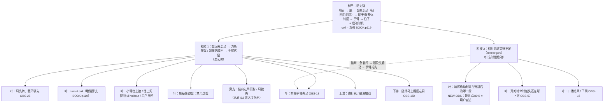

# 动力链树干 + 粗枝地图（kinetic_chain_trunk）

> 版本：2026-10-21 user-adjudication｜按用户拍板的结构：**树干 = 动力链；粗枝 = 少数几根主问题；叶子 = 挂在粗枝下的可观测细节**。
> 本版按用户 2026-10-21 裁决优化：整体仍以 FTT 原书（John Kumpf，`books/ftt_fault_tolerant_forehand/original.pdf`）为准；粗枝 1 核心改回「髋没先启动」；coil 降为增强（BOOK:p119）；Unit Turn 写入用户意识层理解；粗枝 2 拆清「等球」vs「链内过早开胸」。所有 id、叶子角色、OBS 都没变，与 `trunk_branches.json` 同步。
> 用途：诊断时先认树干，再认是哪根粗枝，最后才挂叶子（OBS）。这是给系统诊断用的，不是场上口令。
> 引用规则：
> - 只引已核对卡片的原话（`episodes/<id>.card.json`）和书页码。
> - KU7FHy1qQOI 在这里只有卡片摘要，标「卡片摘要」，不当原话用。6ak4ZScH_gc 已于 2026-10-20 按字幕核对原话；它仍不是已核对卡片，只作知识引用，不进 tree evidence。
> - ui-RFRdQKRk、5jHCDc44SQM 是 **holdout 期**：可以作为知识引用，**不得写进 tree 节点的 evidence**（check_tree T02）。
> 禁令：推肘 / 降拍 / 旋后 / 伸肘 / 送髋（含「把髋送进球里」「髋往前顶」）不作任何处方口令。原话里出现的 supinate / pronate 等词只作知识记录，不作口令。
> 本文件不改 tree.json v1，也不改 tree_v18 或任何 verify 阈值。
> 裁决文件：`book_orphans_adjudication_2026-10-21.md`。

---

## 0. 树干（一句话）

**动力链：蹬地进腿 → 髋先启动（蹬后腿、把髋扭回面向网）→ 躯干带胸整体转回 → 手臂和拍子被动甩出；并在对的时间启动。髋肩反向扭转张力（coil）为非必需增强项（BOOK:p119）。**

树干回答三个问题，下面的粗枝分别挂在其中一个上：

| 树干要回答的 | 断了会怎样 | 对应粗枝 |
|---|---|---|
| 力从哪来、怎么传 | 髋没先启动，力传到髋就断，手臂只好自己发力 | 粗枝 1 |
| 什么时候启动 | 相对来球等不够，链还没准备好就开始挥 | 粗枝 2 |
| 传到拍子上的是不是身体的力 | 结果层，由前两问决定 | 叶子（随挥、球质、口播结果） |

FTT 出处（书；英文均【已核对】，见 FLT-02 / 04 / 05 卡）：
- 「the answer is not to pull with your arm」（书 p.83）
- 场上内化：「twisting the hips back towards the net」（书 p.83 / 117 一带）
- 「Power does not come from swinging harder with the arm」（书 p.116）
- 「When, instead, our hips and chest are still sideways at contact, the arm is much more impinged.」（书 p.30）
- 「A full hip rotation is actually impossible if both of your feet are firmly planted on the ground.」（书 p.84）
- 「When a player consciously initiates their swing by exploding off of their hitting leg, they are far less likely to leave their hips under-rotated」（书 p.111）
- 「All players initiate the swing with their hips, whipping them around before the shoulders」（书 p.119 一带 POWER）
- 腹部 coil / 肩髋分离角：增强项；「The angle separation isn’t necessary for effortless power, though; it just helps add yet another link…」（书 p.119【已核对】）
- 「we aren't harnessing rotation…」— PwkGLkRm73o:Q02（视频补充）

### Unit Turn 与髋（意识层 / 用户 2026-10-21）

- 书 p.59：Unit Turn 时「The hips turn to the side, away from the target, so that they can explosively twist back towards it」——髋也转离目标，这是书的描述，**不否定**。
- 视频（ui-RFRdQKRk holdout）：「The unit doesn't include your hips」。
- **用户理解（意识层，不是改书）**：初学时可以有意识地先不把髋转开，以便做出 twist（反向扭转）。用「髋先别跟着肩一起开」来找 coil/twist。这是初学意识层的找感觉法，不是否定书 p.59 的髋转离。
- 写入本树干 / 粗枝说明时标：**意识层 / 用户 2026-10-21**。

---

## 1. 粗枝地图

规则：
- 粗枝只有这两根。脚钉死、随挥缠肩、小臂上抬、击球早晚都是**叶子或上游 / 下游**，不能和粗枝平级。
- coil / 髋肩反向张力：叶子或旁支增强，**不是**粗枝 1 的唯一核心。
- 链内过早开胸 / 肩抢先：归粗枝 1，**不要**和粗枝 2「等球」混成一条。
- 粗枝之间的虚线是推断，不是证据。

---

## 2. 粗枝 1：髋没先启动 → 力断在髋 / 髋胸未转回 → 手臂代偿

**一句话（书为准）**：前挥没有从髋引导启动——没有蹬后腿、把髋扭回面向网（Lead With The Hips p.83–88；POWER p.115–121）。力在髋这里断；髋胸若仍侧对，手臂被卡，只好用手臂小肌肉代偿。

**核心不是 coil 不足**：
- 书 p.119：「The angle separation isn’t necessary for effortless power」——肩髋分离角 / coil 是**非必需增强**，可作叶子或旁支，引 BOOK:p119；视频 coil 说法作补充，不得压过「髋先启动」。
- 「手臂往上兜」：标 **视频源**（ui-RFRdQKRk holdout / 用户自述），不当书证据。书对应是 p.30「手臂被卡、用小肌肉」。

**这根粗枝说的不是「把髋往球里送」**：
- 书要的是「扭回面向网 / 髋引导启动」，不是「送髋 / 把髋送进球」；
- **禁用**「送髋」「把髋送进球里」「髋往前顶」；
- 6ak4 等视频反对「有意推持拍侧髋」→ 降为**枝叶补充 / 防误用提示**，不得压过书 p.83/117（用户 2026-10-21：B 类髋冲突 **书赢**）。

**两个「back together」不要混**：
- 书 p.111「back together, forward together」指**上半身**（双臂 + 胸）作为整体转离、转回，是正面提示；
- 6ak4@5:05 和 ui@2:43 的「back together, front/forward together」指**髋和肩**一起走，是负面例子 / 防误用。

**「约 45° 往前上」**：用户说法，书和视频里都**没有**力的 45° 方向。只作用户自述。

FTT 出处（书，【已核对】）：
- 书 p.53 / p.55：爆发式挥拍时髋扭转是 fundamental，「There's no leeway here」
- 书 p.83–88：Lead With The Hips；内化「twisting the hips back towards the net」
- 书 p.84：双脚钉死，完整转髋不可能 → 脚钉死只是上游条件
- 书 p.91：「…unlike, say, pulling the racket forward using the hand and arm.」
- 书 p.111：从击球腿蹬出启动，髋就不容易转不够；非持拍手肘过早拉开会过早开胸（**链内过早开胸 → 本粗枝旁支**）
- 书 p.115–121：POWER Checklist；髋先于肩甩开；p.119 coil 非必需
- 书 p.30：触球时髋胸仍侧对，手臂被卡住

FTT 出处（视频 / holdout 知识；补充，不压过书）：
- 「The unit doesn't include your hips…」— ui-RFRdQKRk:Q03（holdout）→ 见 §0 用户意识层解释
- 「I can compensate by swinging up more」— ui-RFRdQKRk@2:35（holdout；**往上兜视频源**）
- 「most players … send their right hip through the shot … back together, front together」— 6ak4@5:05（**防误用**，书赢）
- 「the same tension that flings your shoulder forward, flings your hip backwards.」— 6ak4@2:38（增强补充）
- 「she is thinking of the swing right now as up rather than around」— 2Nn9tyMECZU:Q05
- 对应故障卡：FLT-05（髋没引导）→ FLT-02（手臂主导）

**叶子**（「能见」只表示有机会看到；可靠度以实测一致率为准）：

| 叶子 | OBS | 正后方能见 | 正后方不能见 / 需要什么 |
|---|---|---|---|
| 前挥谁先转：肩还是髋 | OBS-25 | ✅（B 机位题） | — |
| 前挥谁先往目标动 | OBS-18 | ✅ | — |
| 准备时肩比髋多转了一点，但髋没留住（turn ≠ coil；**增强旁支**） | NEW 候选 | ✅ | 张力本身看不到（C 层） |
| 准备转离幅度 | OBS-08 | ✅ | — |
| 触球时髋是否已朝网 | OBS-09 | ✅ | 开放站位下要结合 OBS-25 读 |
| 骨盆在前挥中是否减速 | OBS-71 | 实测 3/3 unclear | 需更高帧率或侧面 |
| 臂和胸是否同步 | OBS-40 | 实测 3/3 unclear | 胸平面被挡 |
| 小臂往上抬 / 往上兜（**视频/用户自述**） | OBS-12a / OBS-11 | catalog 标侧面 S | 正后方要单独出题 |
| 象征性蹬髋；禁用送髋 | OBS-10、OBS-13b | OBS-10 ✅ | 「攒力」是 C 层 |
| 上游：脚钉死 / 腿没加载 | OBS-05、OBS-38 | ✅ | 膝角深浅 OBS-23 需侧面 |
| 下游：随挥马上缠回身体 | OBS-15b | ✅ | — |
| 旁支：链内过早开胸 / 肩抢先 | （书 p.111 非持拍手肘过早拉开等） | 视 OBS | 与 B2「等球」分开 |

**NEW-OBS 候选（正后方的小臂上抬）**：
- 问法：*Between the start of the forward swing and contact, does the hitting hand rise above the hitting elbow, stay about level with it, or stay below it?*
- 取值：`hand_rises_above_elbow` / `about_level` / `hand_below_elbow`
- 机位：正后方（B）
- 动机：用户报告「正后方肉眼能明显看出小臂上抬」；catalog OBS-12/11 只为侧面设计。

---

## 3. 粗枝 2：相对来球的等待不足（启动过早）

**一句话**：准备完成后、相对来球没有等够就启动前挥。树干的「什么时候启动」这一问没答对。主挂 **CH13 Inhale and Wait（书 p.75）**。

**拆开（不要混）**：
1. **相对来球的等待**（本粗枝）：书 p.75「the last step of preparation is a short waiting period between body preparation and swing initiation」；慢球等待可更长；启动线索是视觉信号。
2. **链内过早开胸 / 肩抢先**：归 **粗枝 1** 的叶子或旁支（书 p.111 等），不要和「等球」写成一条。

**具体时点**：书支持「等球、由视觉信号启动」；**书没有规定**「最高点 / 下落 80%」——那是**用户/视频自述**。

FTT 出处：
- 书 p.75（Inhale and Wait，【已核对】）：等待；视觉线索启动。
- 书 p.110–114（Forward Swing Progression）讲扭转同步，不讲相对来球的时机；「急了 → 断链」只是推断（branch_links 虚线）。
- dZadhzVEsds:Q02 / Q03：耐心、拍头至少到球高再加速（视频补充）。
- 树节点 N-C_DZADHZVESDS_C01：手和拍还在球的高度之上就开始向前转体加速（required OBS-57=`above_ball`）

**叶子**：

| 叶子 | OBS | 正后方能见 | 正后方不能见 / 需要什么 |
|---|---|---|---|
| 前挥启动时，球在弹跳后的哪一段（上升 / 最高点 / 下落） | **NEW-OBS 候选** | 部分 | 侧面 S 最准；最高点/80% = 用户自述 |
| 开始转体时拍头相对球的高度 | OBS-57 | ❌（侧面 S） | 需侧面 |
| 击球点前后 | OBS-03 | ❌ | 需侧面 S |
| 引拍顶点停顿 | OBS-04 | ✅ | — |
| 结果：下网 / 打框 / 好 | OBS-16 | ✅ | — |

**两个时间量要分开**：
- **启动时机**（相对来球）：本粗枝。
- **触球位置**（身体前后）：OBS-03，另一变量。

**next_one_thing（外部目标）**：可保留「等球下落再挥」；出处写清 **BOOK:p75 + 用户时点自述**。协议按**来球类型**写（中速、中等弧线上旋；手抛 / 喂球 / 对打 / 发球机均可），**不要写死发球机**。

---

## 4. 链条六步（参考层，叶子从这里取）

| 步 | 在做什么 | 主要 OBS | 正后方能见 | 正后方不能见 |
|---|---|---|---|---|
| 1 地面 | 脚给地面施力，脚位决定能不能转开（书 p.84） | OBS-05、06、38、10 | ✅ 全部 | 蹬地多用力（C） |
| 2 腿加载 | 后腿坐进去存力（书 p.111） | OBS-23、22、13 | 只能粗看站得直不直 | 都需侧面 |
| 3 髋先启动 | 蹬后腿、髋扭回面向网（书 p.83/117）；coil 增强 p.119 | OBS-25、08、71、NEW 肩 vs 髋 | OBS-25、08、NEW | OBS-71 实测看不清；张力（C） |
| 4 躯干 / 胸 | 腹部接住，躯干带胸转回（书 p.30）；过早开胸 = B1 旁支 | OBS-09、19、29 | OBS-09、29 | OBS-19 实测看不清 |
| 5 手臂 | 手臂跟着胸被带出去（书 p.83、p.116） | OBS-18、40、32、36、02 | OBS-18、32、36、02 | OBS-40 实测看不清 |
| 6 拍子 | 拍头被甩过球（书 p.113 转述） | OBS-15、16、35 | OBS-15、16 | OBS-35、28、03 需侧面 |
| 时机 | 相对来球等待后启动（BOOK:p75） | NEW 启动时机、OBS-57、OBS-04 | OBS-04；NEW 部分 | OBS-57 需侧面 |

---

## 5. 用法

1. 先认树干（书：髋先启动；coil 增强）。
2. 判断是哪根粗枝。每根粗枝至少要有一条 A/B 层的中立事实支持（≥2/3 一致），否则只能标「待测」。
3. 叶子按「正后方能见 / 需侧面 / 体感」三类挂上去。看不见的不硬坐实。
4. 两根粗枝同时出现时，不并列成两个第一要害：先说哪根有事实，另一根标待测，用对照测试分开。
5. 盲测（V5）没过关之前，对用户视频的所有结论都标「待验证」。
6. 处方禁用：推肘 / 降拍 / 旋后 / 伸肘 / 送髋。
