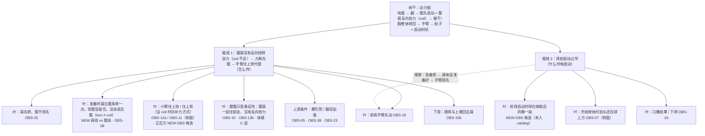

# 动力链树干 + 粗枝地图（kinetic_chain_trunk）

> 版本：2026-10-20 book-loop｜按用户拍板的结构：**树干 = 动力链；粗枝 = 少数几根主问题；叶子 = 挂在粗枝下的可观测细节**。
> 本版以 FTT 原书（John Kumpf，`books/ftt_fault_tolerant_forehand/original.pdf`）为根基重写了树干和粗枝 1 的说法。依据与核对状态见 `loop/reports/book_grounded_opt_2026-10-20.md`。所有 id、叶子角色、OBS 都没变，与 `trunk_branches.json` 同步。
> 用途：诊断时先认树干，再认是哪根粗枝，最后才挂叶子（OBS）。这是给系统诊断用的，不是场上口令。
> 引用规则：
> - 只引已核对卡片的原话（`episodes/<id>.card.json`）和书页码。
> - KU7FHy1qQOI 在这里只有卡片摘要，标「卡片摘要」，不当原话用。6ak4ZScH_gc 已于 2026-10-20 按字幕（auto，`/workspace/ftt_subs/6ak4ZScH_gc.norm.tsv`）核对原话，见 `sources/ftt_hips_6ak4_uiRF_2026-10-20.md`；它仍不是已核对卡片，只作知识引用，不进 tree evidence。
> - ui-RFRdQKRk、5jHCDc44SQM 是 **holdout 期**：可以作为知识引用，**不得写进 tree 节点的 evidence**（check_tree T02）。
> 禁令：推肘 / 降拍 / 旋后 / 伸肘 / 送髋（含「把髋送进球里」「髋往前顶」）不作任何处方口令。原话里出现的 supinate / pronate 等词只作知识记录，不作口令。
> 本文件不改 tree.json v1，也不改 tree_v18 或任何 verify 阈值。

---

## 0. 树干（一句话）

**动力链：蹬地进腿 → 髋先启动，并和肩形成反向扭转张力（coil，不是单纯侧身）→ 躯干带胸整体转回 → 手臂和拍子被动甩出；并在对的时间启动。**

树干回答三个问题，下面的粗枝分别挂在其中一个上：

| 树干要回答的 | 断了会怎样 | 对应粗枝 |
|---|---|---|
| 力从哪来、怎么传 | 传到髋就断，手臂只好自己发力 | 粗枝 1 |
| 什么时候启动 | 启动太早，链还没准备好就开始挥 | 粗枝 2 |
| 传到拍子上的是不是身体的力 | 结果层，由前两问决定 | 叶子（随挥、球质、口播结果） |

FTT 出处（书；英文均【已核对】，见 FLT-02 / 04 / 05 卡）：
- 「the answer is not to pull with your arm」（书 p.83）
- 「Power does not come from swinging harder with the arm」（书 p.116）
- 「When, instead, our hips and chest are still sideways at contact, the arm is much more impinged.」（书 p.30）
- 「A full hip rotation is actually impossible if both of your feet are firmly planted on the ground.」（书 p.84）
- 「When a player consciously initiates their swing by exploding off of their hitting leg, they are far less likely to leave their hips under-rotated」（书 p.111）
- 腹部 coil：髋转动时肩髋角度保持，之后腹部展开、把肩胸转回目标（书 p.89–90；**笔记归纳，英文待逐字核**）；在场上去想「先髋、后腹、再胸」的时序「almost definitely useless」（书 p.90）
- 肩转比髋多 = 肩髋分离角，多出一个旋转环节（POWER Checklist，约 p.117–118；**笔记归纳，页码与英文待核**）
- 「we aren't harnessing rotation. And we can't harness rotation because that energy isn't passing through the shoulder in a throwing chain.」— PwkGLkRm73o:Q02
- 「The secret to effortless power in tennis is to coil with your trunk. But, coiling means more than just turning sideways.」— ui-RFRdQKRk:Q01（holdout）

---

## 1. 粗枝地图

规则：
- 粗枝只有这两根。脚钉死、随挥缠肩、小臂上抬、击球早晚都是**叶子或上游 / 下游**，不能和粗枝平级。
- 粗枝之间的虚线是推断，不是证据。粗枝 2 是否加重了粗枝 1，要靠测试分开（见用户案例 §5）。

---

## 2. 粗枝 1：髋肩之间没有反向扭转张力（coil 不足）→ 力断在髋 → 手臂往上兜代偿

**一句话**：髋没有先启动，也没有和肩之间形成反向的扭转张力。髋和肩只是一起转走、一起转回，下半身的力在髋这里断了一截；身体只好用手臂去补，表现之一是小臂往上抬、往上兜。

**这根粗枝说的不是「髋往前送得不够」**：
- FTT 的问题是**髋肩之间缺少反向张力**，不是髋送得不够远；
- 所以本粗枝**禁用「送髋」类口令**（「送髋」「把髋送进球里」「髋往前顶」）。6ak4ZScH_gc@5:05 指出，这类意图常让人髋肩一起走，反而没张力。

**两个「back together」不要混**：
- 书 p.111「back together, forward together」指**上半身**（双臂 + 胸）作为整体转离、转回，是正面提示；
- 6ak4@5:05 和 ui@2:43 的「back together, front/forward together」指**髋和肩**一起走，是负面例子。

**「约 45° 往前上」**：这是用户的说法，书和视频里都**没有**力的 45° 方向（ui@9:38 的 45° 指脚的朝向）。只作用户自述，不当 FTT 证据，也不作处方。

FTT 出处（书，【已核对】）：
- 书 p.53 / p.55：爆发式挥拍时髋扭转是 fundamental，「There's no leeway here」
- 书 p.84：双脚钉死，完整转髋不可能 → 脚钉死只是上游条件
- 书 p.91：「…unlike, say, pulling the racket forward using the hand and arm.」
- 书 p.111：从击球腿蹬出启动，髋就不容易转不够；非持拍手肘过早拉开会过早开胸

FTT 出处（视频 / holdout 知识）：
- 「The unit doesn't include your hips. If I go backwards with my hips as well, then I create no tension...」— ui-RFRdQKRk:Q03（holdout）
- 躯干比髋扭得更多、转得更快 — 5jHCDc44SQM:Q03 / Q04（holdout）
- 只靠髋去发、腹部没接上，挥拍就散 — 5jHCDc44SQM:Q05–Q06（holdout）
- 「the same tension that flings your shoulder forward, flings your hip backwards.」— 6ak4ZScH_gc@2:38（字幕原话）
- 「the best way to stretch this is to start by throwing that pelvis forward to create more stretch before it swaps off.」— 6ak4ZScH_gc@9:12（字幕原话）
- 「most players when I see them trying to send their right hip through the shot, they send … back together, front together」— 6ak4ZScH_gc@5:05（字幕原话；这正是「象征性蹬髋」的一种机制解释）
- 「we don't really perceive motion. We perceive tension and thereby acceleration.」— 6ak4ZScH_gc@9:55（字幕原话；体感点是「髋被往后拽」，不是「髋往前送」）
- 「my pelvis and shoulders … are going back together, forward together. Versus counter-rotating.」— ui-RFRdQKRk@2:43（holdout）
- 「I can compensate by swinging up more」— ui-RFRdQKRk@2:35（holdout；无扭转时用往上挥补力 → 与「小臂上抬」吻合）
- 书 p.30：触球时髋胸仍侧对，手臂被卡住
- 小臂上抬的成因线索：
  - 「even if your arm and hand are not moving low to high, your racket tip can still move low to high」— PwkGLkRm73o:Q03。树节点 N-C_PWKGLKRM73O_C02：大脑怕打到地上，逼手臂从下往上兜。
  - 「she is thinking of the swing right now as up rather than around」— 2Nn9tyMECZU:Q05。树节点 N-C_2NN9TYMECZU_C01：想着往上抬整个拍子系统，而不是绕着转。
- 对应故障卡：FLT-05（髋没引导）→ FLT-02（手臂主导）

**叶子**（「能见」只表示有机会看到，不等于已稳定；可靠度以实测一致率为准）：

| 叶子 | OBS | 正后方能见 | 正后方不能见 / 需要什么 |
|---|---|---|---|
| 前挥谁先转：肩还是髋 | OBS-25 | ✅（B 机位题） | — |
| 前挥谁先往目标动 | OBS-18 | ✅ | — |
| 准备时肩比髋多转了一点，但髋没留住、没坐进后髋，不形成反向张力（turn ≠ coil） | NEW 候选（肩线 vs 髋线） | ✅ | 「坐进后髋」的张力本身看不到（C 层） |
| 准备转离幅度 | OBS-08 | ✅ | — |
| 触球时髋是否已朝网 | OBS-09 | ✅ | 开放站位下「已朝网」≠「扭转后转回」，要结合 OBS-25 读 |
| 骨盆在前挥中是否减速 | OBS-71 | 实测 3/3 unclear | 需更高帧率或侧面 |
| 臂和胸是否同步 | OBS-40 | 实测 3/3 unclear | 胸平面被挡 |
| 小臂往上抬 / 往上兜（没 coil 时的补力方式） | OBS-12a（`forearm_tilted_up`）、OBS-11（`lifts_up_first`） | catalog 标的是**侧面 S** | 正后方要单独出题，见下方 NEW-OBS 候选 |
| 蹬髋象征性：髋肩一起往前走、没有反向张力，身体前移、力没传上去（「约 45° 往前上」为用户自述，非 FTT 出处） | OBS-10（后脚）、OBS-13b（触球后身体走向） | OBS-10 ✅ | OBS-13 需侧面；「髋攒没攒住力」是 C 层体感 |
| 上游：脚钉死 / 腿没加载 | OBS-05、OBS-38 | ✅ | 膝角深浅 OBS-23 需侧面 |
| 下游：随挥马上缠回身体 | OBS-15b | ✅ | — |

**NEW-OBS 候选（正后方的小臂上抬）**：
- 问法：*Between the start of the forward swing and contact, does the hitting hand rise above the hitting elbow, stay about level with it, or stay below it?*
- 取值：`hand_rises_above_elbow` / `about_level` / `hand_below_elbow`
- 机位：正后方（B）
- 动机：用户报告「正后方肉眼能明显看出小臂上抬」，但 catalog 里的 OBS-12、OBS-11 只为侧面设计。这题需要按 promote 流程审核后才能入 catalog。

---

## 3. 粗枝 2：挥拍启动过早（击球点与时机）

**一句话**：球还没到该挥的位置就开始挥，链还没准备好就启动。树干的「什么时候启动」这一问没答对。

FTT 出处：
- 书 p.75（Inhale and Wait，【已核对】）：「the last step of preparation is a short waiting period between body preparation and swing initiation」「On balls that come extremely slowly, this waiting period may be long.」「Your cue for when to initiate the forward swing is… a visual cue.」
  - 书支持「等球、由视觉信号启动」；**书没有规定**「最高点 / 下落 80%」这种具体时点，那是用户的说法和 dZadhzVEsds 的推论。
- 书 p.110–114（Forward Swing Progression）讲扭转同步，不讲相对来球的时机；「急了 → 断链」只是推断（branch_links 虚线）。
- 「now we have to be patient. If I load the hand up here, the racket's max velocity is going to be down into the ground. And then you're going to either spray the ball or have to try to wrist」— dZadhzVEsds:Q02
- 「we need to be patient for either our pendulum or just our kind of placing the racket back to actually get below at least to the height of the ball. Preferably below our anticipated contact.」— dZadhzVEsds:Q03
- 树节点 N-C_DZADHZVESDS_C01：手和拍还在球的高度之上，就开始了向前的转体加速（required OBS-57=`above_ball`）
- KU7FHy1qQOI（卡片摘要）：动力链服从于打到甜点，先靠脚和眼睛把位置找对

**叶子**：

| 叶子 | OBS | 正后方能见 | 正后方不能见 / 需要什么 |
|---|---|---|---|
| 前挥启动时，球在弹跳后的哪一段（上升 / 最高点 / 下落） | **NEW-OBS 候选**，catalog 里没有 | 部分：画面里能看到球的高度变化，但深度被压缩，最高点不好判 | 侧面 S 最准 |
| 开始转体时拍头相对球的高度 | OBS-57（`above_ball` / `below_ball` …） | ❌（catalog 标侧面 S） | 需侧面 |
| 击球点前后（偏早 / 偏晚的触球位置） | OBS-03 | ❌ | 需侧面 S |
| 引拍顶点停顿 | OBS-04 | ✅ | — |
| 结果：下网 / 打框 / 好 | OBS-16 | ✅（口播或落点） | — |

**NEW-OBS 候选（启动时机）**：
- 问法：*At the moment the forward swing starts, is the incoming ball still rising after the bounce, at about its highest point, or already descending?*
- 取值：`still_rising` / `near_highest_point` / `descending`
- 机位：侧面 S 优先；正后方只作参考
- 动机：用户自述「主观以为在下落时挥，复核视频发现在最高点之前就开始挥」。

**两个时间量要分开**：
- **启动时机**：前挥什么时候开始，相对球的飞行。这是用户说的「过早」。
- **触球位置**：触球点在身体前后，OBS-03。这是旧描述说的「偏晚」。

它们是两个不同的变量，可以同时成立（启动早、触球点却没在身前），不能互相抵消或互相证明。

---

## 4. 链条六步（参考层，叶子从这里取）

| 步 | 在做什么 | 主要 OBS | 正后方能见 | 正后方不能见 |
|---|---|---|---|---|
| 1 地面 | 脚给地面施力，脚位决定能不能转开（书 p.84） | OBS-05、06、38、10 | ✅ 全部 | 蹬地多用力（C） |
| 2 腿加载 | 后腿坐进去存力（书 p.111） | OBS-23、22、13 | 只能粗看站得直不直 | 都需侧面 |
| 3 髋扭转 | 准备时髋留住；前挥髋先发再刹住 | OBS-25、08、71、NEW 肩 vs 髋 | OBS-25、08、NEW | OBS-71 实测看不清；张力（C） |
| 4 躯干 / 胸 | 腹部接住扭力，躯干带胸转回（书 p.30） | OBS-09、19、29 | OBS-09、29 | OBS-19 实测看不清；OBS-14 需侧面 |
| 5 手臂 | 手臂跟着胸被带出去（书 p.83、p.116） | OBS-18、40、32、36、02 | OBS-18、32、36、02 | OBS-40 实测看不清 |
| 6 拍子 | 拍头被甩过球（书 p.113 转述） | OBS-15、16、35 | OBS-15、16 | OBS-35、28、03 需侧面 |
| 时机 | 链在对的时间启动（dZadhzVEsds:Q02/Q03） | NEW 启动时机、OBS-57、OBS-04 | OBS-04；NEW 部分 | OBS-57 需侧面 |

---

## 5. 用法

1. 先认树干。
2. 判断是哪根粗枝。每根粗枝至少要有一条 A/B 层的中立事实支持（≥2/3 一致），否则只能标「待测」。
3. 叶子按「正后方能见 / 需侧面 / 体感」三类挂上去。看不见的不硬坐实。
4. 两根粗枝同时出现时，不并列成两个第一要害：先说哪根有事实，另一根标待测，用 10 球对照测试分开。
5. 盲测（V5）没过关之前，对用户视频的所有结论都标「待验证」。
