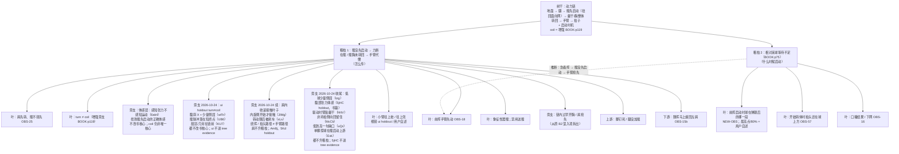

# 动力链树干 + 粗枝地图（kinetic_chain_trunk）

> 版本：2026-10-21 user-adjudication｜按用户拍板的结构：**树干 = 动力链；粗枝 = 少数几根主问题；叶子 = 挂在粗枝下的可观测细节**。
> 本版按用户 2026-10-21 裁决优化：整体仍以 FTT 原书（John Kumpf，`books/ftt_fault_tolerant_forehand/original.pdf`）为准；粗枝 1 核心改回「髋没先启动」；coil 降为增强（BOOK:p119）；Unit Turn 写入用户意识层理解；粗枝 2 拆清「等球」vs「链内过早开胸」。所有 id、叶子角色、OBS 都没变，与 `trunk_branches.json` 同步。
> 用途：诊断时先认树干，再认是哪根粗枝，最后才挂叶子（OBS）。这是给系统诊断用的，不是场上口令。
> 引用规则：
> - 只引已核对卡片的原话（`episodes/<id>.card.json`）和书页码。
> - KU7FHy1qQOI 的原话以 2026-10-24 重过稿的字幕段起点为准（`SRC-FTT-KU7FHy1qQOI_repass_2026-10-24.md`）。它仍不是已核对卡片，只作知识引用，不进 tree evidence。6ak4ZScH_gc 已于 2026-10-20 按字幕核对原话，2026-10-24 再用 norm.tsv 段起点加画面核对，收成粗枝 1 的体感旁支；它仍不是已核对卡片，只作知识引用，不进 tree evidence。精确原话见 `docs/diagnosis/sources/SRC-FTT-6ak4ZScH_gc_feel_tension_2026-10-24.md`。
> - ui-RFRdQKRk、5jHCDc44SQM 是 **holdout 期**：可以作为知识引用，**不得写进 tree 节点的 evidence**（check_tree T02）。
> 禁令：推肘 / 降拍 / 旋后 / 伸肘 / 送髋（含「把髋送进球里」「髋往前顶」）不作任何处方口令。原话里出现的 supinate / pronate 等词只作知识记录，不作口令。
> 本文件不改 tree.json v1，也不改 tree_v18 或任何 verify 阈值。
> 裁决文件：`book_orphans_adjudication_2026-10-21.md`。
> **2026-10-24**：粗枝 1 增加知识旁支「体感层：感知张力不感知运动（6ak4）」。它只回答「髋先启动时该感到什么」。粗枝 1 的书核心不变（髋没先启动 / 扭回面向网，BOOK:p.83 / p.117）。coil 仍是 BOOK:p.119 的非必需增强，不升成粗枝 1 的唯一核心。这条旁支只写在本文件和 `docs/diagnosis/sources/SRC-FTT-6ak4ZScH_gc_feel_tension_2026-10-24.md`，**不**给 `trunk_branches.json` 新 id，因此 compose / verify 仍走 2026-10-21 的 id、叶子角色和 OBS。不改 tree.json，不改 verify 黄金。
> **2026-10-24 Batch A 第一刀**：在同一条「只加旁支、不改书核心」的规则下，补四期重过的交叉引用。`ui-RFRdQKRk` 仍是 holdout。`wFIrPMutzRo` 的腹斜 X 和少量侧屈、`UB6SbA_KX9E` 的短终点脉冲、`KU7FHy1qQOI` 的甜区 / 几何与旋转旋钮，都只作知识旁支或结果层前面的条件。详注见各 `SRC-FTT-*_repass_2026-10-24.md`。不给 `trunk_branches.json` 新 id。
> **2026-10-24 Batch A 续**：肩内收、肩滚的接触时机、反旋刹车、上手投和绕挥，六期都只作叶子或旁支。`Am8j1Zw5KrE`、`5KdScDKxVSI` 仍是 holdout。不把肩升成新粗枝，不改成肩先于髋。场上主句仍是「肩往前、髋被往后拽」；各期抽出的一句只写在来源稿的练习口令旁支。
> **2026-10-24 Batch A 收尾**：tilt、corkscrew、胸参与、非持拍侧、低到高神话（Shorts，deep-with-gap）、单脚探球，六期都只作叶子、旁支或上游。`5jHCDc44SQM` 与 `ui-RFRdQKRk` 仍是 holdout，不进 tree evidence。不升新粗枝，不改成肩或胸先于髋。`uQcObi2oTSs` 只有一句主张，缺口写在来源稿。场上主句不变。

---

## 0. 树干（一句话）

**动力链：蹬地进腿 → 髋先启动（蹬后腿、把髋扭回面向网）→ 躯干带胸整体转回 → 手臂和拍子被动甩出；并在对的时间启动。髋肩反向扭转张力（coil）为非必需增强项（BOOK:p119）。**

树干回答三个问题，下面的粗枝分别挂在其中一个上：

| 树干要回答的 | 断了会怎样 | 对应粗枝 |
|---|---|---|
| 力从哪来、怎么传 | 髋没先启动，力传到髋就断，手臂只好自己发力 | 粗枝 1 |
| 什么时候启动 | 相对来球等不够，链还没准备好就开始挥 | 粗枝 2 |
| 传到拍子上的是不是身体的力 | 结果层，由前两问决定 | 叶子（随挥、球质、口播结果） |

FTT 出处（书；英文均【已核对】，见 FLT-02 / 04 / 05 卡）：
- 「the answer is not to pull with your arm」（书 p.83）
- 场上内化：「twisting the hips back towards the net」（书 p.83 / 117 一带）
- 「Power does not come from swinging harder with the arm」（书 p.116）
- 「When, instead, our hips and chest are still sideways at contact, the arm is much more impinged.」（书 p.30）
- 「A full hip rotation is actually impossible if both of your feet are firmly planted on the ground.」（书 p.84）
- 「When a player consciously initiates their swing by exploding off of their hitting leg, they are far less likely to leave their hips under-rotated」（书 p.111）
- 「All players initiate the swing with their hips, whipping them around before the shoulders」（书 p.119 一带 POWER）
- 腹部 coil / 肩髋分离角：增强项；「The angle separation isn’t necessary for effortless power, though; it just helps add yet another link…」（书 p.119【已核对】）
- 「we aren't harnessing rotation…」— PwkGLkRm73o:Q02（视频补充）

### Unit Turn 与髋（意识层 / 用户 2026-10-21）

- 书 p.59：Unit Turn 时「The hips turn to the side, away from the target, so that they can explosively twist back towards it」——髋也转离目标，这是书的描述，**不否定**。
- 视频（ui-RFRdQKRk holdout）：「The unit doesn't include your hips」。
- **用户理解（意识层，不是改书）**：初学时可以有意识地先不把髋转开，以便做出 twist（反向扭转）。用「髋先别跟着肩一起开」来找 coil/twist。这是初学意识层的找感觉法，不是否定书 p.59 的髋转离。
- 写入本树干 / 粗枝说明时标：**意识层 / 用户 2026-10-21**。

---

## 1. 粗枝地图

规则：
- 粗枝只有这两根。脚钉死、随挥缠肩、小臂上抬、击球早晚都是**叶子或上游 / 下游**，不能和粗枝平级。
- coil / 髋肩反向张力：叶子或旁支增强，**不是**粗枝 1 的唯一核心。2026-10-24 的「感知张力不感知运动」是另一条旁支：它讲体感，不把 coil 升成核心。
- 链内过早开胸 / 肩抢先：归粗枝 1，**不要**和粗枝 2「等球」混成一条。
- 粗枝之间的虚线是推断，不是证据。

---

## 2. 粗枝 1：髋没先启动 → 力断在髋 / 髋胸未转回 → 手臂代偿

**一句话（书为准）**：前挥没有从髋引导启动——没有蹬后腿、把髋扭回面向网（Lead With The Hips p.83–88；POWER p.115–121）。力在髋这里断；髋胸若仍侧对，手臂被卡，只好用手臂小肌肉代偿。

**核心不是 coil 不足**：
- 书 p.119：「The angle separation isn’t necessary for effortless power」——肩髋分离角 / coil 是**非必需增强**，可作叶子或旁支，引 BOOK:p119；视频 coil 说法作补充，不得压过「髋先启动」。
- 「手臂往上兜」：标 **视频源**（ui-RFRdQKRk holdout / 用户自述），不当书证据。书对应是 p.30「手臂被卡、用小肌肉」。

**这根粗枝说的不是「把髋往球里送」**：
- 书要的是「扭回面向网 / 髋引导启动」，不是「送髋 / 把髋送进球」；
- **禁用**「送髋」「把髋送进球里」「髋往前顶」；
- 6ak4 等视频反对「有意推持拍侧髋」→ 降为**枝叶补充 / 防误用提示**，不得压过书 p.83/117（用户 2026-10-21：B 类髋冲突 **书赢**）。2026-10-24 的体感旁支不推翻这条裁决。

### 旁支：体感层：感知张力不感知运动（6ak4）

**一句话**：髋先启动时，要感到的是张力，不是录像里的运动。详注 `docs/diagnosis/sources/SRC-FTT-6ak4ZScH_gc_feel_tension_2026-10-24.md`。字幕原话按 norm.tsv 段起点；画面核对只含红皮筋双锚、文章叠图、错误目标下皮筋松弛、减速不换向。

**它在粗枝 1 的哪一层**：粗枝 1 的核心仍是书——髋没先启动 / 扭回面向网（BOOK:p.83 / p.117）。这条旁支只回答「这件事做对的时候，身体感到什么」，以及「哪一种意图会让人故意不把线拉上」。它不是新粗枝，不替换上面的一句话。

**和 BOOK:p.83 的关系（兼容）。**

- 书的场上内化是「twisting the hips back towards the net」。
- 6ak4@4:03 的意图句是 "drive your shoulders forward, hips back"。它鼓励把髋锚和肩锚之间的斜向筋膜线拉满；回弹时髋被同一股张力拽向网这一侧。方向和 p.83 相同。
- 6ak4@7:31 "the pelvis does accelerate forward before the shoulders. So, that is true." 这是物理事实，对应书「髋先于肩」。先向前加速的功能是把线再拉满（@5:42、@9:13），不是把「持拍侧髋往前」当成目标。
- 6ak4@5:17 反对 "send your right hip through the shot"，因为这个目标会让人故意不拉伸，髋肩 "back together, front together"（段起点 5:21）。这是防误用。书赢，和 2026-10-21 裁决一致。

**和 BOOK:p.119 的关系（不升格）。**

- p.119【已核对】：「The angle separation isn’t necessary for effortless power」。肩髋分离角 / coil 仍是**非必需增强**，可以没有，只要髋先启动。
- 本期把 corkscrew / 分离 / 张力从「防误用脚注」补成体感说明，**不**把 coil 写成粗枝 1 的唯一核心，也**不**要求把分离角做大。
- 感知定律 6ak4@9:51："we don't really perceive motion. We perceive tension and thereby acceleration." 要找的瞬间是 @5:56：骨盆被往后拽，肩被往前拽。录像上的前转可以同时为真。@7:59 多数球只是前移中被拽住后减速，不换向（画面核对与这句字幕一致）。
- 所以 p.119 决定 coil 的地位（增强，可无）；本期决定这个地位在体感上怎么落地（感到张力与加速度，不感到「髋在往前转」）。地位不变。

**用户映射（2026-10-24 同日补充；假设，不进 tree evidence）。** 不升成新粗枝，不改书赢。

- 用户自述：以前转髋只转髋；加上非持拍侧左肩往前伸，感到强烈的 X 型拉伸之后，才体会到髋力。这对得上本旁支的斜向筋膜线（髋锚 ↔ 肩锚），不是另一条链。
- 用户理解：髋末段要有往回拉的意识，力才释放。这里的往回拉 = 张力体感（@5:56 被往后拽，@9:51 感知张力），**不是髋倒退**。@7:57–8:01 多数球是前移中被拽住后减速，不换向。

**场上意图护栏（仍是这一句，不是新清单）。**

- 场上只留：「肩往前、髋被往后拽」。即 6ak4@4:03 "drive your shoulders forward, hips back"，并与 BOOK:p.83「twisting the hips back towards the net」同向。
- 左肩由躯干带着走，不单独抡左臂。单独把非持拍手肘提前绕开，是书 p.111【已核对】的过早开胸：「In some cases, the non-hitting elbow is pulled around the body too early in the swing, causing the chest to open up too early」。那已经挂在本粗枝的「链内过早开胸」旁支上，不为此再开一根粗枝。

**不进树的边界**：无新 OBS id。张力是 C 层。骨盆是否减速仍用既有 OBS-71（正后方实测 unclear）。6ak4 仍不进 tree evidence。同日补充也不新开 id。

### 旁支：2026-10-24 Batch A 第一刀（只加叶子，不改上面的一句话）

四期都按字幕段起点加重抽帧。书核心仍是髋没先启动 / 扭回面向网。coil 仍是 p.119 的非必需增强。都不进 tree evidence。

- **ui-RFRdQKRk（holdout）**：侧身不等于 coil。0:37「The unit doesn't include your hips」。2:38「I can compensate by swinging up more」（旧注 @2:35）。2:46 起髋和肩 back together, forward together，是负面例子。4:58 挥拍时髋向后，和 6ak4 同向。0:55「drive this point forward」只是准备时把髋留成锚，不写成送髋。0:07 把 coil 说成力量秘诀，书 p.119 赢。详注 `SRC-FTT-ui-RFRdQKRk_repass_2026-10-24.md`。
- **wFIrPMutzRo**：腹斜 X，左肩拉在右髋上；背后那一侧是右肩向前时右髋向后（3:48），和 6ak4 同一股张力。髋角变直（2:04 hip pops forward）是录像，不是送髋。少量侧屈让直立硬转不再发僵（0:08、5:43 对 5:58）；侧屈不是后倒，也不写成口令。3:53 肘去左膝只是演示，不作推肘。详注 `SRC-FTT-wFIrPMutzRo_repass_2026-10-24.md`。
- **UB6SbA_KX9E**：肩线可以在腿还弯着时已经转开，右腿随后伸直。这和书「髋先于肩启动」是两套时钟。**书赢，不改成肩先于髋。** 留下的是：髋的脉冲要落在短终点（8:24 press slot），不要落在转完整圈的末尾。9:42「throwing your hip into the ball」只记录，禁止写成送髋。8:32 手臂随后把拍带走，禁止写成推肘。详注 `SRC-FTT-UB6SbA_KX9E_repass_2026-10-24.md`。
- **KU7FHy1qQOI**：甜区和高度 / 距离排在链的前面，不新开粗枝。上身即使往前跑也要先拧上（13:30），这是 coil 增强。16:16 挥拍更短就稍等，是粗枝 2 的视频补充，书核心仍是 p.75。14:44 左臂把躯干拉到髋上，只作准备感觉，不写成拉左臂。详注 `SRC-FTT-KU7FHy1qQOI_repass_2026-10-24.md`。

### 旁支：2026-10-24 Batch A 续（肩内收 / 反旋 / 绕挥，仍不改上面的一句话）

六期都按字幕段起点加 360p 抽帧。肩内收、肩滚、反旋刹车、绕挥都挂在粗枝 1 下面，**不升成新粗枝，不改成肩先于髋**。场上主句仍是「肩往前、髋被往后拽」。各期另有一句练习口令旁支，写在来源稿里，不替换主句。都不进 tree evidence。

- **Am8j1Zw5KrE（holdout）**：接触区的最后一环是肩内收，上臂同时转向内（0:58）。0:21 是拉过身体，不写成推肘。5:58 慢打可以只用这一环做干净接触；6:12 后髋 uncork 才加上速度。速度环仍是髋先。详注 `SRC-FTT-Am8j1Zw5KrE_repass_2026-10-24.md`。
- **5KdScDKxVSI（holdout）**：接触是胸肱角关上（0:05、3:05）。2:29 和 3:49「可以不转」与书冲突，**书赢**。3:56 自己把后腿和躯干放回接触上游。3:12、4:47 的 push 只记录，不写成推肘。详注 `SRC-FTT-5KdScDKxVSI_repass_2026-10-24.md`。
- **JIMgI3jiVns**：接触在这个人内旋刚开始（0:14），大部分滚动在接触后（3:03）。没有客观接触点（3:58）。静帧只认出人和肘的远近，不证明滚动起点。不改成肩先于髋。详注 `SRC-FTT-JIMgI3jiVns_repass_2026-10-24.md`。
- **xLs469ZVMPU**：髋的转动要开始再被停住（0:57）。右腿向后、左腿向上、前脚在接触时蹬住，是三种刹车。1:11「fire that right hip into the shot」只记录，禁止送髋。和 UB6 的短终点同向。BOOK:p.84 的两脚钉死不和第三种刹车合成一句。详注 `SRC-FTT-xLs469ZVMPU_repass_2026-10-24.md`。
- **PwkGLkRm73o**：0:24 旋转没穿过肩。0:49 手臂可以不走低到高，拍头仍然可以。1:05 的 supinate / pronate 只作知识。7:12 的高到低是手臂路径，不写成降拍。11:10 能量仍从髋穿过肩；不先叫转髋，是因为肩这一环没接上。详注 `SRC-FTT-PwkGLkRm73o_repass_2026-10-24.md`。
- **2Nn9tyMECZU**：1:27 把挥拍想成上而不是绕（旧注 Q05）。肘高、拍低代表整条手臂滚了（4:37）。11:31 躯干在目标前放慢，肩再接到目标。13:45 髋向前、肩向后，和 6ak4 的准备对拉同向，不写成送髋。14:42 把 coil 说得比幅度更重要，**书 p.119 赢**，coil 仍是增强。详注 `SRC-FTT-2Nn9tyMECZU_repass_2026-10-24.md`。

### 旁支：2026-10-24 Batch A 收尾（tilt / corkscrew / 胸 / 非持拍侧 / 单脚，仍不改上面的一句话）

六期都按字幕段起点加 360p 抽帧。tilt、corkscrew、胸参与、非持拍侧、低到高神话、单脚探球都挂在粗枝 1 下面或它的上游，**不升成新粗枝，不改成肩或胸先于髋**。场上主句仍是「肩往前、髋被往后拽」。各期另有一句练习口令旁支，写在来源稿里，不替换主句。`uQcObi2oTSs` 内容只有一句，不另写练习口令，沿用 2Nn。都不进 tree evidence。

- **tzgAWr3QGv0**：0:56 胸把臂留在躯干上，force / press 只记录，不写成推肘。3:35 手准备在触球高度附近，不写成降拍。6:21 短脉冲里髋、躯干、胸一起通过一个点，挂在 UB6 的短终点上。8:35 低球时肩线斜下来，10:30 击球肩从非击球肩下面穿过，和 wFIr 的少量侧屈同一族。11:23 左手横回只作记录，旁边仍是书 p.111 的过早开胸。7:50 后髋变直不写成送髋。详注 `SRC-FTT-tzgAWr3QGv0_repass_2026-10-24.md`。
- **5jHCDc44SQM（holdout）**：0:54 准备时胸可以比髋转得更开。2:28 髋在物理上领先约 25 毫秒，这段感觉不到，人感到腹部张力，和 6ak4 同族。1:13、5:57 把躯干说成几乎整段都更快、胸廓从启动起就在转，**书 p.119 赢**。coil 仍是增强，不是粗枝 1 的唯一核心。正手挂点在 5:05。7:16 膝去肘是场外演示。详注 `SRC-FTT-5jHCDc44SQM_repass_2026-10-24.md`。
- **hNVbbPEob3g**：0:22「胸先走、臂后抽」是他放弃的那一档。0:36 驱动时臂贴着躯干。4:28 收尾发生在躯干放慢之后，和 2Nn、UB6 同一套钟。5:58 仍从髋上把躯干拧出去。0:45 的 force the arm 不写成推肘。字幕在 6:18 截断。详注 `SRC-FTT-hNVbbPEob3g_repass_2026-10-24.md`。
- **McCb-RfYd0w**：0:35 启动的转动把左侧送出去，0:29 左侧再向回压，0:50 通常只看见肘收。1:05 双臂真的交叉出现在转动很少、人还侧着的时候。2:22、2:33 两种内化只作知识，不写成提前拉左臂。详注 `SRC-FTT-McCb-RfYd0w_repass_2026-10-24.md`。
- **uQcObi2oTSs（deep-with-gap）**：约 10 秒，只有一句：近网或高球基本由后向前，升高少到可能注意不到。没有对错对比。指向 2Nn / Pwk，不新开叶子名，不写成降拍。详注 `SRC-FTT-uQcObi2oTSs_repass_2026-10-24.md`。
- **ExkBtFRhUWY**：0:56 右脚到球后面，1:54 / 8:14 再向球场压回去。这是粗枝 1 的上游，和书 p.84、p.111 同侧。press the foot 不写成送髋。4:50 太近时拍到头上方，不写成降拍。低置信卡片本轮已对字幕，仍不进树。详注 `SRC-FTT-ExkBtFRhUWY_repass_2026-10-24.md`。

**两个「back together」不要混**：
- 书 p.111「back together, forward together」指**上半身**（双臂 + 胸）作为整体转离、转回，是正面提示；
- 6ak4@5:21 和 ui@2:43 的「back together, front/forward together」指**髋和肩**一起走，是负面例子 / 防误用。旧注把 6ak4 收成 @5:05，那是 "send your right hip through" 附近的约数。

**「约 45° 往前上」**：用户说法，书和视频里都**没有**力的 45° 方向。只作用户自述。

FTT 出处（书，【已核对】）：
- 书 p.53 / p.55：爆发式挥拍时髋扭转是 fundamental，「There's no leeway here」
- 书 p.83–88：Lead With The Hips；内化「twisting the hips back towards the net」
- 书 p.84：双脚钉死，完整转髋不可能 → 脚钉死只是上游条件
- 书 p.91：「…unlike, say, pulling the racket forward using the hand and arm.」
- 书 p.111：从击球腿蹬出启动，髋就不容易转不够；非持拍手肘过早拉开会过早开胸（**链内过早开胸 → 本粗枝旁支**）
- 书 p.115–121：POWER Checklist；髋先于肩甩开；p.119 coil 非必需
- 书 p.30：触球时髋胸仍侧对，手臂被卡住

FTT 出处（视频 / holdout 知识；补充，不压过书）：
- 「The unit doesn't include your hips…」— ui-RFRdQKRk:Q03（holdout）→ 见 §0 用户意识层解释
- 「I can compensate by swinging up more」— ui-RFRdQKRk@2:38（holdout；**往上兜视频源**。旧注 @2:35）
- 「most players … send their right hip through the shot … back together, front together」— 6ak4@5:17（back together 段起点 5:21；旧注 @5:05）（**防误用**，书赢）
- 「same tension that flings your shoulder forward, flings your hip backwards.」— 6ak4@2:39（其前的 the 在 2:36；旧注 @2:38；同一股张力，体感旁支的机制句）
- 「we don't really perceive motion. We perceive tension and thereby acceleration.」— 6ak4@9:51（**体感旁支**。不替换粗枝 1 的书核心，也不把 coil 升成唯一核心）
- 「she is thinking of the swing right now as up rather than around」— 2Nn9tyMECZU@1:27（旧注 Q05；重过稿 `SRC-FTT-2Nn9tyMECZU_repass_2026-10-24.md`。绕挥是叶子，不升粗枝）
- 「the hips, the pelvis, it actually moves faster than the trunk for about 25 milliseconds. But you're not going to be able to feel that.」— 5jHCDc44SQM@2:28（holdout。体感是腹部张力。1:13 把躯干说成几乎整段更快，书 p.119 赢。不进 tree evidence）
- 「as you drive, you make this attached」— hNVbbPEob3g@0:36（驱动时臂贴躯干。0:22 胸先走是他放弃的一档。5:58 仍从髋上拧出）
- 对应故障卡：FLT-05（髋没引导）→ FLT-02（手臂主导）

**叶子**（「能见」只表示有机会看到；可靠度以实测一致率为准）：

| 叶子 | OBS | 正后方能见 | 正后方不能见 / 需要什么 |
|---|---|---|---|
| 前挥谁先转：肩还是髋 | OBS-25 | ✅（B 机位题） | — |
| 前挥谁先往目标动 | OBS-18 | ✅ | — |
| 准备时肩比髋多转了一点，但髋没留住（turn ≠ coil；**增强旁支**） | NEW 候选 | ✅ | 张力本身看不到（C 层） |
| 旁支：体感层：感知张力不感知运动（6ak4） | 无新 OBS（C 层；不进 tree evidence） | 录像能看到骨盆前移、肩随后超越 | 「被往后拽」看不到；减速仍用 OBS-71 |
| 旁支：turn ≠ coil；往上兜（ui，holdout） | 无新 OBS；不进 tree evidence | 准备结束肩比髋多转、单脚会不会落脚 | 张力（C）。45° 是脚的朝向 |
| 旁支：腹斜 X；少量侧屈（wFIr） | 无新 OBS | 触球时躯干有没有侧屈；直立硬转时球进不进网 | 「被拉开」看不到。侧屈不是后倒 |
| 旁支：髋脉冲的短终点（UB6） | 无新 OBS | 人有没有转到随挥才出球 | 不把「肩线先动」写成肩先于髋。书赢 |
| 条件：甜区与高低远近（KU7） | 无新 OBS | 球是否打在拍面中心；触球高低 | 不新开粗枝。原话不进 tree evidence |
| 旁支：肩内收是接触区最后一环（Am8j，holdout） | 无新 OBS；不进 tree evidence | 肘有没有过髋的平面；拍是横着翻还是从后向前 | 「拉过身体」看不到。不写成推肘 |
| 旁支：胸肱角关上（5Kd，holdout） | 无新 OBS；不进 tree evidence | 接触时拍面是否只轻轻关；低球有没有侧倾 | 「可以不转」与书冲突，书赢 |
| 旁支：内旋刚开始才接触（JIMg） | 无新 OBS | 肘弯还是伸、点近还是远 | 静帧不能证明滚动起点 |
| 旁支：转动被反旋刹车停住（xLs） | 无新 OBS | 右腿是否留在身后、左腿是否抬起；接触时前脚还在不在地上 | 1:11 的句子禁止写成送髋 |
| 旁支：拍头路径 ≠ 手臂路径（Pwk） | 无新 OBS | 肘是掉着捞，还是留在上面；随挥收到髋侧时球还有没有高度 | supinate / 高到低不写成旋后或降拍 |
| 旁支：绕挥，不是把挥拍想成上（2Nn） | 无新 OBS | 收尾是肘高拍低，还是只有前臂在滚 | coil 仍是 p.119 增强。13:45 不写成送髋 |
| 旁支：低球少量侧屈（tzg） | 无新 OBS | 低球时击球肩是否低于另一肩；手是否准备在触球高度附近 | press / extend through 不写成推肘或伸肘。不升粗枝 |
| 旁支：腹部张力体感（5jHC，holdout） | 无新 OBS；不进 tree evidence | 准备结束胸是否比髋转得更开 | 25 毫秒感觉不到。躯干更快与 p.119 冲突，书赢 |
| 旁支：驱动时臂贴着躯干（hNV） | 无新 OBS | 驱动时臂是贴着躯干，还是落在身后 | 0:22 胸先走是放弃的一档。force 不写成推肘 |
| 旁支：非持拍侧向回留住（McCb） | 无新 OBS | 结束时是肘收一下，还是转动很少时双臂交叉 | 不写成提前拉左臂。交叉不是每拍的目标外形 |
| 一句补充：近网或高球由后向前（uQc，deep-with-gap） | 无新 OBS | 本期没有可对照的画面 | 只有一句。指向 2Nn / Pwk。不写成降拍 |
| 上游：单脚把脚探到球后面（Exk） | 无新 OBS | 承重脚是否在球后面；太近时拍是否走到头上方 | press the foot 不写成送髋。低置信已对字幕，仍不进树 |
| 准备转离幅度 | OBS-08 | ✅ | — |
| 触球时髋是否已朝网 | OBS-09 | ✅ | 开放站位下要结合 OBS-25 读 |
| 骨盆在前挥中是否减速 | OBS-71 | 实测 3/3 unclear | 需更高帧率或侧面 |
| 臂和胸是否同步 | OBS-40 | 实测 3/3 unclear | 胸平面被挡 |
| 小臂往上抬 / 往上兜（**视频/用户自述**） | OBS-12a / OBS-11 | catalog 标侧面 S | 正后方要单独出题 |
| 象征性蹬髋；禁用送髋 | OBS-10、OBS-13b | OBS-10 ✅ | 「攒力」是 C 层 |
| 上游：脚钉死 / 腿没加载 | OBS-05、OBS-38 | ✅ | 膝角深浅 OBS-23 需侧面 |
| 下游：随挥马上缠回身体 | OBS-15b | ✅ | — |
| 旁支：链内过早开胸 / 肩抢先 | （书 p.111 非持拍手肘过早拉开等） | 视 OBS | 与 B2「等球」分开 |

**NEW-OBS 候选（正后方的小臂上抬）**：
- 问法：*Between the start of the forward swing and contact, does the hitting hand rise above the hitting elbow, stay about level with it, or stay below it?*
- 取值：`hand_rises_above_elbow` / `about_level` / `hand_below_elbow`
- 机位：正后方（B）
- 动机：用户报告「正后方肉眼能明显看出小臂上抬」；catalog OBS-12/11 只为侧面设计。

---

## 3. 粗枝 2：相对来球的等待不足（启动过早）

**一句话**：准备完成后、相对来球没有等够就启动前挥。树干的「什么时候启动」这一问没答对。主挂 **CH13 Inhale and Wait（书 p.75）**。

**拆开（不要混）**：
1. **相对来球的等待**（本粗枝）：书 p.75「the last step of preparation is a short waiting period between body preparation and swing initiation」；慢球等待可更长；启动线索是视觉信号。
2. **链内过早开胸 / 肩抢先**：归 **粗枝 1** 的叶子或旁支（书 p.111 等），不要和「等球」写成一条。

**具体时点**：书支持「等球、由视觉信号启动」；**书没有规定**「最高点 / 下落 80%」——那是**用户/视频自述**。

FTT 出处：
- 书 p.75（Inhale and Wait，【已核对】）：等待；视觉线索启动。
- 书 p.110–114（Forward Swing Progression）讲扭转同步，不讲相对来球的时机；「急了 → 断链」只是推断（branch_links 虚线）。
- dZadhzVEsds:Q02 / Q03：耐心、拍头至少到球高再加速（视频补充）。
- 树节点 N-C_DZADHZVESDS_C01：手和拍还在球的高度之上就开始向前转体加速（required OBS-57=`above_ball`）

**叶子**：

| 叶子 | OBS | 正后方能见 | 正后方不能见 / 需要什么 |
|---|---|---|---|
| 前挥启动时，球在弹跳后的哪一段（上升 / 最高点 / 下落） | **NEW-OBS 候选** | 部分 | 侧面 S 最准；最高点/80% = 用户自述 |
| 开始转体时拍头相对球的高度 | OBS-57 | ❌（侧面 S） | 需侧面 |
| 击球点前后 | OBS-03 | ❌ | 需侧面 S |
| 引拍顶点停顿 | OBS-04 | ✅ | — |
| 结果：下网 / 打框 / 好 | OBS-16 | ✅ | — |

**两个时间量要分开**：
- **启动时机**（相对来球）：本粗枝。
- **触球位置**（身体前后）：OBS-03，另一变量。

**next_one_thing（外部目标）**：可保留「等球下落再挥」；出处写清 **BOOK:p75 + 用户时点自述**。协议按**来球类型**写（中速、中等弧线上旋；手抛 / 喂球 / 对打 / 发球机均可），**不要写死发球机**。

---

## 4. 链条六步（参考层，叶子从这里取）

| 步 | 在做什么 | 主要 OBS | 正后方能见 | 正后方不能见 |
|---|---|---|---|---|
| 1 地面 | 脚给地面施力，脚位决定能不能转开（书 p.84） | OBS-05、06、38、10 | ✅ 全部 | 蹬地多用力（C） |
| 2 腿加载 | 后腿坐进去存力（书 p.111） | OBS-23、22、13 | 只能粗看站得直不直 | 都需侧面 |
| 3 髋先启动 | 蹬后腿、髋扭回面向网（书 p.83/117）；coil 增强 p.119；体感旁支＝感知张力不感知运动（6ak4，不改书核心） | OBS-25、08、71、NEW 肩 vs 髋 | OBS-25、08、NEW | OBS-71 实测看不清；张力（C） |
| 4 躯干 / 胸 | 腹部接住，躯干带胸转回（书 p.30）；过早开胸 = B1 旁支 | OBS-09、19、29 | OBS-09、29 | OBS-19 实测看不清 |
| 5 手臂 | 手臂跟着胸被带出去（书 p.83、p.116） | OBS-18、40、32、36、02 | OBS-18、32、36、02 | OBS-40 实测看不清 |
| 6 拍子 | 拍头被甩过球（书 p.113 转述） | OBS-15、16、35 | OBS-15、16 | OBS-35、28、03 需侧面 |
| 时机 | 相对来球等待后启动（BOOK:p75） | NEW 启动时机、OBS-57、OBS-04 | OBS-04；NEW 部分 | OBS-57 需侧面 |

---

## 5. 用法

1. 先认树干（书：髋先启动；coil 增强）。
2. 判断是哪根粗枝。每根粗枝至少要有一条 A/B 层的中立事实支持（≥2/3 一致），否则只能标「待测」。
3. 叶子按「正后方能见 / 需侧面 / 体感」三类挂上去。看不见的不硬坐实。
4. 两根粗枝同时出现时，不并列成两个第一要害：先说哪根有事实，另一根标待测，用对照测试分开。
5. 盲测（V5）没过关之前，对用户视频的所有结论都标「待验证」。
6. 处方禁用：推肘 / 降拍 / 旋后 / 伸肘 / 送髋。
7. 粗枝 1 的体感旁支只用来解释「录像上的前转」和「被往后拽的体感」为什么可以同时为真。场上只留「肩往前、髋被往后拽」。往回拉是张力，不是髋倒退；左肩由躯干带着走，不单独抡左臂（防书 p.111 过早开胸，沿用已有旁支）。它不单独开训练清单，不升成新粗枝，也不把 coil 当成这根粗枝的唯一核心。
8. 2026-10-24 的四期旁支同样不单开训练清单。ui 的准备锚、wFIr 的肘去膝和侧屈、UB6 的「髋扔进球」、KU7 的左臂拉躯干，都只留在来源稿里，不写成推肘、降拍、旋后、伸肘或送髋。
9. 2026-10-24 Batch A 续的六期也不单开训练清单，不替换场上主句。肩内收、内旋起点、三种刹车、上手投、绕挥，都只留在来源稿的练习口令旁支里。片中的 pull across、press the hand、fire the hip into the shot、supinate、high to low、press the arm out、drive the pelvis forward，都不写成推肘、降拍、旋后、伸肘或送髋。
10. 2026-10-24 Batch A 收尾的六期同样不单开训练清单，不替换场上主句。tilt、左手横回、膝去肘、胸把臂带向前、非持拍侧向回压、拍走到头上方、脚向球场压回去，都只留在来源稿里，不写成推肘、降拍、旋后、伸肘或送髋。`uQcObi2oTSs` 不另写练习口令。`5jHCDc44SQM` 继续 holdout。

## 附：辅助视频叶子（2026-10-22）— 5xcIshgCd-E（TPA tennis / Tom Allsopp，非 FTT）
- 挂粗枝 1（髋没先启动 → 手臂代偿）。要点：「hips first, arm second」@4:25；「not the arm's turn yet」@2:13；「slow enough take back … fire something else before the arms」@2:54。
- 书支持：CH18 p.83（不是用手拉，髋先转、扭回面向网）；p.64（手的下一次移动是被大肌肉拉动的被动结果）；CH19 p.89（肩胸随髋被动转）；p.82（手腕放松当铰链）。
- 冲突：视频说手臂可偏紧（@3:36、@4:28）→ 书 p.82 赢，手和手腕保持放松。
- 详注 `docs/diagnosis/sources/tpa_kinetic_chain_5xcIshgCd-E_2026-10-22.md`。不进 tree evidence、不进中性提示词。
