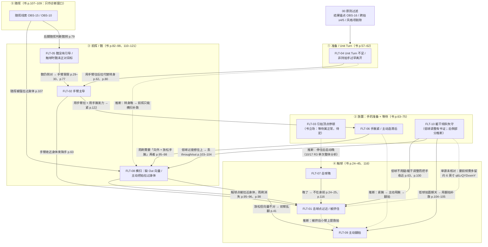

# 诊断树 v0（2026-10-18）

> 按 FTT 阶段排列：准备/Unit Turn → 放置 → 前挥/髋 → 触球 → 随挥。节点是 PLAN.md B3 的 10 张 FLT 卡。
> 实线 = 原书有直接出处【已核对】；虚线 = 推断或单源。边的方向 = 「上游候选 → 下游后果」。
> 进树之前先过 `00_principles.md` P9（结果锚点 → 剔除偶发 → 剔除单独风格项）。
> 注意 P3：阶段顺序只是平局规则，不等于「越早越先修」。

FLT-07 的上游（视觉追踪不足、启动信号点太晚，书 p.75–76）在 v0 里没有单独节点，只写在 FLT-07 卡第 3 节，均为【推断】边。

## 读法

- 从 `index/obs_to_fault.md` 拿到候选节点后，沿进入它的边往上游找，逐个用该卡第 6 节的 10 球测试确认或排除。
- 虚线边**不能**作为排第一的根因，除非对应测试已经确认过。
- FLT-03 是「待定」节点：原书不支持把停顿本身当故障。FLT-10 半待定：低球调整方式有书证，「后倒」原书没有讨论。详见两张卡。

## 版本记录
- v0（2026-10-18）：10 个节点，13 条书证边，5 条推断/单源边。尚未挂接 FTT 视频（第二周任务 8）。
