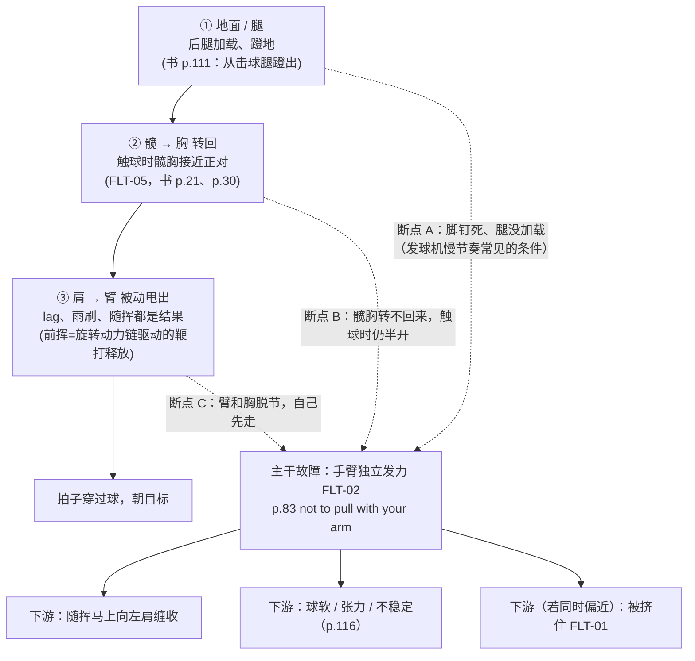

# 主干诊断：正后方视频 2026-10-19

> 依据：`cc_trunk_pack_20261019.md`（你的原话、三份正后方结果、FTT 原则 / FLT-02/04/05、tree_v14 摘要、字幕要点）。
> 先说清楚两件事：
> - **盲测还没过关**（V5 recall≈0），所以下面对你视频的判断只能算「待验证线索」，不是结论。
> - **机位是正后方**：击球点前后、膝角深浅、拍面俯仰都看不清，我不会硬下结论。
> - 本文件没有改 tree_v14，也没有为了 PASS 调任何东西。

---

## 1. 核心论点（唯一主干）

**你正手的根本问题是：力没有从地面经腿、髋、胸一路传到手臂，链在中间断了，于是手臂只好自己去拉拍（FLT-02 手臂主导）。其他所有现象都是这个断点的上游条件，或者是它的下游表象。**

FTT 原话（书）：
- 「Finally it's time to swing. What now? Hint – the answer is not to pull with your arm.」（p.83）
- 「Power does not come from swinging harder with the arm; only tension, misses, and injury do.」（p.116）
- 「When hips and chest still sideways at contact, the arm is much more impinged」（p.30）：触球时髋胸还侧着，手臂就被卡住，只能用小肌肉。

FTT 视频里同一个主干：
- PwkGLkRm73o：业余球员「arm underhand low-to-high」，转体的能量没法经肩这一环传出去。
- cIIEYn42o4g：「It's a link in the kinetic chain, but it's not the last link.」肩只是链上的一环，不是起点。

这一条对应你登记表里的长期主线 **P-01「手主导 / 手先找球」**。它不是这次新想出来的，是 learning.md 从一开始就写着的「大问题」：手不肯把球拍交给身体。

---

## 2. 主干因果图

读法：
- 实线是 FTT 说的正常传力顺序：主动的是腿、髋、胸；手臂、lag、随挥是被动的（P5）。
- 虚线是三个可能的断点。断在哪一环，手臂都会被迫顶上来，所以三个断点汇到同一个故障。
- **诊断要回答的是「断在 A、B 还是 C」**，而不是把脚、随挥、膝盖当成三个并列问题。

---

## 3. 本视频重诊（正后方，按主干解释）

### 3.1 先说实话：正后方看到的是「间接证据」

你说「这里应该能看到我手臂独立发力了」。按现有三份结果，能确认的是一组**和手臂独立发力一致**的现象，但还没有一条**直接**证据。直接证据是「手臂先于胸动」，三份结果都没问到。原因是上一轮刻意不让知识库概念进前两遍，所以没问。

好消息是，「臂和胸谁先动」**正后方恰恰是最合适的机位**。只是这次没问，不是看不到（见 §7）。

### 3.2 按主干逐层看（只用 facts 里「清楚」的项）

| 主干环节 | 画面事实（facts / desc） | 主干下的解读 | 把握 |
|---|---|---|---|
| ① 地面 / 腿 | 宽开放站位钉在原地，无侧移、垫步、交叉；膝盖弯曲不明显（直立微屈） | 断点 A 的**条件**成立：腿几乎没有加载，地面力很难进链（书 p.84：双脚钉死不可能完整转髋） | 中（膝角深浅正后方不准） |
| ② 髋 → 胸 | 触球时肩线半开、背部仍朝镜头 | 断点 B 的**线索**：胸没有转回到正对，正是 p.30 说的手臂被卡住的状态 | 中（「半开」是肩线，髋线这次没单独判） |
| ③ 肩 → 臂 | 随挥落左肩至左前胸，缺少向网延伸的观感（desc：随挥过早向上刷/兜） | 主干的**下游表象**：身体没转过来，手臂自己拉，于是马上往身上缠收。P5：随挥只是线索，不是处方 | 中 |
| 准备端 | 转肩一体化引拍，左手扶拍喉 | Unit Turn 准备做得不差，**问题更可能在前挥传力**，而不是准备（削弱「FLT-04 是主因」） | 中 |
| 间距 | 拍在身体右侧较多，横向间距明显 | **不支持**「被挤住 FLT-01」作为这次的问题 | 中 |

### 3.3 一句话结论（待验证）

**最可能的断点是 ①→②：腿没加载、髋胸没转回来，手臂只好从半开的身体位置自己拉拍。** 随挥缠收是这个断点的下游结果，不是独立的问题。

把握是中低。它由三条相互一致的间接线索支撑，但「臂先动」这条直接证据还没测，盲测也没过关。

---

## 4. 分支地图（都挂在主干下）

| # | 分支 | 在主干的位置 | 本视频状态 | 依据 |
|---|---|---|---|---|
| 1 | 脚钉死 / 腿未加载（无蹬地） | 断点 A：**上游条件** | **支持主干** | facts：宽开放钉原地、膝直立微屈；书 p.84、p.111；aPcKJDadzek「kinetic chain doesn't snap」 |
| 2 | 髋胸触球时未转回（半开） | 断点 B：**主干本身的环节**（FLT-05 → FLT-02） | **支持主干**（肩线半开）；髋线这次没测，部分**机位不足** | facts：肩线半开、背部朝镜头；书 p.30 |
| 3 | 随挥马上向左肩缠收（yank） | **下游表象** | **支持主干**（中把握） | facts：随挥落左肩至左前胸；QXAtdSEUkfY C03「yanks racket over shoulder rather than drive hands forward」 |
| 4 | Unit Turn 准备不足（FLT-04） | 另一条可能的上游 | **削弱这一支**（转肩引拍 + 左手扶拍做得好），反过来说明断点在前挥 | desc 优点；书 p.59/62 |
| 5 | 被挤住（FLT-01） | 下游（只在偏近时出现） | **削弱这一支**：横向间距明显 | facts：拍在身体右侧较多 |
| 6 | 击球点偏晚 / 刷得太陡 | 下游表象 | **机位不足**：正后方看不清前后深度和轨迹陡度（OBS-03/31） | desc 自己也写了看不清 |

**发球机节奏这个情境**（toArb3WkJcs：「prolonged interval → halt feet」）解释了分支 1 为什么会出现。它是**情境条件**，不是 FTT 定义的动力链故障，所以不单列为分支。

---

## 5. 和上次诊断的纠错

上次把「脚下完全锁死」定为第一要害（把握极高），并说「千万别先改手，必须先改脚」。这里错了三处：

1. **违反 P3「治因不治症」**。FTT 说可见的错误常常只是线索（书 p.17–18：「diagnose the cause… rather than simply relaying the clues」）。脚钉死是画面上最显眼的，但它在主干里只是断点 A 的**条件**。真正要回答的是：力有没有从髋胸传到手臂。上次停在了最显眼的线索上。
2. **违反 P6**。FTT 把爆发式挥拍时髋胸转动不足列为必须纠正（p.53/55），而脚步模式多数属于风格。上次把风格层的东西排在了必须纠正层前面。
3. **把情境当原因**。toArb3WkJcs 说的是发球机慢节奏让人停脚，这是练习情境的副产品。上次把它和动力链故障并列，甚至排在前面，导致结论和你长期的主线（P-01 手主导）完全脱节。

**它也没全错**：脚没加载这个事实是对的，在新叙事里它是断点 A 的条件。错在位置，不在事实。

另外，上次「明确未列手主导」，是因为规定前两遍不能用知识库概念驱动。这个规则本身是对的（防止提示词把模型带偏）。但它应该约束的是**抽事实**那一步，不应该约束**诊断叙事**那一步。到了诊断这一步，就必须先选主干（见 §7）。

---

## 6. 下一次只改一件事

> 开始前固定提醒：**准备时鼻吸，启动前挥至触球时用嘴短促呼气。**
> 呼气只做节奏锚和张力阀门，不是发力来源；不屏气，不做 Valsalva，不用呼气硬推胸部或髋部。若短促呼气伴随前额/枕部疼痛、眩晕或恶心，当天停止挥拍并就医评估。

**外部目标（唯一一句）：「让拍子朝目标方向穿过球，挥拍在触球那一刻就算结束。」**（书 p.113）

为什么是这一句：
- 手臂独立发力最典型的下游，就是触球后手臂继续自己拉、往左肩缠收（分支 3）。
- 把「结束」放在触球那一刻、方向朝目标，等于不给手臂「自己再多拉一段」的任务。力只能来自身体把拍子带过去。
- 它是球和拍层面的目标，不是身体口令。腿、髋、胸怎么动交给直觉，不在场上想（P7：动力链时序在场上想「almost definitely useless」，p.90）。
- 不含任何「推肘 / 降拍 / 旋后 / 伸肘」类口令。

发球机最低速，40 球：

| 组 | 球数 | 做法 | 看什么 |
|---|---|---|---|
| 基线 | 10 | 照平时打，不想目标 | 每球口播一个词：好 / 网 / 长 / 偏 / 挤 |
| 目标组 ×2 | 2×10 | 只想上面那一句 | 同样口播 |
| 复测 | 10 | 照平时打 | 同样口播 |

**验证标准**（同机位正后方重拍）：
- 目标组的随挥不再马上缠回左肩，多数球先朝目标方向延伸一段再收（OBS-15b）。
- 触球时肩线比基线组更接近正对（OBS-09，看髋线和肩线）。
- 口播「好」不少于基线组。如果「好」明显变少，说明这句目标在逼手臂刹车而身体没接上，下次换目标，不硬练。

如果两条画面都没变，说明断点不在这里（可能在 ①腿，或者根本不是这条链），回到 §7 补测。

---

## 7. 对诊断系统的改造建议：先选主干，再挂 OBS

这次「硬拼凑」的根源是流程顺序反了：先让 OBS 命中一堆节点，再按命中数排序。tree_v14 的节点 flt_ref 多数没挂到 FLT-02，于是主干在排序里根本出现不了。建议改四处（这里只提建议，**没有动 tree_v14**）。

1. **流程加一步「选主干」**：事实抽取（中立） → **选主干（只能一个）** → 按主干的断点去补问 OBS → 把其余命中挂成分支（上游条件 / 下游表象 / 情境）→ 输出。
   - 主干候选限定在几张「必须纠正」的故障卡（FLT-02、FLT-05、FLT-01…），按 P3/P6 选。
   - 中立规则只管事实抽取，不管选主干。
2. **每个主干绑定一组「断点 OBS」，正后方每次必问**。FLT-02 的断点 OBS，都是正后方（B 机位）能看的：
   - OBS-18：谁先动；
   - OBS-25：肩还是髋先转；
   - OBS-40：臂跟胸是否脱节；
   - OBS-09：触球时髋是否转回；
   - OBS-32：肘是否直线拖过身体。

   这次三份结果一个都没问到，所以臂独立发力只能靠间接线索。**下一步最便宜的事，就是对今天这段视频用中立问法补问这 5 项**，不用重拍。
3. **输出模板固定成「一句主干 + 断点 + 分支表」**：
   - 主干：一句话 + FTT 原话出处；
   - 断点：在哪一环断（A/B/C）+ 证据 + 把握；
   - 分支：每条必须标「上游条件 / 下游表象 / 情境」和「支持 / 削弱 / 机位不足」；
   - 不允许出现两个并列的「第一要害」。
4. **tree 侧的数据补丁**（另立任务，人工审核后再做，不为 PASS 改）：
   - 给 PwkGLkRm73o C01/C02、UJPUDUX0JIA_C05、HNVBBPEOB3G_C02、APCKJDADZEK_C01、FOMZ8WJV3DQ_C03 这类节点补上 `flt_ref` 和「在主干的哪一环」字段；
   - 把 toArb3WkJcs C02 这类「情境」节点标成 context，不进根因排序。

**诚实边界**：即使按这个流程改好，盲测不过关之前，对你视频的任何主干判断都只是线索。真正的验收还是两件事：补问那 5 项 OBS，以及第 6 节的 40 球对照。
